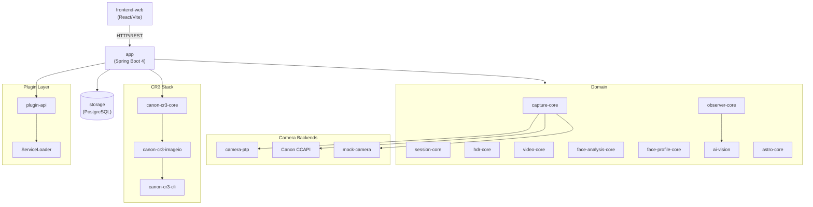

# Focus Stack (Photographer)

[](https://github.com/carstenartur/Photographer/actions/workflows/ci.yml)
[](https://carstenartur.github.io/Photographer/dev/bench/)
[](https://carstenartur.github.io/Photographer/tests/surefire-report.html)
[](https://carstenartur.github.io/Photographer/coverage/)
[](LICENSE)
[](https://github.com/carstenartur/Photographer/dependency-graph/sbom)
[](https://github.com/carstenartur/Photographer/releases)

Focus Stack is a modular Java 25 + Spring Boot 4 photography platform for automated focus stacking, timelapse, and AI-assisted image analysis. It connects to Canon cameras via CCAPI, provides a React/Vite frontend, and is extensible through a ServiceLoader-based plugin architecture.

> **Note:** This project uses Java 25 and Spring Boot 4, which are recent releases. An up-to-date toolchain is required (JDK 25, Maven 3.9+).

## Features

**Capture**
- Canon CCAPI camera control (live-view, focus stepping, remote shutter)
- Mock camera backend for development and testing without hardware
- PTP/USB camera backend (`camera-ptp`)

**Imaging & AI**
- Adaptive focus stacking with Canon CR3 decoding pipeline
- HDR timelapse capture and merging
- Face-orbit multi-angle capture sessions
- Astro (long-exposure) session management
- Wildlife observer with pluggable AI vision providers (Gemini, mock)

**Plugins**
- Runtime plugin loading via Java `ServiceLoader` — no framework required
- Plugin interfaces: `AnalysisPlugin`, `CameraBackendPlugin`, `VisionProviderPlugin`
- Drop JAR into the plugins directory; the application discovers it automatically

**Operations**
- PostgreSQL persistence (H2 in-memory for local/test)
- Hibernate Search / Lucene full-text search
- REST API with OpenAPI documentation
- Docker-first deployment with `docker compose`

## Architecture



## Modules

| Module | Purpose |
|---|---|
| `app` | Main Spring Boot application — REST API, workflows, plugin management, serves frontend. |
| `frontend-web` | React/Vite UI (Dashboard, Cameras, Jobs, Gallery, HDR, Face Orbit, Observer, Astro, Plugins). |
| `common-api` | Shared records and contracts used across modules. |
| `plugin-api` | Public plugin extension interfaces (`AnalysisPlugin`, `CameraBackendPlugin`, `VisionProviderPlugin`). |
| `capture-core` | Capture orchestration and focus-stacking logic. |
| `camera-ptp` | PTP/USB camera backend. |
| `storage` | JPA repositories and PostgreSQL persistence. |
| `session-core` | Session workflow management. |
| `hdr-core` | HDR timelapse capture and processing. |
| `video-core` | Video recording integration. |
| `face-analysis-core` | Face detection and analysis. |
| `face-profile-core` | Face profile management for face-orbit sessions. |
| `observer-core` | Wildlife observer workflow. |
| `ai-vision` | AI vision abstraction (`VisionProvider` interface, Gemini + mock implementations). |
| `astro-core` | Astro/long-exposure session management. |
| `canon-cr3-core` | Canon CR3 BMFF parser and CRX entropy codec. |
| `canon-cr3-imageio` | Java ImageIO plugin for CR3 files. |
| `canon-cr3-cli` | CLI tooling for CR3 inspection and decoding. |
| `canon-cr3-benchmark` | JMH microbenchmarks for the CR3 stack. |

## Quickstart (Docker)

```bash
git clone https://github.com/carstenartur/Photographer.git
cd Photographer
cp .env.example .env
docker compose up --build
```

Open: http://localhost:8080

Default credentials:

- Username: `admin`
- Password: value of `FOCUSSTACK_SECURITY_ADMIN_PASSWORD` in `.env` (default: `focusstack`)

Optional demo seed:

```bash
./scripts/seed-demo-data.sh
```

## Local Development

Prerequisites:

- JDK 25
- Maven 3.9+
- Node.js 20.19+ (or 22.12+)
- Docker / Docker Compose (for PostgreSQL and integration tests)

Run backend:

```bash
mvn spring-boot:run -pl app -am -Djava.awt.headless=true
```

Run frontend dev server:

```bash
cd frontend-web
npm ci
npm run dev
```

## Build & Test

Backend full verify (unit + integration tests — same command used by CI):

```bash
mvn -B clean verify -Djava.awt.headless=true
```

To skip integration tests for faster feedback:

```bash
mvn -B clean verify -DskipITs=true -Djava.awt.headless=true
```

Integration tests use Testcontainers and require a running Docker daemon.

Frontend:

```bash
cd frontend-web
npm ci
npm run lint
npm run build
```

## Configuration

Key environment variables (see `.env.example` for defaults):

| Variable | Description | Default |
|---|---|---|
| `FOCUSSTACK_SECURITY_ADMIN_PASSWORD` | Admin user password | `focusstack` |
| `SPRING_DATASOURCE_URL` | JDBC URL for PostgreSQL | `jdbc:postgresql://postgres:5432/focusstack` |
| `SPRING_DATASOURCE_USERNAME` | Database username | `focusstack` |
| `SPRING_DATASOURCE_PASSWORD` | Database password | `focusstack` |
| `POSTGRES_DB` | PostgreSQL database name (docker-compose) | `focusstack` |
| `POSTGRES_USER` | PostgreSQL user (docker-compose) | `focusstack` |
| `POSTGRES_PASSWORD` | PostgreSQL password (docker-compose) | `focusstack` |
| `CAMERA_MOCK_ENABLED` | Enable mock camera backend | `false` |
| `FOCUSSTACK_CAMERA_CCAPI_BASE_URL` | Canon CCAPI base URL | `http://192.168.1.2:8080` |
| `FOCUSSTACK_PLUGINS_DIR` | Directory scanned for plugin JARs | `./plugins` |
| `GEMINI_API_KEY` | Google Gemini API key for AI vision | _(empty)_ |
| `OBSERVER_AI_PROVIDER` | Active AI provider (`gemini` or `mock`) | `mock` |
| `SPRING_PROFILES_ACTIVE` | Active Spring profile (`docker`, `dev`, `postgres`) | `default` |

## Plugins

The `plugin-api` module defines three extension points discovered at runtime via `java.util.ServiceLoader`:

- **`AnalysisPlugin`** — custom image analysis steps inserted into capture workflows.
- **`CameraBackendPlugin`** — additional camera backends (supplement the built-in CCAPI and PTP backends).
- **`VisionProviderPlugin`** — additional AI vision providers for the Observer workflow.

To add a plugin, implement the interface, register the implementation in `META-INF/services/`, and drop the JAR into the directory configured by `FOCUSSTACK_PLUGINS_DIR`. The application discovers it on the next startup without recompilation.

See [`plugin-api/`](plugin-api/) for the interface source.

## AI Vision

The `ai-vision` module provides a `VisionProvider` interface that decouples the Observer workflow from specific AI provider APIs. Implementations ship with the project:

- **`MockVisionProvider`** — returns pre-configured results; suitable for development and CI.
- **`GeminiVisionProvider`** — calls the Google Gemini API; requires `GEMINI_API_KEY`.

Set `OBSERVER_AI_PROVIDER=gemini` and provide `GEMINI_API_KEY` to enable live analysis.

See [`ai-vision/README.md`](ai-vision/README.md) for full configuration details.

## Supported Cameras

Tested CCAPI models:

- Canon PowerShot G5 X Mark II
- Canon PowerShot G7 X Mark III

Other Canon cameras that support CCAPI may work but are not officially verified. See [docs/camera-setup.md](docs/camera-setup.md) for setup instructions.

## Reports & Benchmarks

Published to GitHub Pages after each push to `main`:

- [Test Report](https://carstenartur.github.io/Photographer/tests/surefire-report.html)
- [Coverage Report](https://carstenartur.github.io/Photographer/coverage/)
- [JMH Benchmark History](https://carstenartur.github.io/Photographer/dev/bench/)

## Documentation

- [Quickstart](docs/quickstart.md)
- [Development Guide](docs/development.md)
- [Architecture](docs/architecture.md)
- [REST API Reference](docs/api.md)
- [Test Strategy](docs/test-strategy.md)
- [Camera Setup](docs/camera-setup.md)

## Contributing

Contributions are welcome. Please open an issue or pull request on GitHub. There is no formal CLA; by submitting a PR you agree to license your contribution under the MIT License.

## License

MIT — see [LICENSE](LICENSE).

