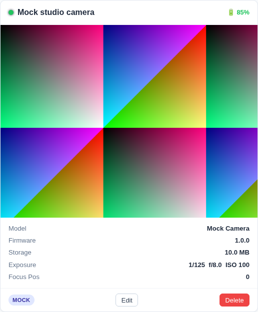
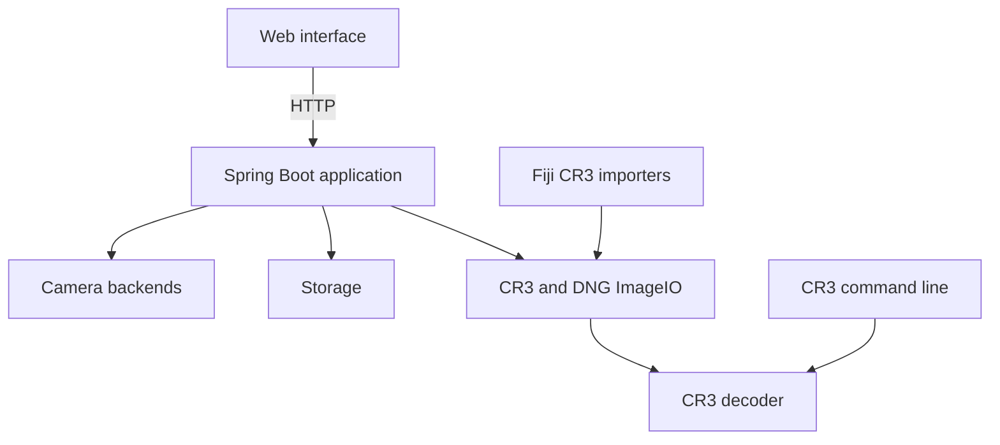

# Photographer (Focus Stack)

[](https://github.com/carstenartur/Photographer/actions/workflows/ci.yml)
[](https://carstenartur.github.io/Photographer/dev/bench/)
[](https://carstenartur.github.io/Photographer/tests/surefire-report.html)
[](https://carstenartur.github.io/Photographer/coverage/)
[](https://carstenartur.github.io/Photographer/duplication/cpd.html)
[](LICENSE)
[](https://github.com/carstenartur/Photographer/dependency-graph/sbom)
[](https://github.com/carstenartur/Photographer/releases/latest)
[](https://central.sonatype.com/artifact/io.github.carstenartur/cr3-imageio)
[](https://doi.org/10.5281/zenodo.24334498)

Photographer controls compatible Canon cameras via CCAPI and USB/PTP. Its React web interface and Spring Boot backend support automated focus stacking, astrophotography sessions and AI-assisted wildlife observation, with extension points for camera backends, image analysis and vision providers. Standalone Java ImageIO libraries read supported CR3 RAW and C-RAW files and write lossless CR3 and uncompressed Bayer DNG.

| What would you like to do? | Start here |
|---|---|
| Control a camera or try a focus stack without hardware | [Start the web application](docs/quickstart.md) · [Illustrated walkthrough](docs/web-interface.md) |
| Photograph a bird arriving at a feeder or perch | [Set up local bird detection](docs/web-interface.md#photograph-birds-at-a-fixed-location) · [Settings and operating limits](docs/developer/operations.md#local-bird-observer) |
| Pair Fresnel and capture a measurement with a mock camera | [Pairing, capture and recovery](docs/fresnel-capture.md) |
| Read CR3 or write lossless CR3 and Bayer DNG in Java | [ImageIO dependency and working examples](docs/cr3/imageio.md) · [Camera compatibility](docs/cr3/camera-coverage.md) |
| Understand the CR3 container and CRX bitstream | [CR3 and CRX format reference](docs/cr3/format.md) · [CR3 / CRX manual](docs/cr3/index.md) |
| Open a Bayer mosaic or a color image in Fiji | [Install the Fiji update site](docs/cr3/fiji-update-site.md) · [Import sensor data](cr3-imagej/README.md) · [Open a color image](docs/cr3/fiji-update-site.md#open-a-color-image) |
| Inspect a CR3 or export a preview from the command line | [CLI commands](docs/cr3/cli.md) |
| Review the CR3 reader and writer provenance | [Reviewer guide](docs/cleanroom/reviewer-guide.md) |
| Find the stable release and check its downloads | [Photographer 0.1.8](docs/releases/0.1.8.md) · [Downloads](https://github.com/carstenartur/Photographer/releases/tag/v0.1.8) |
| Build or extend Photographer | [Developer manual](docs/developer/index.md) · [Project verification](docs/developer/testing.md) |



The application builds with JDK 25 and Maven 3.9+. The standalone CR3 libraries and Fiji importer run on Java 21 or newer.

## Features

**Capture**
- Live view, focus stepping and remote shutter release via Canon’s Camera Control API (CCAPI)
- Mock camera backend for development and testing without hardware
- PTP/USB camera backend (`camera-ptp`)

**Imaging & AI**
- Adaptive focus-stacking capture with CR3 media ingestion
- CR3 inspection and native Java decoding of 14-bit Canon V1 lossless RAW and three-level C-RAW ([supported cameras and measurements](docs/cr3/decoder.md))
- Astro capture, star registration and stacking
- Local bird detection in camera live view, with a selectable observation region and automatic photo capture
- Wildlife observer with pluggable AI vision providers (local YOLOX-Nano, Gemini, mock)
- Experimental timed capture and face-orbit session prototypes

**Plugins**
- Runtime plugin loading via Java `ServiceLoader` — no framework required
- Plugin interfaces: `AnalysisPlugin`, `CameraBackendPlugin`, `VisionProviderPlugin`
- Drop JAR into the plugins directory; the application discovers it automatically

**Operations**
- PostgreSQL persistence (H2 in-memory for local/test)
- Hibernate Search / Lucene full-text search
- REST API with OpenAPI documentation
- Docker-first deployment with `docker compose`

## Architecture



The packaged application serves the React frontend and runs capture jobs. The same decoder is available independently through ImageIO, Fiji and the CLI. [Architecture and module dependencies](docs/developer/architecture.md)

## Modules

Find the Maven modules, dependency layers and supported library interfaces in the [Developer Manual](docs/developer/modules.md). The [CR3 module map](docs/cr3/index.md#module-map) identifies the standalone library artifacts.

## Import Canon CR3 files in Java

Since 0.1.9, `ImageIO.read(file)` develops a full-resolution sRGB image with three unsigned 16-bit channels. Use `image.getRaster().getSample(x, y, band)` to access the full precision. Version 0.1.8 defaults to RGB8 and offers RGB16 through reader parameters. The standalone `cr3-core` decoder also accepts a file path directly.

[Run the minimal Maven example](docs/cr3/imageio.md#run-the-minimal-example) · [ImageIO setup and parameters](docs/cr3/imageio.md) · [Write lossless CR3](docs/cr3/imageio.md#write-a-lossless-cr3-using-a-camera-profile) · [Export a Bayer DNG](docs/cr3/imageio.md#write-and-read-a-bayer-dng) · [Maven release status](docs/cr3-maven-central.md)

### Camera-like RGB16 development

The current development version includes the available lens and camera tone profiles in normal RAW development, including `ImageIO.read(file)` and the ImageJ color importer. Profiles cover the **PowerShot G5 X Mark II** and **EOS R** combinations listed in the guide. Each stage can be disabled through the read parameters; `cameraRendered()` remains an explicit RGB16 factory for the same rendering. The table compares the earlier neutral rendering with the profiled default against the embedded camera JPEG across 48 image regions. Smaller median ΔE00 indicates a closer match on that exposure.

| Original | Neutral RGB16 | Profiled RGB16 default |
| --- | ---: | ---: |
| G5 X Mark II, dim interior | 10.04 | 4.96 |
| EOS R, RF 85 mm F2 Macro, plant | 21.26 | 6.44 |
| EOS R, RF 24–105 mm F4 L at ISO 12800 | 2.41 | 2.86 |
| EOS R, RF 50 mm F1.2 L, portrait (tone only) | 15.42 | 6.69 |

The high-ISO example reaches 1.99 with lens shading set to zero and the other corrections active. [Supported lenses, settings, import cost and results for all eleven originals](docs/cr3/camera-rendering.md)

### RGB16 import performance

The current fully profiled RGB16 default has a further exact sRGB quantization optimization. Paired complete imports against `567983ff` on Java 21 and 25 with Serial GC reduced median elapsed time by 7–26% across three recordings, with 10–22% less CPU time. The comparison uses four logical CPUs, a warm JVM, unchanged full-image fingerprints, and no Vector API flag. [Measurements, memory accounting and reproduction](docs/cr3/srgb-quantization-performance-2026-11-25/README.md)

The following historical comparison measures neutral RGB16 at commit `6cb25a7`, before lens and camera tone profiles became the default. Each timed import opened one original and returned a fresh, full-resolution RGB16 image. The table gives median times on four AMD EPYC logical CPUs with a warm filesystem cache. Photographer used `ImageIO.read(File)` on Java 21. LibRaw used bilinear demosaicing. Each process made three warmup reads before timing. See [profiled rendering and its import cost](docs/cr3/camera-rendering.md#import-cost) for the current processing path.

| Camera and recording | Photographer (`6cb25a7`), ms | LibRaw 0.21.4, ms |
| --- | ---: | ---: |
| PowerShot G5 X Mark II RAW | 229 | 685 |
| PowerShot G5 X Mark II C-RAW | 215 | 700 |
| EOS R RAW | 342 | 1,040 |
| EOS R8 C-RAW | 315 | 784 |
| PowerShot G7 X Mark III C-RAW | 237 | 642 |
| EOS R5 Mark II C-RAW (APS-C) | 231 | 689 |

Peak process memory (RSS) was 40–49% lower for Photographer across these six files. The engines apply different crops and color processing. On the EOS R their output dimensions were nearly identical and peak RSS was 239 versus 469 MiB. For an assessment of the developed image itself, see the [comparison with Canon’s embedded camera JPEG](docs/cr3/camera-jpeg-comparison.md).

For applications that only need the Bayer mosaic, the two decoders returned byte-identical sensor values on three tested originals. On G5 X Mark II RAW the timings overlapped across runs (79 versus 86 ms). LibRaw was faster on G5 X Mark II C-RAW (82 versus 58 ms) and EOS R RAW (136 versus 102 ms). [Measurements, image dimensions and reproduction](docs/cr3/import-comparison-2026-11-24/README.md) · [Earlier release comparison with LibRaw 0.22.3](docs/cr3/import-comparison-2026-11-22/README.md)

## Run the web application

Follow the [quickstart](docs/quickstart.md) to build with Docker Compose, set the administrator password and run a capture job with a mock camera. It also covers running the packaged JAR with an in-memory database. For a physical camera, create a profile for its transport and check the operations its firmware advertises. [Camera setup](docs/camera-setup.md)

## Build and test

Run the product checks used by CI from the repository root. They require JDK 25, Maven 3.9+, Python 3 and a Docker daemon for the Testcontainers integration tests.

```bash
bash scripts/verify-product.sh
```

Pass `-DskipITs=true` for faster feedback. The [testing guide](docs/developer/testing.md) covers frontend, module-specific and hardware checks.

## Configuration

The [Compose environment template](.env.example) lists the settings needed for local startup. The [quickstart](docs/quickstart.md) explains how to configure them. See the [operations guide](docs/developer/operations.md) for application profiles, credentials and persistent data.

## Plugins

The `plugin-api` module defines three extension points discovered at runtime via `java.util.ServiceLoader`:

- **`AnalysisPlugin`** — custom image analysis steps inserted into capture workflows.
- **`CameraBackendPlugin`** — additional camera backends (supplement the built-in CCAPI and PTP backends).
- **`VisionProviderPlugin`** — additional AI vision providers for the Observer workflow.

To add a plugin, implement the interface, register the implementation in `META-INF/services/`, and drop the JAR into the directory configured by `FOCUSSTACK_PLUGINS_DIR`. The application discovers it on the next startup without recompilation.

See [`plugin-api/`](plugin-api/) for the interface source.

## AI Vision

The `ai-vision` module provides a `VisionProvider` interface that decouples the Observer workflow from specific AI provider APIs. Implementations ship with the project:

- **`MockVisionProvider`** — returns pre-configured results; suitable for development and CI.
- **`GeminiVisionProvider`** — calls the Google Gemini API; requires `GEMINI_API_KEY`.
- **`LocalBirdVisionProvider`** — runs the bundled YOLOX-Nano model on the application host. The **Observer → Live bird detection** panel uses it to detect generic birds before capture, without a cloud account or API key. Species selection is not yet implemented.

Configure `OBSERVER_AI_PROVIDER=gemini` and `GEMINI_API_KEY` for the existing Observer classification pipeline. Pass these variables into the application container when using Compose. The local live trigger uses `LocalBirdVisionProvider` and records its bird result directly; it does not invoke Gemini after capture.

See [`ai-vision/README.md`](ai-vision/README.md) for full configuration details and the [model notice](ai-vision/src/main/resources/com/photographer/focusstack/ai/local/MODEL-NOTICE.md) for provenance and the outstanding upstream clarification about pretrained weights.

## Hardware-backed camera evidence

- **Canon PowerShot G5 X Mark II:** CCAPI live view, capture, focus drive and manual focus-stacking flow; USB/PTP CR3 fixture capture.
- **Canon EOS R:** USB/PTP CR3 capture with committed ISO variants and external reference outputs.

Other compatible Canon cameras may work but are not officially verified. See [docs/camera-setup.md](docs/camera-setup.md) and the model/firmware evidence issues for the exact support boundary.

## Reports & Benchmarks

The scheduled Maven site publishes the test, coverage and duplicate-code reports. The CPD badge counts duplicate groups in production Java code across modules, using a minimum of 100 matching tokens. [Scope and local reproduction](docs/developer/testing.md#duplicate-code-report-cpd). CR3 benchmark runs update the performance history for relevant changes on `main`.

- [Test Report](https://carstenartur.github.io/Photographer/tests/surefire-report.html)
- [Coverage Report](https://carstenartur.github.io/Photographer/coverage/)
- [Duplicate Code Report (CPD)](https://carstenartur.github.io/Photographer/duplication/cpd.html)
- [JMH Benchmark History](https://carstenartur.github.io/Photographer/dev/bench/)

## Documentation

- [Developer Manual](docs/developer/index.md) — architecture, modules, testing, contributing and documentation authority
- [Publish a release](docs/developer/ci.md#publish-a-release)
- [Contributing](CONTRIBUTING.md)
- [Security Policy](SECURITY.md)
- [Public Release Checklist](docs/public-release.md)
- [Quickstart and first capture](docs/quickstart.md) · [Web interface walkthrough](docs/web-interface.md)
- [REST API Reference](docs/api.md)
- [Camera Setup](docs/camera-setup.md)
- [CR3 / CRX clean-room engineering record](docs/cleanroom/README.md)

## Contributing

Contributions are welcome. Start with [CONTRIBUTING.md](CONTRIBUTING.md) and the canonical [developer contribution guide](docs/developer/contributing.md). There is no formal CLA; by submitting a pull request you agree to license your contribution under the MIT License.

Photographer uses a clean-room implementation of CR3 and CRX. The engineering record documents the technical references and tests. [CR3/CRX engineering record](docs/cleanroom/README.md)

Security vulnerabilities must be reported privately according to [SECURITY.md](SECURITY.md).

## AI-assisted development

AI tools are used during development, including for code, documentation and tests. Project direction and release decisions remain with the maintainer. The [CR3/CRX engineering record](docs/cleanroom/README.md) documents the technical references, experiments and validation evidence behind the implementation.

## Citation and authorship

The primary author is [Carsten Hammer](https://orcid.org/0009-0005-1047-6381), ORCID [`0009-0005-1047-6381`](https://orcid.org/0009-0005-1047-6381).

Use GitHub's **Cite this repository** function or the metadata in [`CITATION.cff`](CITATION.cff). The project DOI [10.5281/zenodo.24334498](https://doi.org/10.5281/zenodo.24334498) represents all archived versions. For reproducible work, cite the version used; [Photographer 0.1.7](docs/releases/0.1.7.md#archive-and-citation) has DOI [10.5281/zenodo.24334499](https://doi.org/10.5281/zenodo.24334499). Machine-readable metadata is also available in [`codemeta.json`](codemeta.json) and [`.zenodo.json`](.zenodo.json).

## License

Photographer’s code is available under the [MIT License](LICENSE). The three lens calibration tables distributed with `cr3-processing` use CC BY-SA 3.0. [Lensfun data, attribution and license](canon-cr3-processing/src/main/resources/META-INF/lensfun/NOTICE.txt)
