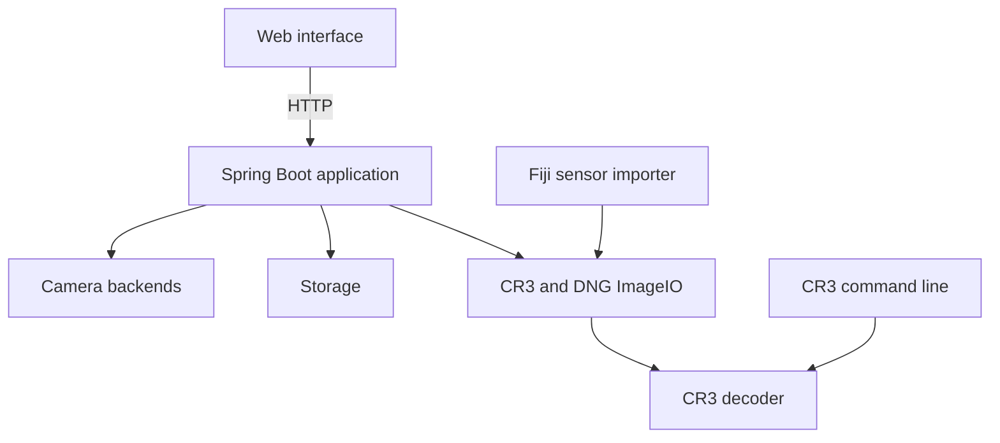

# Photographer (Focus Stack)

[](https://github.com/carstenartur/Photographer/actions/workflows/ci.yml)
[](https://carstenartur.github.io/Photographer/dev/bench/)
[](https://carstenartur.github.io/Photographer/tests/surefire-report.html)
[](https://carstenartur.github.io/Photographer/coverage/)
[](LICENSE)
[](https://github.com/carstenartur/Photographer/dependency-graph/sbom)
[](https://github.com/carstenartur/Photographer/releases)
[](https://orcid.org/0009-0005-1047-6381)

Focus Stack is a modular Java 25 + Spring Boot 4 photography platform for automated focus stacking, timelapse, and AI-assisted image analysis. It connects to Canon cameras via CCAPI and USB/PTP, provides a React/Vite frontend, and is extensible through a ServiceLoader-based plugin architecture.

| What would you like to do? | Start here |
|---|---|
| Control a camera or try a focus stack without hardware | [Start the web application](docs/quickstart.md) · [Illustrated walkthrough](docs/web-interface.md) |
| Read CR3 or write lossless CR3 and Bayer DNG in Java | [ImageIO dependency and working examples](docs/cr3/imageio.md) · [Supported RAW layouts](docs/cr3/decoder.md) |
| Understand the CR3 container and CRX bitstream | [CR3 and CRX format reference](docs/cr3/format.md) · [CR3 / CRX manual](docs/cr3/index.md) |
| Open a Bayer mosaic or a color image in Fiji | [Install the Fiji update site](docs/cr3/fiji-update-site.md) · [Import sensor data](cr3-imagej/README.md) · [Open a color image](docs/cr3/fiji-update-site.md#open-a-color-image) |
| Inspect a CR3 or export a preview from the command line | [CLI commands](docs/cr3/cli.md) |
| Review the CR3 reader and writer provenance | [Reviewer guide](docs/cleanroom/reviewer-guide.md) |
| Find the stable release and check its downloads | [Photographer 0.1.5](docs/releases/0.1.5.md) |
| Build or extend Photographer | [Developer manual](docs/developer/index.md) · [Project verification](docs/developer/testing.md) |


The application builds with JDK 25 and Maven 3.9+. The standalone CR3 libraries and Fiji importer run on Java 21 or newer.

## Features

**Capture**
- Canon CCAPI camera control (live-view, focus stepping, remote shutter)
- Mock camera backend for development and testing without hardware
- PTP/USB camera backend (`camera-ptp`)

**Imaging & AI**
- Adaptive focus-stacking capture with CR3 media ingestion
- CR3 inspection and native Java decoding of 14-bit Canon V1 lossless RAW and three-level C-RAW ([supported cameras and measurements](docs/cr3/decoder.md))
- HDR timelapse capture and merging
- Face-orbit multi-angle capture sessions
- Astro (long-exposure) session management
- Wildlife observer with pluggable AI vision providers (Gemini, mock)

**Plugins**
- Runtime plugin loading via Java `ServiceLoader` — no framework required
- Plugin interfaces: `AnalysisPlugin`, `CameraBackendPlugin`, `VisionProviderPlugin`
- Drop JAR into the plugins directory; the application discovers it automatically

**Operations**
- PostgreSQL persistence (H2 in-memory for local/test)
- Hibernate Search / Lucene full-text search
- REST API with OpenAPI documentation
- Docker-first deployment with `docker compose`

## Architecture



The packaged application serves the React frontend and runs capture jobs. The same decoder is available independently through ImageIO, Fiji and the CLI. [Architecture and module dependencies](docs/developer/architecture.md)

## Modules

Find the Maven modules, dependency layers and supported library interfaces in the [Developer Manual](docs/developer/modules.md). The [CR3 module map](docs/cr3/index.md#module-map) identifies the standalone library artifacts.

## Import Canon CR3 files in Java

Add `io.github.carstenartur:cr3-imageio` to a Java 21 or newer Maven application to read the camera’s embedded JPEG with `ImageIO.read(file)`. Select processed RGB, linear Bayer or the original sensor codes through the reader parameters. The standalone `cr3-core` decoder also accepts a file path directly.

[ImageIO setup and parameters](docs/cr3/imageio.md) · [Write lossless CR3](docs/cr3/imageio.md#write-a-lossless-cr3-using-a-camera-profile) · [Export a Bayer DNG](docs/cr3/imageio.md#write-and-read-a-bayer-dng) · [Maven release status](docs/cr3-maven-central.md)

## Run the web application

Follow the [quickstart](docs/quickstart.md) to build with Docker Compose, set the administrator password and run a capture job with a mock camera. It also covers running the packaged JAR with an in-memory database. For a physical camera, create a profile for its transport and check the operations its firmware advertises. [Camera setup](docs/camera-setup.md)

## Build and test

Run the product checks used by CI from the repository root. They require JDK 25, Maven 3.9+, Python 3 and a Docker daemon for the Testcontainers integration tests.

```bash
bash scripts/verify-product.sh
```

Pass `-DskipITs=true` for faster feedback. The [testing guide](docs/developer/testing.md) covers frontend, module-specific and hardware checks.

## Configuration

The [Compose environment template](.env.example) lists the settings needed for local startup. The [quickstart](docs/quickstart.md) explains how to configure them. See the [operations guide](docs/developer/operations.md) for application profiles, credentials and persistent data.

## Plugins

The `plugin-api` module defines three extension points discovered at runtime via `java.util.ServiceLoader`:

- **`AnalysisPlugin`** — custom image analysis steps inserted into capture workflows.
- **`CameraBackendPlugin`** — additional camera backends (supplement the built-in CCAPI and PTP backends).
- **`VisionProviderPlugin`** — additional AI vision providers for the Observer workflow.

To add a plugin, implement the interface, register the implementation in `META-INF/services/`, and drop the JAR into the directory configured by `FOCUSSTACK_PLUGINS_DIR`. The application discovers it on the next startup without recompilation.

See [`plugin-api/`](plugin-api/) for the interface source.

## AI Vision

The `ai-vision` module provides a `VisionProvider` interface that decouples the Observer workflow from specific AI provider APIs. Implementations ship with the project:

- **`MockVisionProvider`** — returns pre-configured results; suitable for development and CI.
- **`GeminiVisionProvider`** — calls the Google Gemini API; requires `GEMINI_API_KEY`.

Configure `OBSERVER_AI_PROVIDER=gemini` and `GEMINI_API_KEY` for the Observer workflow. Pass these variables into the application container when using Compose.

See [`ai-vision/README.md`](ai-vision/README.md) for full configuration details.

## Hardware-backed camera evidence

- **Canon PowerShot G5 X Mark II:** CCAPI live view, capture, focus drive and manual focus-stacking flow; USB/PTP CR3 fixture capture.
- **Canon EOS R:** USB/PTP CR3 capture with committed ISO variants and external reference outputs.

Other compatible Canon cameras may work but are not officially verified. See [docs/camera-setup.md](docs/camera-setup.md) and the model/firmware evidence issues for the exact support boundary.

## Reports & Benchmarks

The scheduled Maven site publishes the test and coverage reports. CR3 benchmark runs update the performance history for relevant changes on `main`.

- [Test Report](https://carstenartur.github.io/Photographer/tests/surefire-report.html)
- [Coverage Report](https://carstenartur.github.io/Photographer/coverage/)
- [JMH Benchmark History](https://carstenartur.github.io/Photographer/dev/bench/)

## Documentation

- [Developer Manual](docs/developer/index.md) — architecture, modules, testing, contributing and documentation authority
- [Contributing](CONTRIBUTING.md)
- [Security Policy](SECURITY.md)
- [Public Release Checklist](docs/public-release.md)
- [Quickstart and first capture](docs/quickstart.md) · [Web interface walkthrough](docs/web-interface.md)
- [REST API Reference](docs/api.md)
- [Camera Setup](docs/camera-setup.md)
- [CR3 / CRX clean-room engineering record](docs/cleanroom/README.md)

## Contributing

Contributions are welcome. Start with [CONTRIBUTING.md](CONTRIBUTING.md) and the canonical [developer contribution guide](docs/developer/contributing.md). There is no formal CLA; by submitting a pull request you agree to license your contribution under the MIT License.

Changes to CR3/CRX container, entropy, predictor, wavelet, dequantisation or assembly semantics must also include the [clean-room contributor attestation](docs/cleanroom/contributor-attestation.md) and cite registered sources plus project-owned evidence.

Security vulnerabilities must be reported privately according to [SECURITY.md](SECURITY.md).

## Citation and authorship

The primary author is [Carsten Hammer](https://orcid.org/0009-0005-1047-6381), ORCID [`0009-0005-1047-6381`](https://orcid.org/0009-0005-1047-6381).

Use GitHub's **Cite this repository** function or the metadata in [`CITATION.cff`](CITATION.cff). Machine-readable metadata is also available in [`codemeta.json`](codemeta.json) and [`.zenodo.json`](.zenodo.json). A DOI will only be stated after a public release has actually been archived.

## License

MIT — see [LICENSE](LICENSE).
