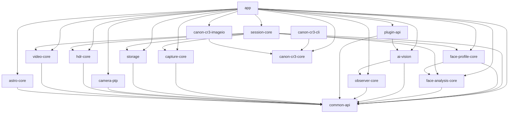

# Architecture

This document describes the high-level design of Focus Stack.

---

## Overview

Focus Stack is a **modular monolith** built as a Maven multi-module project.
A single Spring Boot application (`app`) orchestrates all functionality and
serves a React frontend as static resources. Domain logic is extracted into
independent library modules with no Spring dependency, keeping the core
portable and testable.

### Repository Layout

```
/
├── common-api/            # Shared records and interfaces (no framework dependency)
├── plugin-api/            # Public plugin SPI (AnalysisPlugin, CameraBackendPlugin, VisionProviderPlugin)
├── capture-core/          # Bracket and sequence capture abstractions
├── storage/               # Session file-system persistence
├── camera-ptp/            # Clean-room PTP/USB Canon backend (5-layer architecture)
├── hdr-core/              # HDR merge and tonemapping interfaces
├── video-core/            # Video encoding interface
├── face-analysis-core/    # Face detection, landmarks, quality scoring
├── face-profile-core/     # 3D face profile generation
├── session-core/          # HDR timelapse and face-orbit session orchestration
├── observer-core/         # Wildlife observer rules engine (pure Java, no Spring)
├── ai-vision/             # AI vision abstraction (Gemini + mock providers)
├── astro-core/            # Star detection, frame registration, astrophotography stacking
├── canon-cr3-core/        # Canon CR3 RAW parser (ISO-BMFF, CRX codec, metadata, processing)
├── canon-cr3-imageio/     # Java ImageIO adapter for CR3
├── canon-cr3-cli/         # CLI tool for CR3 inspection
├── frontend-web/          # React 19 / Vite SPA
├── app/                   # Spring Boot application (REST API, workflows, plugin management)
├── docs/                  # Project documentation
├── docker/                # Additional Docker images (e.g. Fiji worker)
├── scripts/               # Developer and CI helper scripts
├── fixtures/              # Sample images for testing
└── sample-data/           # Synthetic test data (e.g. astro star fields)
```

---

## Module Layers

The modules form a layered dependency graph:

```
                        ┌────────────┐
                        │    app     │  ← Spring Boot monolith
                        └─────┬──────┘
          ┌───────────────────┼───────────────────┐
          ▼                   ▼                   ▼
   ┌─────────────┐   ┌──────────────┐   ┌──────────────┐
   │ session-core│   │ observer-core│   │ astro-core   │
   └──────┬──────┘   └──────┬───────┘   └──────┬───────┘
          ▼                  ▼                  ▼
   ┌─────────────┐   ┌──────────────┐   ┌──────────────┐
   │capture-core │   │  ai-vision   │   │   hdr-core   │
   │  storage    │   │              │   │  video-core  │
   └──────┬──────┘   └──────┬───────┘   └──────────────┘
          ▼                  ▼
   ┌─────────────┐   ┌──────────────┐
   │ camera-ptp  │   │  plugin-api  │
   └──────┬──────┘   └──────┬───────┘
          ▼                  ▼
   ┌────────────────────────────────┐
   │          common-api            │  ← shared records, interfaces
   └────────────────────────────────┘

   Canon CR3 stack (independent):
   ┌──────────────┐   ┌──────────────────┐   ┌──────────────┐
   │ canon-cr3-cli│──►│ canon-cr3-imageio│──►│ canon-cr3-core│
   └──────────────┘   └──────────────────┘   └──────────────┘
```

The same dependency graph rendered as a Mermaid diagram (matches the
`<dependency>` declarations in the per-module `pom.xml` files; verify with
`mvn -B dependency:tree -pl <module> -am`):



> **Note:** `plugin-api → ai-vision` and `ai-vision → observer-core` are
> structural smells tracked in `TODO.md` (P1 architecture refactorings); the
> arrows are drawn here to reflect the *current* state, not the desired
> target.

---

## The `app` Module (Spring Boot Monolith)

The `app` module wires all library modules into a single deployable Spring Boot
application. Key responsibilities:

- **REST API** — camera profiles, stacking jobs, analysis, HDR timelapse,
  face orbit, observer, astro sessions, plugin management
- **Camera backends** — `CanonCcapiBackend` (Wi-Fi), `MockCameraBackend` (CI/demos),
  `PtpCameraBackend` (USB), plus external backends via `plugin-api`
- **Image analysis** — sharpness (Laplacian variance via ImageJ), motion detection
  (pixel diff, optical flow, structural similarity), stack merging (EDF)
- **Session workflows** — HDR timelapse, face orbit capture, wildlife observer,
  astro sessions — all scheduled on a bounded `sessionTaskExecutor`
- **Persistence** — JPA (PostgreSQL / H2) with Hibernate Search (Lucene)
- **Security** — Spring Security with form login and admin user initialization
- **Frontend** — serves the React build from `static/` resources
- **WebSocket** — STOMP/SockJS for real-time capture progress and logs

### Package Structure

```
com.photographer.focusstack
├── analysis/       # Sharpness, motion, plugins, stack merging
├── ai/             # AI vision provider wiring and registry
├── app/            # Config, security, plugin loading
├── astro/          # Astro session controller and service
├── camera/         # Backends, entities, controllers, services, strategies
└── observer/       # Observer session controller and service
```

---

## Frontend

| | |
|---|---|
| **Language** | JavaScript (JSX) |
| **Framework** | React 19, Vite |
| **Port** | 5173 (dev) / served by Spring Boot in production |

The frontend is built by `frontend-maven-plugin` during `mvn package` and
copied into `app/src/main/resources/static/`. In development, the Vite dev
server proxies API calls to the Spring Boot backend.

Pages: Dashboard, Cameras, Jobs, Gallery, HDR Timelapse, Face Orbit,
Wildlife Observer, Astro Sessions, Plugins.

---

## Domain Modules

### Camera Control

| Module | Role |
|---|---|
| `camera-ptp` | Clean-room PTP/USB implementation with Canon EOS extensions (5 layers: core → usb → canon → session → backend) |
| `capture-core` | `BracketCaptureService` and `SequenceCaptureService` — plain Java, no Spring |
| `storage` | File-system session persistence (`data/sessions/{id}/frames/`, `brackets/`, `results/`) |

### Imaging & Analysis

| Module | Role |
|---|---|
| `hdr-core` | `HdrProcessor` and `Tonemapper` interfaces with mock adapters |
| `video-core` | `VideoEncoder` interface for timelapse video generation |
| `face-analysis-core` | Face detection, landmark extraction, quality scoring |
| `face-profile-core` | 3D face profile generation from multi-angle captures |
| `astro-core` | `StarDetectionService`, `FrameRegistrationService`, `AstroStackingService`, focus optimization |

### Session Orchestration

| Module | Role |
|---|---|
| `session-core` | `HdrTimelapseService` (bracket → merge → tonemap → video), `FaceOrbitService` (capture → quality → profile) |
| `observer-core` | Wildlife observer: state machine, rules engine, scene monitor, capture orchestrator (pure Java, no Spring) |

### AI & Plugins

| Module | Role |
|---|---|
| `ai-vision` | `VisionProvider` interface with Gemini and mock implementations |
| `plugin-api` | Stable SPI for external plugins: `AnalysisPlugin`, `CameraBackendPlugin`, `VisionProviderPlugin` |

### Canon CR3

| Module | Role |
|---|---|
| `canon-cr3-core` | ISO-BMFF parser, CRX codec, TIFF/EXIF metadata, Bayer demosaicing, wavelet transforms |
| `canon-cr3-imageio` | Java ImageIO adapter (`CanonCr3ImageReader`, `CanonCr3ImageReaderSpi`) |
| `canon-cr3-cli` | Debug CLI (commands: `info`, `boxes`, `preview`, `thumb`) |

---

## Adaptive Focus Stacking Cycle

The core capture loop runs inside the `app` module:

```
 ┌─────────────────────────────────────────────────────────────────┐
 │                     CAPTURE SEQUENCE                            │
 │                                                                 │
 │  1. User sets near-focus and far-focus limits in the UI.        │
 │  2. App positions the lens at the near limit via the backend.   │
 │  3. LOOP:                                                       │
 │     a. Trigger shutter → capture frame.                         │
 │     b. Analyse frame: sharpness (Laplacian) + motion detection. │
 │     c. IF motion detected OR gain below threshold → STOP.       │
 │     d. Compute next step via FocusStepStrategy:                 │
 │        - Rising sharpness → full step (far from peak).          │
 │        - Plateau → halve step (approaching peak).               │
 │        - Falling sharpness → quarter step (past peak).          │
 │     e. Advance focus by computed step size.                     │
 │  4. Broadcast progress per frame via WebSocket.                 │
 │  5. Persist completed stack metadata; notify UI.                │
 └─────────────────────────────────────────────────────────────────┘
```

### FocusStepStrategy

Configured via `camera.focus.step-strategy` (default: `adaptive`):

| Strategy | Behaviour |
|---|---|
| `adaptive` | Gradient-based narrowing around sharpness peak (default) |
| `linear` | Fixed step size for every move (safe fallback) |

### MotionDetectionStrategy

Configured via `analysis.motion.strategy`:

| Strategy | Behaviour |
|---|---|
| `optical-flow` | ImageJ-decoded per-pixel comparison (accurate for compressed images) |
| `pixel-diff` | Raw byte comparison (fast, works on any byte array) |
| `structural-similarity` | SSIM-based comparison |

---

## Communication

```
Browser ──HTTP/WS──► app (Spring Boot) ──CCAPI──► Canon Camera
                        │
                        ▼
                    PostgreSQL
```

- **Browser ↔ app**: REST for commands; STOMP/SockJS WebSocket for real-time
  progress events and logs; MJPEG proxy for Live View.
- **app → Canon camera**: Canon CCAPI over Wi-Fi (HTTP) or PTP over USB.
- **app → PostgreSQL**: JDBC via HikariCP connection pool.

---

## Plugin System

Focus Stack uses a custom `FocusStackPluginManager` based on `ServiceLoader` +
`URLClassLoader` for runtime plugin loading. External plugins implement SPIs
from `plugin-api` and register via `META-INF/services/`.

### Extension Points

| SPI | Purpose |
|---|---|
| `AnalysisPlugin` | Custom image analysis algorithms |
| `CameraBackendPlugin` | Additional camera backends |
| `VisionProviderPlugin` | Alternative AI vision providers |

Plugins are discovered at startup from the `plugins/` directory.
`CameraBackendRegistry` and `VisionProviderRegistry` integrate external
plugins into the backend and AI provider selection.

---

## Configuration

Configuration is read from environment variables and `application.yml`,
overridden in `docker-compose.yml` for Docker deployments.

| Variable | Description |
|---|---|
| `CAMERA_CCAPI_URL` | Base URL of the Canon CCAPI (e.g. `http://192.168.1.2:8080`) |
| `CAMERA_MOCK_ENABLED` | `true` to use the built-in mock camera |
| `CAMERA_FOCUS_STEP_STRATEGY` | `adaptive` or `linear` (default: `adaptive`) |
| `SPRING_DATASOURCE_URL` | JDBC URL for PostgreSQL |
| `SPRING_DATASOURCE_USERNAME` | Database username |
| `SPRING_DATASOURCE_PASSWORD` | Database password |
| `FOCUSSTACK_SECURITY_ADMIN_PASSWORD` | Admin user password |

---

## Security

- Spring Security with form-based login and HTTP Basic for API access.
- `DefaultAdminInitializer` creates the admin user on first start.
- CCAPI communication is unencrypted HTTP on the local Wi-Fi network.
  Use a dedicated or isolated network for camera control.

---

## Mock Camera Failure Simulation

`MockCameraBackend` supports configuration flags for testing error scenarios
without real hardware:

| Property | Default | Description |
|---|---|---|
| `camera.mock.simulate-timeout-after-frames` | `0` | Block for 30 s after N captures (simulates network timeout) |
| `camera.mock.simulate-disconnect-after-frames` | `0` | Throw after N captures (simulates Wi-Fi disconnect) |
| `camera.mock.simulate-empty-frame-at` | `0` | Return empty image at capture N (simulates transmission error) |
| `camera.mock.simulate-movement-at` | `0` | Return noise-like image at capture N (simulates subject movement) |

Set any flag to `0` to disable it.
