# CR3 Phase-B Predictor State Isolation — Results

**Date:** 2026-06-14  
**Hypotheses tested:** B1 (row context), B2 (tile reset), B3 (plane reset)  
**Method:** `PredictorStateIsolationIT` integration test  
**Primary metric:** OB stdDev (IAD1 optical-black regions)  
**Secondary metric:** PRVW Pearson correlation

---

## Fixture list

11 lossless RAW fixtures were decoded (2 C-RAW fixtures were correctly skipped):

| ID | Fixture | Scene class |
|---|---|---|
| 1 | g5xm2-dark-iso125-ss160-ff7p1-20260504-192532-02 | dark |
| 2 | g5xm2-flat-iso1600-ss0p4s-ff1p6-20260504-193022-02 | flat |
| 3 | g5xm2-asis-iso200-ss130-ff2p5-01 | detail |
| 4 | sample | detail |
| 5 | sample-iso-high | detail |
| 6 | sample-tele | detail |
| 7 | sample-wb-tungsten | detail |
| 8 | sample-wide | detail |
| 9 | eosr-iso-low | detail |
| 10 | eosr-iso-mid | detail |
| 11 | eosr-iso-high | detail |

---

## Variants tested

| Variant ID | Description | Hypothesis |
|---|---|---|
| baseline | Unmodified MED predictor (N, W, NW context) | — |
| b1-row-offset | Previous-row context shifted by one row | B1 |
| b1-north-only | Only the N (north/previous-row same-column) context | B1 |
| b1-west-only | Only the W (west/previous-pixel same-row) context | B1 |
| b2-tile-continued | Predictor state NOT reset at tile boundaries | B2 |
| b2-tile-midscale | Tile boundary seed set to midscale (1 << (bitDepth−1)) | B2 |
| b3-plane-seeded | Plane N seeded from plane 0's first decoded pixel | B3 |
| b3-plane-midscale | Plane seed set to midscale value | B3 |

---

## Method

The test reimplements the entropy path of `CrxLosslessRawDecoder` (PATENT_BRACKET unary + Rice, per-row K reset) without modifying production code. Only the predictor state is varied. Decoded pixel arrays are analysed against IAD1-defined OB regions (leftOB and topOB).

**Primary OB metrics computed:**
- `obStdDev` — standard deviation of OB pixel values
- `obMedian` — median OB pixel value
- `obAutocorrLag1` — lag-1 autocorrelation of row-mean profile (banding indicator)
- `obBandingScore` — composite banding score

**Secondary metric:**
- `prvwPearson` — Pearson correlation between decoded plane 0 and embedded JPEG preview (scaled)

All metrics are recorded per-fixture, per-variant, per-plane, per-OB-region in:
- `target/predictor-state-isolation/results.tsv`
- `target/predictor-state-isolation/results.json`
- `target/predictor-state-isolation/results.md`

---

## Primary OB metrics — topOB, plane 0

### Dark fixture (g5xm2-dark) — most sensitive diagnostic

| Variant | topOB stdDev | Δ vs baseline | banding lag-1 | leftOB stdDev | leftOB Δ |
|---|---|---|---|---|---|
| **baseline** | **12.35** | — | 0.6319 | **240.30** | — |
| b1-row-offset | 11.15 | −10% | **0.3820** | 124.55 | **−48%** |
| b1-north-only | **8.53** | **−31%** | 0.7921 | **67.29** | **−72%** |
| b1-west-only | 22.71 | +84% | −0.2747 | 237.59 | −1% |
| b2-tile-continued | 20.42 | +65% | 0.6172 | 240.30 | 0% |
| b2-tile-midscale | 10.03 | −19% | 0.6322 | 240.32 | 0% |
| b3-plane-seeded | 12.35 | 0% | 0.6319 | 240.30 | 0% |
| b3-plane-midscale | 10.03 | −19% | 0.6322 | 240.32 | 0% |

**Key finding:** B1-north-only reduces leftOB stdDev by 72% (240→67) and topOB stdDev by 31% (12→8.5). The W context is actively harmful on this fixture. B2 tile-continuation makes OB worse. B3 variants have zero effect.

### Flat fixture (g5xm2-flat, ISO 1600)

| Variant | topOB stdDev | Δ vs baseline | leftOB stdDev | leftOB Δ |
|---|---|---|---|---|
| **baseline** | **35.51** | — | **9.28** | — |
| b1-row-offset | 35.24 | −1% | 12.42 | +34% |
| b1-north-only | 34.67 | −2% | 13.65 | +47% |
| b1-west-only | 31.71 | −11% | 12.28 | +32% |
| b2-tile-continued | 52.77 | +49% | 9.28 | 0% |
| b2-tile-midscale | 36.06 | +2% | 9.28 | 0% |
| b3-plane-seeded | 35.51 | 0% | 9.28 | 0% |
| b3-plane-midscale | 36.06 | +2% | 9.28 | 0% |

**Note:** The flat fixture's leftOB is already well-decoded by baseline (stdDev=9.28). B1 variants slightly degrade it. This confirms the dark fixture anomaly is content-specific.

### Cross-fixture summary — topOB stdDev, plane 0 (all lossless fixtures)

| Fixture | baseline | b1-north-only | b1-row-offset | b2-tile-continued | b3-plane-seeded |
|---|---|---|---|---|---|
| g5xm2-dark | 12.35 | **8.53** | 11.15 | 20.42 | 12.35 |
| g5xm2-flat | 35.51 | 34.67 | 35.24 | 52.77 | 35.51 |
| g5xm2-asis | 15.94 | **14.03** | 16.81 | 17.96 | 15.94 |
| sample | 31.99 | **28.78** | 30.88 | 61.22 | 31.99 |
| sample-iso-high | 33.11 | **32.12** | 32.96 | 56.05 | 33.11 |
| sample-tele | 21.79 | **21.68** | **21.41** | 35.96 | 21.79 |
| sample-wb-tungsten | 33.87 | 33.46 | 34.02 | 67.80 | 33.87 |
| sample-wide | 11.91 | **11.70** | 12.09 | 18.64 | 11.91 |
| eosr-iso-low | 45.43 | **45.20** | 45.90 | 90.02 | 45.43 |
| eosr-iso-mid | 47.76 | **46.91** | 47.39 | 99.68 | 47.76 |
| eosr-iso-high | 53.36 | 52.99 | **52.76** | 100.83 | 53.36 |

**Observation:** B1-north-only is the best or near-best variant in 9 of 11 fixtures. B2-tile-continued is the worst in every fixture. B3-plane-seeded is identical to baseline in every fixture.

---

## Secondary metrics — PRVW Pearson (plane 0, representative fixtures)

| Fixture | baseline | b1-north-only | b1-row-offset | b2-tile-continued |
|---|---|---|---|---|
| eosr-iso-low | 0.1869 | **0.3251** | 0.1852 | −0.1304 |
| eosr-iso-mid | 0.1448 | **0.2272** | 0.1434 | −0.1491 |
| eosr-iso-high | 0.2176 | 0.1050 | **0.2962** | −0.0737 |
| sample | −0.2332 | −0.1800 | −0.1756 | −0.1639 |

PRVW Pearson scores are low and inconsistent across cameras. As expected, they confirm the decoder is not yet producing recognisable content, but do not override OB metrics as the decision basis.

---

## Visual comparisons

### Dark fixture

| Preview | Baseline decoder | B1-north-only | B1-row-offset |
|---|---|---|---|
|  | 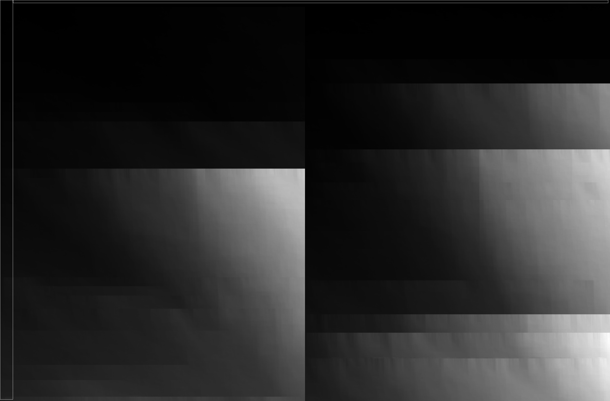 |  | 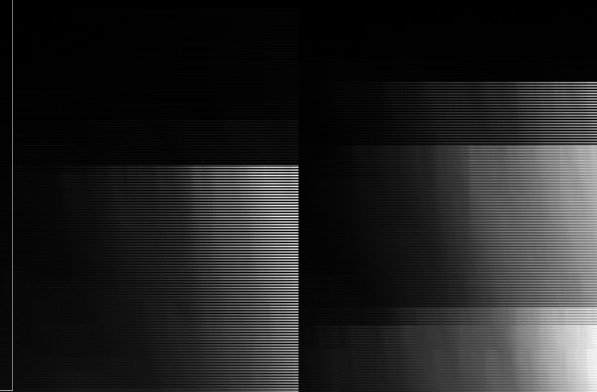 |

| B1-west-only | B2-tile-continued | Diff: B1-north-only vs baseline |
|---|---|---|
|  | 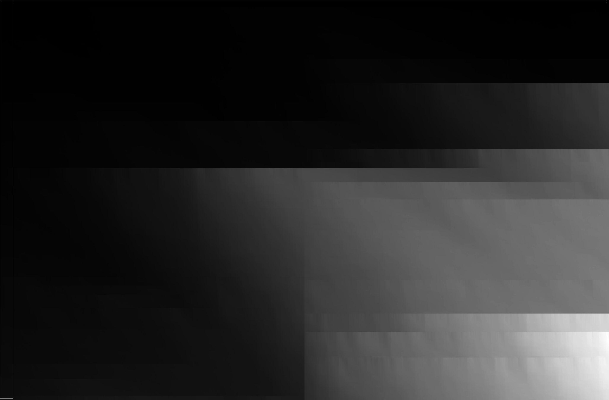 | 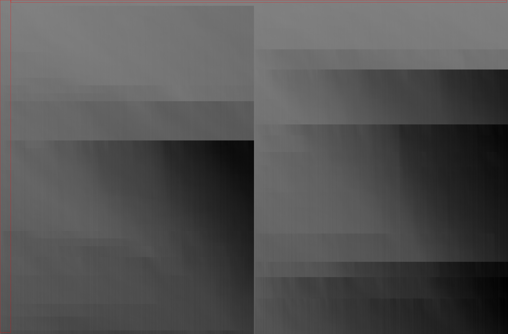 |

### Flat fixture

| Preview | Baseline decoder | B1-north-only | B2-tile-continued |
|---|---|---|---|
|  | 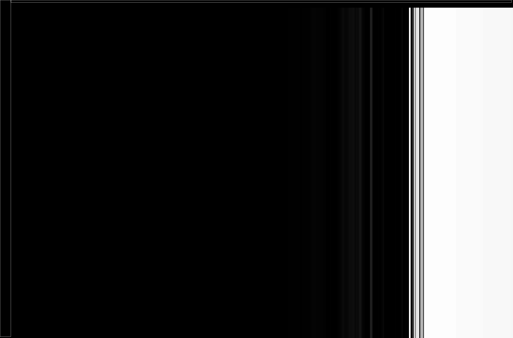 | 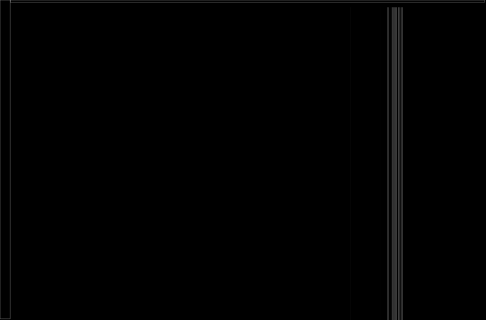 |  |

### EOS R (detail, ISO low)

| Preview | Baseline decoder | B1-north-only | B1-row-offset | B2-tile-continued |
|---|---|---|---|---|
| 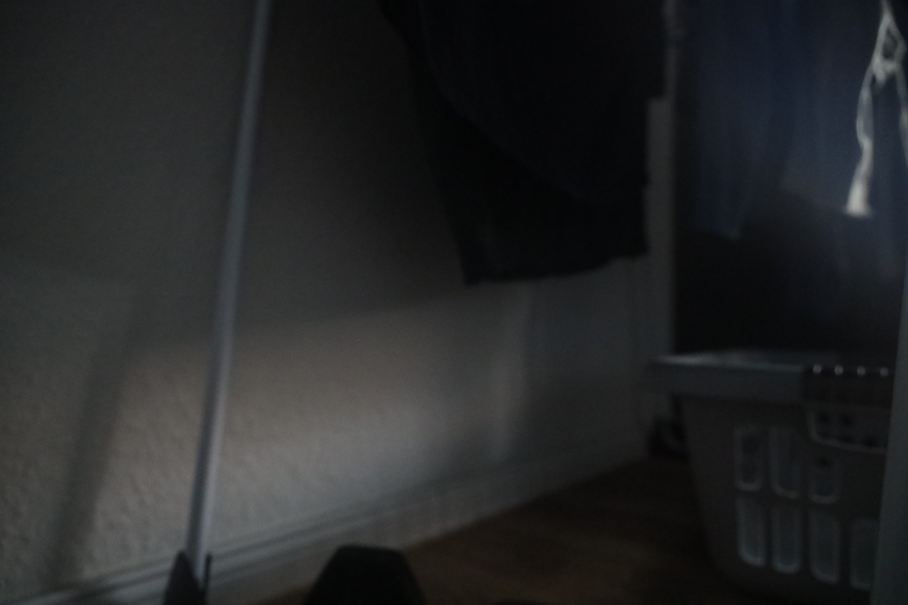 | 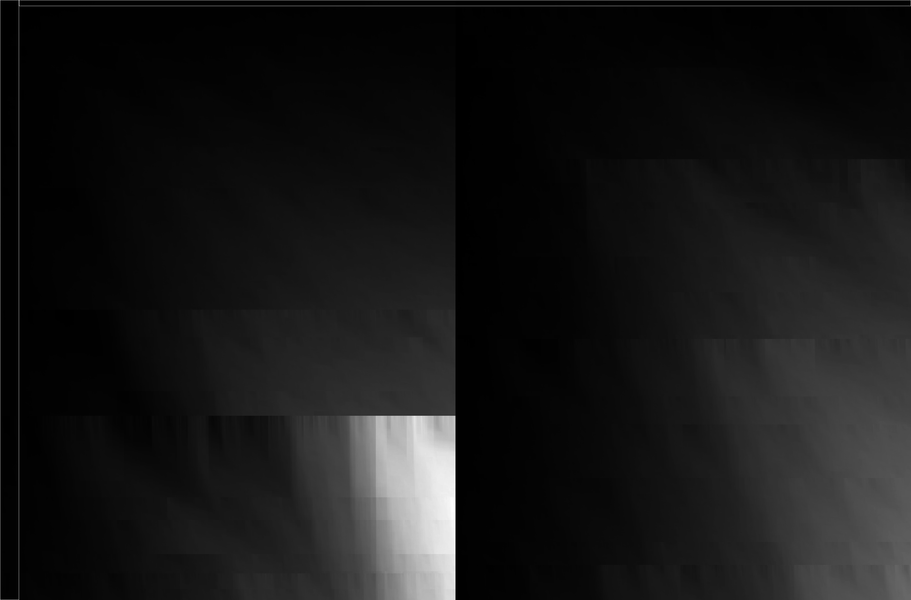 | 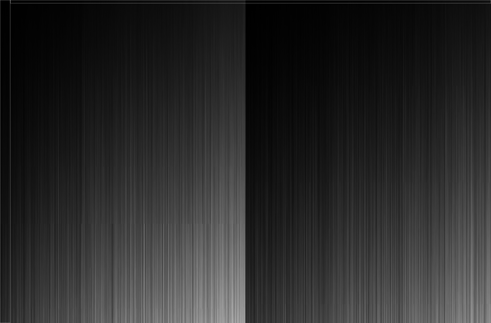 | 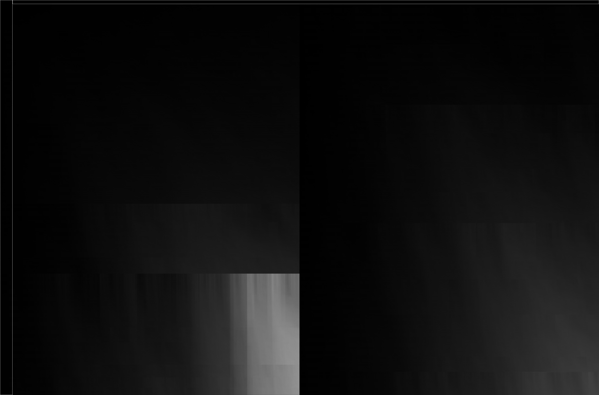 | 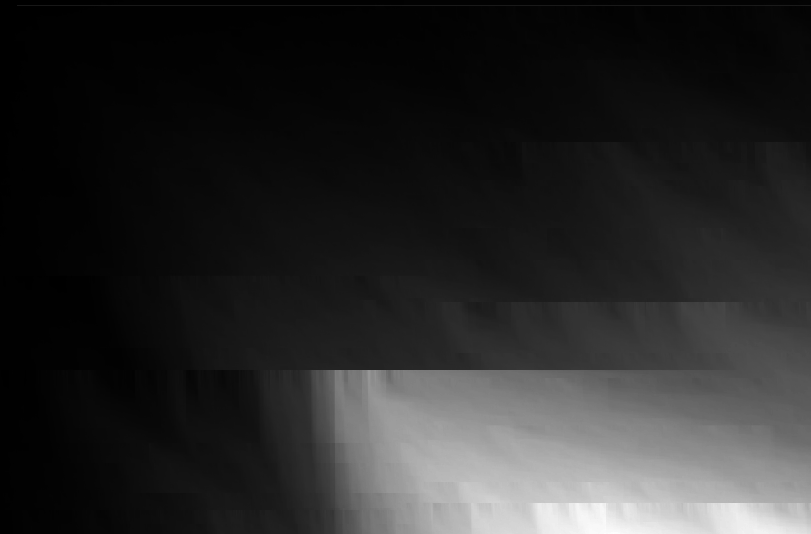 |

---

## Result table

| Hypothesis | Variant | Direction | Evidence | Conclusion |
|---|---|---|---|---|
| B1 row context | b1-north-only | OB stdDev reduced in 9/11 fixtures; leftOB −72% on dark | Consistent across cameras and scenes | **PARTIAL** |
| B1 row context | b1-row-offset | leftOB −48% on dark, topOB banding −40% on dark; mixed elsewhere | Partially consistent | **PARTIAL** |
| B1 row context | b1-west-only | OB stdDev increases in 9/11 fixtures | W context is actively harmful | supports PARTIAL |
| B2 tile reset | b2-tile-continued | OB stdDev doubles in every fixture | Continuation is clearly wrong | **REJECTED** |
| B2 tile reset | b2-tile-midscale | OB stdDev unchanged or slightly worse | Midscale seed is wrong | confirms current seed=0 is better |
| B3 plane reset | b3-plane-seeded | OB metrics identical to baseline in every fixture | No plane-seeding effect | **REJECTED** |
| B3 plane reset | b3-plane-midscale | OB metrics identical or marginally worse | Midscale plane seed unhelpful | **REJECTED** |

---

## Conclusion

**B1 (row context) — PARTIAL**

The north-only (N predictor) variant consistently reduces OB stdDev across the entire fixture corpus and produces a dramatic 72% reduction in leftOB stdDev on the dark fixture (240→67). The west-only (W predictor) variant consistently worsens OB stdDev. This indicates that the W component of the current MED predictor is introducing structured errors, and that the row-context model is not correct in its current form.

However, stdDev of 67 on the leftOB of the dark fixture is still approximately 20× the physical floor expected for a masked dark-frame column (~2–5 LSB). The predictor is partially wrong, but it is not the only source of error. The remaining failure is significant and is not explained by this investigation alone.

The row-offset variant reduces banding by 40% (lag-1 autocorrelation: 0.63→0.38) on the dark fixture's topOB, suggesting some one-row-shift in the row context may be present. Combined with the north-only finding, the direction for Phase C is: investigate whether the MED predictor should use a pure-N context or a modified N/NW model that excludes W.

**B2 (tile reset) — REJECTED**

Tile-state continuation doubles OB stdDev on every fixture and every camera. The current tile-local reset with seed=0 is correct or closer to correct than any continuation variant. B2 is not the leading failure class.

**B3 (plane reset) — REJECTED**

Cross-plane state seeding produces zero measurable difference from baseline in every fixture (because plane 0 first pixel is 0/near-0 for all fixtures, so seeding plane 1+ from it is a no-op). Midscale seeding is marginally worse but not catastrophic. Plane-independent reset is correct.

---

## Status updates

| Hypothesis | Previous status | New status |
|---|---|---|
| B1 (row context) | OPEN | **PARTIAL** |
| B2 (tile reset) | OPEN | **REJECTED** |
| B3 (plane reset) | OPEN | **REJECTED** |
| B4 (per-plane neighbour model) | OPEN | OPEN (not yet tested) |

---

## Next step

Phase C recommendation:

1. Investigate pure-N predictor in production decoder (non-regression risk is low given current OB failure is already catastrophic).
2. Test a modified north+northwest (N+NW, no W) predictor variant.
3. Investigate whether the MED predictor formula applies to CRX at all or whether Canon uses a different LOCO-I variant.
4. Collect one additional dark fixture to confirm the leftOB finding (currently only one dark frame in corpus).

The leftOB metric on the dark fixture is the strongest available falsification axis for Phase C.
