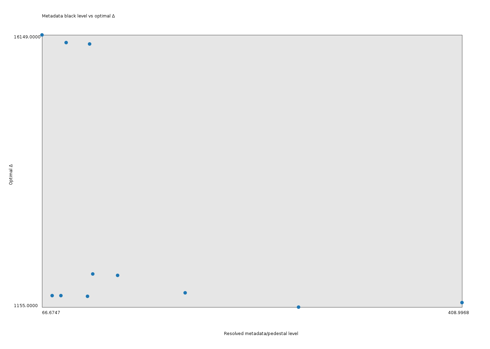
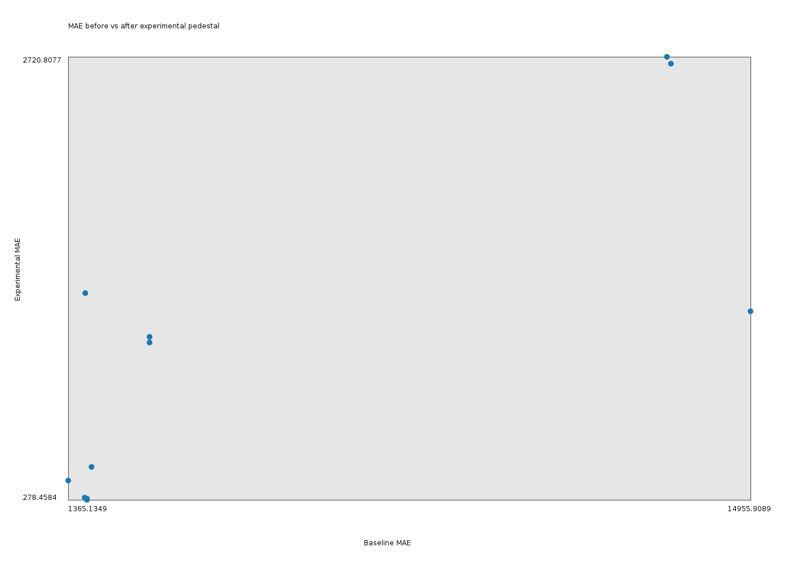

# Pedestal Hypothesis Validation

Generated: 2026-06-16T13:14:37.629028674Z

## Methodik

1. Für jede lossless-CR3-Fixture wurde `pedestal-report` über `Cr3Decoder.pedestalReport()` erfasst.
2. Gegen die vorhandenen `*.reference.tiff` Sidecars wurde für jede Fixture ein konstanter Offset Δ gesucht, der MAE minimiert.
3. Baseline- und Experimental-Metriken (Decoder+Δ) wurden auf denselben RAW-Mosaikdaten berechnet.
4. Metadata/Pedestal-Level wurden gegen optimale Δ-Werte korreliert.

## Schritt 1 – Pedestal Baseline

| Fixture | Kamera | Quelle | Modus | Werte |
|---|---|---|---|---|
| `eosr-iso-high.cr3` | Canon EOS R | OB_PER_ROW | PER_ROW | minPerRow=1 |
| `eosr-iso-low.cr3` | Canon EOS R | OB_PER_ROW | PER_ROW | minPerRow=0 |
| `eosr-iso-mid.cr3` | Canon EOS R | OB_PER_ROW | PER_ROW | minPerRow=0 |
| `research/g5xm2-asis-iso200-ss130-ff2p5-01.cr3` | Canon PowerShot G5 X Mark II | OB_PER_ROW | PER_ROW | minPerRow=0 |
| `research/g5xm2-dark-iso125-ss160-ff7p1-20260504-192532-02.cr3` | Canon PowerShot G5 X Mark II | OB_PER_ROW | PER_ROW | minPerRow=0 |
| `research/g5xm2-flat-iso1600-ss0p4s-ff1p6-20260504-193022-02.cr3` | Canon PowerShot G5 X Mark II | OB_PER_ROW | PER_ROW | minPerRow=0 |
| `sample-iso-high.cr3` | Canon PowerShot G5 X Mark II | OB_PER_ROW | PER_ROW | minPerRow=0 |
| `sample-tele.cr3` | Canon PowerShot G5 X Mark II | OB_PER_ROW | PER_ROW | minPerRow=0 |
| `sample-wb-tungsten.cr3` | Canon PowerShot G5 X Mark II | OB_PER_ROW | PER_ROW | minPerRow=0 |
| `sample-wide.cr3` | Canon PowerShot G5 X Mark II | OB_PER_ROW | PER_ROW | minPerRow=0 |
| `sample.cr3` | Canon PowerShot G5 X Mark II | OB_PER_ROW | PER_ROW | minPerRow=1 |

## Schritt 2 – Referenzbasiertes Optimierungsproblem

| Fixture | Optimales Δ | MAE vorher | MAE nachher | RMSE nachher | Pearson nachher | OB-MAE nachher |
|---|---:|---:|---:|---:|---:|---:|
| `eosr-iso-high.cr3` | 1788.0000 | 1735.1697 | 278.4584 | 352.4165 | 0.2208 | 180.0225 |
| `eosr-iso-low.cr3` | 1752.0000 | 1691.6085 | 290.1825 | 372.8502 | 0.2799 | 195.6019 |
| `eosr-iso-mid.cr3` | 1797.0000 | 1733.2698 | 285.0645 | 362.9045 | 0.2167 | 169.5796 |
| `research/g5xm2-asis-iso200-ss130-ff2p5-01.cr3` | 1155.0000 | 1706.9891 | 1417.3329 | 2331.5680 | -0.2461 | 681.2193 |
| `research/g5xm2-dark-iso125-ss160-ff7p1-20260504-192532-02.cr3` | 1410.0000 | 1365.1349 | 385.4136 | 536.7133 | -0.0093 | 355.4232 |
| `research/g5xm2-flat-iso1600-ss0p4s-ff1p6-20260504-193022-02.cr3` | 16149.0000 | 14955.9089 | 1318.9541 | 4099.8275 | 0.0455 | 10767.1896 |
| `sample-iso-high.cr3` | 15647.0000 | 13294.9533 | 2720.8077 | 4799.8059 | 0.0662 | 12275.9087 |
| `sample-tele.cr3` | 2972.0000 | 2983.7212 | 1176.3601 | 1480.9892 | -0.4176 | 1019.4247 |
| `sample-wb-tungsten.cr3` | 15726.0000 | 13364.9529 | 2681.8142 | 4819.2138 | -0.0698 | 12324.1880 |
| `sample-wide.cr3` | 2901.0000 | 2987.3870 | 1145.8626 | 1557.3504 | -0.2891 | 972.9023 |
| `sample.cr3` | 1950.0000 | 1833.9213 | 458.6745 | 631.0161 | -0.1162 | 140.2831 |

## Schritt 3 – Vergleich mit Pedestal-Report

| Fixture | Resolved BlackLevel (Skalar) | Optimales Δ | DeltaMetadata = Δ - Resolved |
|---|---:|---:|---:|
| `eosr-iso-high.cr3` | 74.8767 | 1788.0000 | 1713.1233 |
| `eosr-iso-low.cr3` | 103.7559 | 1752.0000 | 1648.2441 |
| `eosr-iso-mid.cr3` | 82.1241 | 1797.0000 | 1714.8759 |
| `research/g5xm2-asis-iso200-ss130-ff2p5-01.cr3` | 275.8842 | 1155.0000 | 879.1158 |
| `research/g5xm2-dark-iso125-ss160-ff7p1-20260504-192532-02.cr3` | 408.9968 | 1410.0000 | 1001.0032 |
| `research/g5xm2-flat-iso1600-ss0p4s-ff1p6-20260504-193022-02.cr3` | 66.6747 | 16149.0000 | 16082.3253 |
| `sample-iso-high.cr3` | 105.6102 | 15647.0000 | 15541.3898 |
| `sample-tele.cr3` | 107.9739 | 2972.0000 | 2864.0261 |
| `sample-wb-tungsten.cr3` | 86.3819 | 15726.0000 | 15639.6181 |
| `sample-wide.cr3` | 128.4229 | 2901.0000 | 2772.5771 |
| `sample.cr3` | 183.4748 | 1950.0000 | 1766.5252 |

## Schritt 4 – Korrelation

- Scatterplot Metadata-BlackLevel vs Optimales Δ:

## Schritt 5/6 – Experimental Pedestal Regression

| Fixture | Baseline MAE | Experimental MAE | Baseline RMSE | Experimental RMSE | Baseline Pearson | Experimental Pearson | Baseline OB-StdDev | Experimental OB-StdDev |
|---|---:|---:|---:|---:|---:|---:|---:|---:|
| `eosr-iso-high.cr3` | 1735.1697 | 278.4584 | 1769.8080 | 352.4165 | 0.2208 | 0.2208 | 65.7684 | 65.7684 |
| `eosr-iso-low.cr3` | 1691.6085 | 290.1825 | 1731.1533 | 372.8502 | 0.2799 | 0.2799 | 88.0079 | 88.0079 |
| `eosr-iso-mid.cr3` | 1733.2698 | 285.0645 | 1769.7069 | 362.9045 | 0.2167 | 0.2167 | 69.3977 | 69.3977 |
| `research/g5xm2-asis-iso200-ss130-ff2p5-01.cr3` | 1706.9891 | 1417.3329 | 2162.8831 | 2331.5680 | -0.2461 | -0.2461 | 236.4949 | 236.4949 |
| `research/g5xm2-dark-iso125-ss160-ff7p1-20260504-192532-02.cr3` | 1365.1349 | 385.4136 | 1438.1309 | 536.7133 | -0.0093 | -0.0093 | 265.0815 | 265.0815 |
| `research/g5xm2-flat-iso1600-ss0p4s-ff1p6-20260504-193022-02.cr3` | 14955.9089 | 1318.9541 | 15461.7053 | 4099.8275 | 0.0455 | 0.0455 | 6110.9319 | 6110.9319 |
| `sample-iso-high.cr3` | 13294.9533 | 2720.8077 | 13937.7830 | 4799.8059 | 0.0662 | 0.0662 | 3848.7242 | 3848.7242 |
| `sample-tele.cr3` | 2983.7212 | 1176.3601 | 3290.8050 | 1480.9892 | -0.4176 | -0.4176 | 733.3228 | 733.3228 |
| `sample-wb-tungsten.cr3` | 13364.9529 | 2681.8142 | 14009.7197 | 4819.2138 | -0.0698 | -0.0698 | 3863.1556 | 3863.1556 |
| `sample-wide.cr3` | 2987.3870 | 1145.8626 | 3285.1004 | 1557.3504 | -0.2891 | -0.2891 | 741.2664 | 741.2664 |
| `sample.cr3` | 1833.9213 | 458.6745 | 1930.1354 | 631.0161 | -0.1162 | -0.1162 | 222.6886 | 222.6886 |

- Scatterplot MAE vorher/nachher:

## Beispielbilder

[Ursprünglicher Bericht mit eingebetteten Bildern](https://github.com/carstenartur/Photographer/blob/271db071539de2a0a2e4f5cdbeaeb432af65fba1/docs/cr3-results/2026-06-16-pedestal-hypothesis-validation.md) · [Alle Originalabbildungen](https://github.com/carstenartur/Photographer/tree/271db071539de2a0a2e4f5cdbeaeb432af65fba1/docs/cr3-results/images/pedestal-hypothesis-validation)

### `eosr-iso-high.cr3`

| Reference | Baseline-Diff | Experimental-Diff |
|---|---|---|
| [Reference](https://github.com/carstenartur/Photographer/blob/271db071539de2a0a2e4f5cdbeaeb432af65fba1/docs/cr3-results/images/pedestal-hypothesis-validation/eosr-iso-high-reference.png) | [Baseline-Diff](https://github.com/carstenartur/Photographer/blob/271db071539de2a0a2e4f5cdbeaeb432af65fba1/docs/cr3-results/images/pedestal-hypothesis-validation/eosr-iso-high-baseline-diff.png) | [Experimental-Diff](https://github.com/carstenartur/Photographer/blob/271db071539de2a0a2e4f5cdbeaeb432af65fba1/docs/cr3-results/images/pedestal-hypothesis-validation/eosr-iso-high-experimental-diff.png) |

### `eosr-iso-low.cr3`

| Reference | Baseline-Diff | Experimental-Diff |
|---|---|---|
| [Reference](https://github.com/carstenartur/Photographer/blob/271db071539de2a0a2e4f5cdbeaeb432af65fba1/docs/cr3-results/images/pedestal-hypothesis-validation/eosr-iso-low-reference.png) | [Baseline-Diff](https://github.com/carstenartur/Photographer/blob/271db071539de2a0a2e4f5cdbeaeb432af65fba1/docs/cr3-results/images/pedestal-hypothesis-validation/eosr-iso-low-baseline-diff.png) | [Experimental-Diff](https://github.com/carstenartur/Photographer/blob/271db071539de2a0a2e4f5cdbeaeb432af65fba1/docs/cr3-results/images/pedestal-hypothesis-validation/eosr-iso-low-experimental-diff.png) |

### `eosr-iso-mid.cr3`

| Reference | Baseline-Diff | Experimental-Diff |
|---|---|---|
| [Reference](https://github.com/carstenartur/Photographer/blob/271db071539de2a0a2e4f5cdbeaeb432af65fba1/docs/cr3-results/images/pedestal-hypothesis-validation/eosr-iso-mid-reference.png) | [Baseline-Diff](https://github.com/carstenartur/Photographer/blob/271db071539de2a0a2e4f5cdbeaeb432af65fba1/docs/cr3-results/images/pedestal-hypothesis-validation/eosr-iso-mid-baseline-diff.png) | [Experimental-Diff](https://github.com/carstenartur/Photographer/blob/271db071539de2a0a2e4f5cdbeaeb432af65fba1/docs/cr3-results/images/pedestal-hypothesis-validation/eosr-iso-mid-experimental-diff.png) |

## Schlussfolgerung

- Entscheidung: **SUPPORTED**
- Begründung:
  - MAE >20% verbessert bei 10/11 Fixtures.
  - OB-MAE verbessert bei 8/11 Fixtures.
  - Pearson verschlechtert bei 0/11 Fixtures.
  - Verbesserung über 2 Kameramodelle reproduzierbar.
