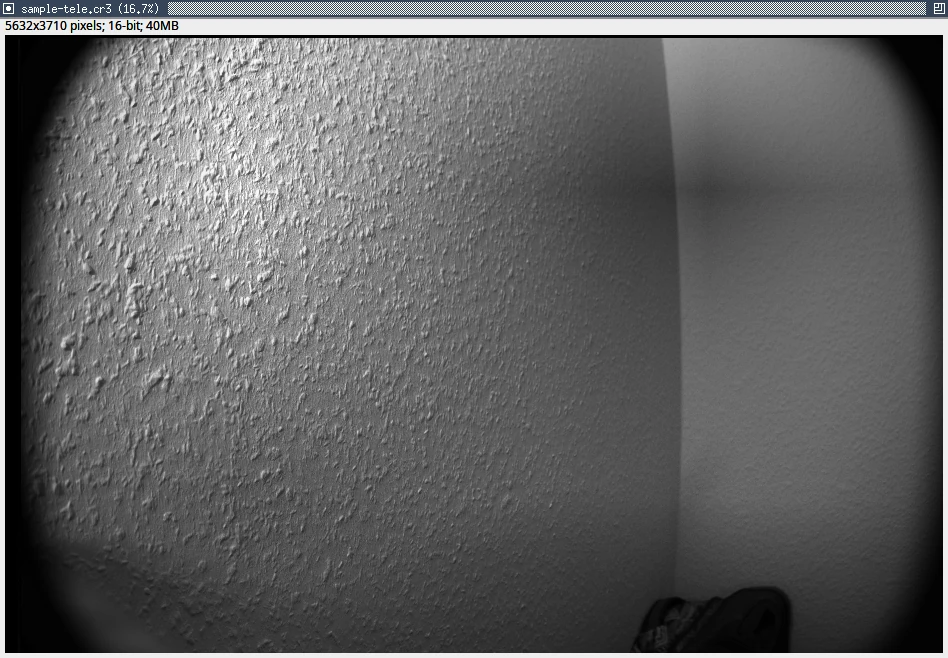

# Install the Canon CR3 importer in Fiji

Use Fiji with Java 21 or newer. Add the hosted update site to receive the importer and subsequent updates. For offline installation, obtain the two ZIPs from the project's GitHub release assets or the **cr3-fiji-distribution** Actions artifact. Access follows the repository's sharing settings. The workflow can also be run manually.

## Install from the hosted Fiji update site

1. Open **Help › Update... › Manage update sites › Add Unlisted Site**.
2. Enter **Canon CR3 Sensor Importer** and the URL `https://carstenartur.github.io/Photographer/fiji/cr3/`.
3. Enable the site, close the site manager, apply the changes and restart Fiji.
4. Open **File › Import › CR3 Sensor Data...**. For later versions, run **Help › Update...** again.

The [published version](https://carstenartur.github.io/Photographer/fiji/cr3/version.txt) identifies the installed channel's current build. A version ending in `-SNAPSHOT` is a preview. Stable releases use the same URL and retain the timestamped updater history.

## Open a sensor image

Choose **File › Import › CR3 Sensor Data...** and select a CR3. To reproduce the example, open the repository fixture [sample-tele.cr3](../../canon-cr3-imageio/src/test/resources/samples/sample-tele.cr3). The importer opens the original Bayer mosaic in sensor coordinates and Fiji displays that plane in grayscale. In this PowerShot G5 X Mark II capture, the RGGB mosaic contains 14-bit sensor codes. ImageJ stores them in an unsigned 16-bit image measuring 5,632 × 3,710 pixels.



The screenshot uses **Image › Adjust › Brightness/Contrast... › Set** with a display minimum of **2048** and maximum of **6473**. Use **Reset** to restore the display range. Adjusting these limits preserves the pixel values for measurement. Leave **Apply** unused to preserve those values. Other exposures can need different display limits.

## Open a color image

**Development (0.1.8-SNAPSHOT, planned for the next release).** Choose **File › Import › CR3 Color Image...** to develop a [supported RAW or C-RAW file](decoder.md). Fiji opens an RGB composite with three unsigned 16-bit channels. The importer crops to the active area, applies EXIF orientation and develops to sRGB. Each channel starts with the same 0–65535 display range. The rendering is experimental. For the camera's own rendering, choose the embedded JPEG in the script below.

| Import | Pixel values |
| --- | --- |
| **CR3 Sensor Data...** | One original camera code per Bayer site, including margins. A 14-bit code of 2857 stays 2857 in the 16-bit plane. |
| **CR3 Color Image...** (development) | Three demosaiced, color-processed values per output pixel, quantized to 16 bits per channel. |
| Camera JPEG (script) | The camera's rendered, 8-bit-per-channel preview, when present. |

**Stable 0.1.7.** The [hosted Groovy example](https://carstenartur.github.io/Photographer/fiji/cr3/open-cr3-color.groovy) for this release offers camera JPEG and 8-bit developed RGB.

**Development builds.** Open the [16-bit Groovy example](../../cr3-imagej/examples/open-cr3-color.groovy) in Fiji's Script Editor and select **Groovy**. Run it, choose a CR3 and select **Develop RAW to 16-bit RGB** for the three-channel composite. Leave that option cleared to open the camera JPEG. The development update-site ZIP includes this script as `open-cr3-color.groovy` at the site root.

For byte-preserving JPEG extraction in Java, use the [embedded-preview extractor](import.md#copy-the-cameras-embedded-jpeg-unchanged). The [ImageIO guide](imageio.md#read-parameters) describes the development controls.

## Install from the ZIP

Close Fiji. Extract `cr3-fiji-install.zip` into the Fiji application directory that contains `jars/` and `plugins/`. On macOS, open **Show Package Contents** to locate those folders. Merge the two directories with their existing counterparts. Restart Fiji and choose **File › Import › CR3 Sensor Data...**.

The archive installs one menu plugin and six CR3 libraries. Fiji supplies ImageJ and SLF4J. To uninstall a manual installation, remove the seven files listed in the ZIP and restart Fiji.

## Serve a local copy of the update site

Extract `cr3-fiji-update-site.zip` into a directory outside the Fiji installation. Its root contains `db.xml.gz`, `jars/` and `plugins/`. To try it on your own computer, start a local server in that directory:

```sh
python3 -m http.server 8765 --bind 127.0.0.1
```

Open **Help › Update... › Manage update sites › Add Unlisted Site**. Enter **Canon CR3 Sensor Importer** and `http://127.0.0.1:8765/`, enable the site, close the site manager, apply changes and restart Fiji. The URL must point to the directory containing the database. For an existing hosted copy, use its HTTPS base URL. A GitHub release ZIP download is an archive, so extract and serve its contents before adding the site.

To receive later updates, keep the same base URL and run **Help › Update...** again after a new version is staged. For local testing, keep the server running whenever Fiji checks the site, or disable the site after installation.

## Build both archives

Use Maven 3.9.x, JDK 25, Python 3 and a Fiji installation with the ImageJ 2.x updater. Run from the repository root, setting the path to the Fiji directory that contains `db.xml.gz`:

```sh
mvn -pl cr3-imagej -am verify -Pfiji-update-site -Dfiji.directory=/path/to/Fiji
```

The profile obtains the release-version CR3 libraries through Maven. Fiji's updater stages the timestamped files, discovers their dependencies and builds the database. A second local installation downloads all seven files, compares their bytes with the site and checks their updater status. Find the site tree and both ZIPs in `target/cr3-fiji-site/`.

For the next release, reuse that output directory to extend its history. From a clean checkout, set `FIJI_PREVIOUS_SITE` to the previous release's **cr3-fiji-update-site.zip** before running Maven. Use `-Dfiji.site.output=/new/path` to choose a different output. For static hosting, copy the entire resulting `site/` tree, including old timestamped payloads, and replace `db.xml.gz` last. Contributors can also share the ZIP privately and use the local-server instructions above.

## Release publication

The regular release workflow builds and tests the seven Fiji JARs on the verified stable tag. The distribution job attaches the two ZIPs to the GitHub release and publishes that release's update-site archive under `fiji/cr3/` on the existing `gh-pages` branch. It checks the Maven coordinates inside the current JARs, keeps timestamped payloads from previous releases and compares the anonymous downloads of the version file, update database and all seven current JARs against the local release bytes after requesting a Pages build. The site uses the existing public Pages source at the root of `gh-pages`.

If an attachment step stops after uploading one ZIP, rerun the failed jobs in the original Actions run while its verified artifact is retained. The attach job downloads that pair, checks every already uploaded ZIP byte-for-byte and fills only missing assets. Rebuilding can change Fiji timestamps and JAR bytes; a mismatching upload is reported before any missing file is added.

To complete the Fiji distribution for a published stable release, run **CR3 Fiji distribution** on **main** and set `publish_existing_tag` to its exact tag. For example, run:

```sh
gh workflow run cr3-fiji-distribution.yml --ref main -f publish_existing_tag=v0.1.6
```

The workflow resolves the existing tag to its source commit. If both ZIPs are present it reuses them. Otherwise it builds from the tagged sources and checks existing assets before filling missing downloads. It tests the installed plugin on Java 21, publishes the update site and verifies the anonymous downloads. An empty input runs only the verification build.
