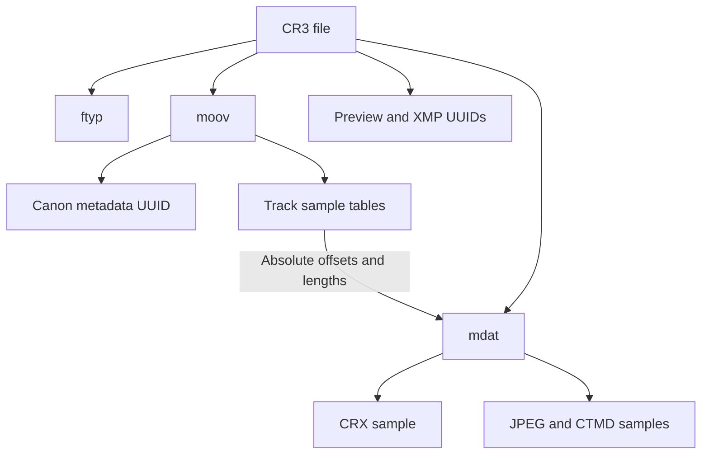

# CR3 and CRX format reference

A **CR3** file uses the **ISO Base Media File Format (BMFF)** container for camera sensor readings, capture metadata and embedded images. **CRX** is the compression used for the RAW readings. An embedded JPEG can be displayed independently of CRX decoding. Both full RAW and **compact RAW (C-RAW)** files use the `.CR3` extension.

This independent engineering reference describes the layouts measured in Photographer. The reader code and evidence reviewed for this reference are pinned to [2640720dfa9170e6093e2b13e3b24e108ad4567a](https://github.com/carstenartur/Photographer/tree/2640720dfa9170e6093e2b13e3b24e108ad4567a). The sections on writing describe construction and validation for the four measured lossless camera profiles.

Jump to the [reader steps](#reading-order), [writer profiles](#lossless-writer-camera-profiles), [patent publications](#patent-publications) or [glossary](#7-glossary).

## Contents

1. [Sensor data and scope](#1-sensor-data-and-scope)
   - [Sensor data and embedded images](#sensor-data-and-embedded-images)
   - [Scope and evidence](#scope-and-evidence)
2. [Implementing a reader](#2-implementing-a-reader)
   - [Reading order](#reading-order)
   - [Verifying a reader](#verifying-a-reader)
   - [Reference implementation and license](#reference-implementation-and-license)
3. [CR3 container and metadata](#3-cr3-container-and-metadata)
   - [ISO Base Media File Format container](#iso-base-media-file-format-container)
     - [Box framing and file identification](#box-framing-and-file-identification)
     - [Canon user types and movie boxes](#canon-user-types-and-movie-boxes)
     - [Tracks and sample ranges](#tracks-and-sample-ranges)
     - [Embedded preview and thumbnail](#embedded-preview-and-thumbnail)
     - [Constraints evidenced for writing](#constraints-evidenced-for-writing)
   - [Metadata and sensor calibration](#metadata-and-sensor-calibration)
     - [CMT box payloads](#cmt-box-payloads)
     - [Canon MakerNotes](#canon-makernotes)
     - [Canon timed metadata](#canon-timed-metadata)
       - [CTMD ColorData](#ctmd-colordata)
     - [Sensor geometry and IAD1](#sensor-geometry-and-iad1)
     - [CFA and calibration in output modes](#cfa-and-calibration-in-output-modes)
     - [Capture metadata and regenerated mosaics](#capture-metadata-and-regenerated-mosaics)
4. [CRX decoding](#4-crx-decoding)
   - [CRX framing and sample placement](#crx-framing-and-sample-placement)
     - [Codec parameters in CMP1](#codec-parameters-in-cmp1)
     - [Directory records and entropy origin](#directory-records-and-entropy-origin)
     - [Tile order, position planes and sensor output](#tile-order-position-planes-and-sensor-output)
   - [V1 lossless sample coding](#v1-lossless-sample-coding)
     - [Profile and entropy boundaries](#profile-and-entropy-boundaries)
     - [Unsigned symbols, signed residuals and state](#unsigned-symbols-signed-residuals-and-state)
     - [First row and subsequent rows](#first-row-and-subsequent-rows)
     - [Evidence for the measured lossless layout](#evidence-for-the-measured-lossless-layout)
   - [V1 three-level C-RAW reconstruction](#v1-three-level-c-raw-reconstruction)
     - [Profile and band windows](#profile-and-band-windows)
     - [Approximation band and detail entropy](#approximation-band-and-detail-entropy)
     - [Inverse quantization](#inverse-quantization)
     - [Physical band dimensions and tile boundaries](#physical-band-dimensions-and-tile-boundaries)
     - [Inverse integer 5/3 lifting](#inverse-integer-53-lifting)
     - [Evidence for the measured C-RAW layout](#evidence-for-the-measured-c-raw-layout)
5. [CR3 writing and verification](#5-cr3-writing-and-verification)
   - [Minimal lossless writer derivation](#minimal-lossless-writer-derivation)
   - [Lossless writer camera profiles](#lossless-writer-camera-profiles)
     - [Writer sensor geometry](#writer-sensor-geometry)
     - [CRX parameters for the writer](#crx-parameters-for-the-writer)
     - [Writer track and reference values](#writer-track-and-reference-values)
     - [Generated metadata](#generated-metadata)
   - [Writing and verifying a CR3 file](#writing-and-verifying-a-cr3-file)
     - [Container round trip](#container-round-trip)
     - [Inspection with the project CLI](#inspection-with-the-project-cli)
     - [Verification levels](#verification-levels)
6. [Sources](#6-sources)
   - [Source provenance and references](#source-provenance-and-references)
   - [Patent publications](#patent-publications)
     - [US 2016/0323602 A1](#us-20160323602-a1)
     - [JP 2017-192077 A](#jp-2017-192077-a)
   - [Standards and project evidence](#standards-and-project-evidence)
7. [Glossary](#7-glossary)

## 1. Sensor data and scope

### Sensor data and embedded images

> **Bayer filter and color filter array (CFA)**
>
> In a Bayer sensor, each site measures light through one red, green or blue filter. The filters repeat in a 2 × 2 block. This example shows RGGB, starting at the upper-left sensor site.
>
> | Sensor row | Even column | Odd column |
> | --- | --- | --- |
> | Even | Red | Green |
> | Odd | Green | Blue |
>
> The grid of single readings is the **Bayer mosaic**. **Demosaicing** estimates the other two color values at each site to build an RGB image. A native RAW reader can return the mosaic and its CFA pattern before that step. [CFA values](#cfa-and-calibration-in-output-modes)

For a ready-to-view image, follow [embedded preview and thumbnail](#embedded-preview-and-thumbnail). To recover sensor readings, follow the [reader steps](#reading-order) and start with the [2 × 2 test image](#verifying-a-reader). To create a file from an existing full mosaic, choose a [lossless writer profile](#lossless-writer-camera-profiles).

### Scope and evidence

| Layout | Measured structural properties | Native decode evidence |
| --- | --- | --- |
| CRX V1 lossless RAW | 14-bit, encoding type 0, four positional Bayer planes, one subband per plane, horizontal full-height tiles | 15 files with 365,774,016 matching sensor samples across EOS R, EOS RP, EOS M50 and PowerShot G5 X Mark II. [RG4](../cr3-results/2026-11-14-crx-native/README.md) |
| CRX V1 three-level C-RAW | 14-bit reconstruction, encoding type 0, four unrounded positional planes, two equal-width horizontal tiles, ten subbands per plane | Six files with 146,467,152 matching reconstructed samples across the same models. The comparison is with the Bayer mosaic decoded from each compressed recording. [RG5](../cr3-results/2026-11-14-crx-wavelet/README.md) |

The measurements compare every site of the full sensor raster, including the masked margins. Camera settings or shooting modes can change the layout even within one model.

| Task | Described and checked here | Outside this evidence |
| --- | --- | --- |
| Locate and extract images | Embedded JPEGs and the sample ranges in the measured still-image container | General CR3 layouts with multiple samples per track |
| Decode the RAW mosaic | The two V1 layouts above, including the C-RAW reconstruction from compressed coefficients | Native V2 decoding, extended CMP1 headers and other C-RAW wavelet layouts |
| Write a CR3 | Four full-frame lossless 14-bit profiles, with input sensor codes preserved exactly | C-RAW writing, other camera modes and byte-identical camera firmware output |
| Interpret metadata and open the result | The mapped tags, sensor geometry and [tested applications](#verification-levels) | Meanings of uncharacterized Canon fields, lens corrections and untested applications such as Canon Digital Photo Professional |

The [decoder guide](decoder.md), [current research state](current-state.md) and [open hypotheses](open-hypotheses.md) describe the remaining product and research boundaries.

[Back to contents](#contents)

<a name="implementing-a-reader"></a>

## 2. Implementing a reader

The byte and bit layouts in this reference can be used to implement a reader for the measured profiles. Start by returning the full native Bayer raster and its CFA pattern. Thumbnail extraction, metadata interpretation and RGB development can be added as separate outputs. [Measured profiles](#scope-and-evidence)

### Reading order

1. **Walk the BMFF boxes.** Read `ftyp` and bound each header and payload by the enclosing box and the file extent. Interpret the container integers as big-endian and retain the absolute offsets of media data. [Box framing](#box-framing-and-file-identification)
2. **Locate the RAW sample.** Resolve the track from its descriptor and sample tables. `CRAW` can describe a JPEG track as well as a CRX track. For a one-sample profile, locate the single sample and verify that its declared byte range lies inside the intended `mdat`. [Track roles and sample ranges](#tracks-and-sample-ranges)
3. **Read the codec parameters and directory.** Read `CMP1` and select the CRX marker family. Check the geometry, bit depth, CFA, encoding and wavelet levels against the layout you implement. Use the first `CMP1.mdatHeaderSize` bytes **of the selected sample** as the directory. Reconcile tile, plane and subband sizes before reading entropy or allocating the output raster. [Codec parameters](#codec-parameters-in-cmp1) · [Directory and entropy origin](#directory-records-and-entropy-origin)
4. **Decode and place each plane.** Decode from the bounded subband ranges. Lossless V1 uses one subband per plane. Measured three-level C-RAW uses an approximation band and nine detail bands, followed by inverse quantization and lifting. Place the reconstructed codes using the tile ordinal and plane index. An unsupported layout or truncated payload should produce an explicit RAW read error. [Lossless coding](#v1-lossless-sample-coding) · [C-RAW reconstruction](#v1-three-level-c-raw-reconstruction) · [Bayer placement](#tile-order-position-planes-and-sensor-output)
5. **Return the native mosaic.** Include the full sensor dimensions, 14-bit values in an unsigned storage type and the CFA phase at the sensor origin. Keep crop, orientation, black-level correction and scaling separate so an exact comparison can address every original sensor site. Expose JPEG preview and thumbnail extraction as distinct read modes. [Metadata and calibration](#metadata-and-sensor-calibration) · [Embedded preview and thumbnail](#embedded-preview-and-thumbnail)

### Verifying a reader

The project's synthetic `four-sites.cr3` is a compact first test. The RAW sample starts at file byte 255 and contains 140 bytes. The first 108 bytes are the CRX directory. The four remaining eight-byte plane payloads reconstruct a 2 × 2 raster whose rows are `[8192, 8193]` and `[8191, 8194]`. Check these native values before applying any crop or scaling. [Synthetic file](../../canon-cr3-core/src/test/resources/com/photographer/focusstack/cr3/decode/four-sites.cr3) · [Expected API output](../../canon-cr3-core/src/test/java/com/photographer/focusstack/cr3/decode/Cr3DecoderTest.java#L101-L132)

| Check | Expected behavior | Evidence |
| --- | --- | --- |
| Vary plane order across two tiles | File order controls payload consumption. Plane indices control Bayer placement. | [Synthetic two-tile test](../../canon-cr3-codec/src/test/java/com/photographer/focusstack/cr3/raw/codec/CrxSensorDecoderTest.java) |
| Exercise lossless runs, literal escapes and truncation | Reconstruct the expected values and reject a symbol that exceeds its bounded stream. | [Lossless plane tests](../../canon-cr3-codec/src/test/java/com/photographer/focusstack/cr3/raw/codec/CrxNativeLosslessPlaneTest.java) |
| Exercise C-RAW detail bands and tile boundaries | Preserve signed coefficients during reconstruction and compare the final sensor values. | [Detail-band tests](../../canon-cr3-codec/src/test/java/com/photographer/focusstack/cr3/raw/codec/CrxWaveletDetailTest.java) · [Lifting and boundary tests](../../canon-cr3-codec/src/test/java/com/photographer/focusstack/cr3/raw/codec/CrxWaveletTileTest.java) |
| Compare camera files with the registered reference mosaics | Match every site of the uncropped native raster for the profiles exercised. | [Lossless comparison and replay](../cr3-results/2026-11-14-crx-native/README.md) · [C-RAW comparison and replay](../cr3-results/2026-11-14-crx-wavelet/README.md) |

### Reference implementation and license

| Reader stage | Photographer source code |
| --- | --- |
| BMFF boxes and CR3 track resolution | [IsoBmffReader](../../canon-cr3-container/src/main/java/com/photographer/focusstack/cr3/bmff/IsoBmffReader.java) · [Cr3Parser](../../canon-cr3-container/src/main/java/com/photographer/focusstack/cr3/container/Cr3Parser.java) |
| Metadata, calibration and embedded JPEGs | [Cr3MetadataReader](../../canon-cr3-metadata/src/main/java/com/photographer/focusstack/cr3/metadata/Cr3MetadataReader.java) · [Cr3SensorCalibration](../../canon-cr3-imageio/src/main/java/com/photographer/focusstack/cr3/imageio/Cr3SensorCalibration.java) · [Cr3PreviewExtractor](../../canon-cr3-container/src/main/java/com/photographer/focusstack/cr3/preview/Cr3PreviewExtractor.java) |
| CRX parameters, directories and native dispatch | [Cmp1Box](../../canon-cr3-container/src/main/java/com/photographer/focusstack/cr3/bmff/Cmp1Box.java) · [CrxHeader](../../canon-cr3-codec/src/main/java/com/photographer/focusstack/cr3/raw/codec/CrxHeader.java) · [CrxSensorDecoder](../../canon-cr3-codec/src/main/java/com/photographer/focusstack/cr3/raw/codec/CrxSensorDecoder.java) |
| Lossless entropy and plane reconstruction | [CrxEntropyState](../../canon-cr3-codec/src/main/java/com/photographer/focusstack/cr3/raw/codec/CrxEntropyState.java) · [CrxNativeLosslessPlane](../../canon-cr3-codec/src/main/java/com/photographer/focusstack/cr3/raw/codec/CrxNativeLosslessPlane.java) · [CrxNativeLosslessImage](../../canon-cr3-codec/src/main/java/com/photographer/focusstack/cr3/raw/codec/CrxNativeLosslessImage.java) |
| C-RAW detail coding and inverse lifting | [CrxLossyDecoder](../../canon-cr3-codec/src/main/java/com/photographer/focusstack/cr3/raw/codec/CrxLossyDecoder.java) · [CrxWaveletDetail](../../canon-cr3-codec/src/main/java/com/photographer/focusstack/cr3/raw/codec/CrxWaveletDetail.java) · [CrxWaveletTile](../../canon-cr3-codec/src/main/java/com/photographer/focusstack/cr3/raw/codec/CrxWaveletTile.java) |
| Native raster and Java ImageIO integration | [Cr3Decoder](../../canon-cr3-core/src/main/java/com/photographer/focusstack/cr3/decode/Cr3Decoder.java) · [CanonCr3ImageReader](../../canon-cr3-imageio/src/main/java/com/photographer/focusstack/cr3/imageio/CanonCr3ImageReader.java) |

Photographer's MIT license covers the code and accompanying documentation. It permits use, modification and redistribution, including in commercial and closed-source products. Include the copyright and license notices in copies or substantial portions. Check the recorded terms for external fixtures and reference outputs before redistributing them. [MIT license](../../LICENSE) · [Source register](../cleanroom/source-register.json)

A project with its own clean-room policy should follow that policy when selecting format descriptions, test fixtures and any source code it consults. The format rules and expected reader outputs are specified here for readers who choose to work from the description. For Java projects integrating the existing reader, see the [Core import example](import.md#maven) and [ImageIO guide](imageio.md#maven-setup).

[Back to contents](#contents)

## 3. CR3 container and metadata

### ISO Base Media File Format container

CR3 uses ISO Base Media File Format (ISO/IEC 14496-12, `SRC-004`). Container integers are big-endian. Four-character codes are literal, case-sensitive ASCII bytes. The tables use zero-based byte offsets. An offset marked “payload” begins after the box header, and a sample offset in `stco` or `co64` is absolute from the start of the file. TIFF payloads inside the metadata boxes declare their own byte order. [Source register](../cleanroom/source-register.json) · [Box reader](../../canon-cr3-container/src/main/java/com/photographer/focusstack/cr3/bmff/IsoBmffReader.java#L75-L163)

#### Box framing and file identification

> **Boxes, offsets and byte order**
>
> A **box** is a section of the file with a byte length and a **four-character code (FourCC)**, such as `moov`. Boxes can contain other boxes. An **offset** counts bytes from an origin named by the field, usually the start of the file, the box or the sample. Tables use hexadecimal for values prefixed by `0x`. A `u16` is an unsigned two-byte number. For example, the bytes `01 00` mean 256 in big-endian order and 1 in little-endian order.

| Offset | Bytes | Field |
|---:|---:|---|
| Box +0 | 4 | `size32`. A value of at least 8 gives the total box length, including the applicable header. Value 1 selects `largesize`. Value 0 extends a top-level box to EOF. |
| Box +4 | 4 | Box type |
| Box +8 | 8 | `largesize`, present only when `size32 = 1`. It gives the total box length and includes the extended size field. |
| Box +8 or +16 | 16 | `uuid` user type, present only for `uuid`. It follows the size and type fields, including `largesize` when present. |

The base header is 8 or 16 bytes. A `uuid` adds 16 bytes before its content. Photographer's `IsoBox.dataOffset()` points immediately after the base header, so for a `uuid` it points to the user type. The box interval ends at `boxStart + boxSize`, exclusive. For a zero-size box the reader uses the current range end if known. At an unknown end it records an unresolved size and stops scanning. [Box offsets](../../canon-cr3-container/src/main/java/com/photographer/focusstack/cr3/bmff/IsoBox.java#L38-L58) · [Size and child traversal](../../canon-cr3-container/src/main/java/com/photographer/focusstack/cr3/bmff/IsoBmffReader.java#L109-L200)

`ftyp` starts with the 4-byte major brand at payload +0 and the 4-byte minor version at +4. Compatible brands follow at +8, each 4 bytes. The Canon major brand is `crx ` (`63 72 78 20`, including the final space). The project tests a header with minor version 1 and compatible brands `crx ` and `isom`. Brand detection also accepts `crx ` solely in the compatible list. The detection entry point expects `ftyp` at the current position of the input stream. It accepts the base or extended box header and restores the position and byte order after probing. The full parser scans top-level boxes from the current position and requires `ftyp`, `moov` and `mdat`. [Brand parser](../../canon-cr3-container/src/main/java/com/photographer/focusstack/cr3/bmff/FtypBox.java#L27-L72) · [Brand tests](../../canon-cr3-container/src/test/java/com/photographer/focusstack/cr3/bmff/IsoBmffReaderTest.java#L313-L383) · [Stream probe](../../canon-cr3-container/src/main/java/com/photographer/focusstack/cr3/container/Cr3Parser.java#L137-L168) · [CR3 parser](../../canon-cr3-container/src/main/java/com/photographer/focusstack/cr3/container/Cr3Parser.java#L42-L70)

The tested camera layout links track descriptions in `moov` to the sample bytes in `mdat`. The preview and XMP packets have their own top-level user types. [Camera-file structure test](../../canon-cr3-imageio/src/test/java/com/photographer/focusstack/cr3/imageio/RealSampleCr3Test.java#L58-L137)



#### Canon user types and movie boxes

The UUIDs below are written in byte order as stored. Content offsets in the last column start **after** the 16-byte user type.

| Location | User type | Content |
|---|---|---|
| `moov/uuid` | `85c0b687-820f-11e0-8111-f4ce462b6a48` | Child boxes start at +0. The observed group includes `CNCV`, `CCTP`, `CTBO`, `THMB` and `CMT1` through `CMT4`. |
| Top-level `uuid` | `eaf42b5e-1c98-4b88-b9fb-b7dc406e4d16` | Eight bytes of unknown meaning at +0, followed by a `PRVW` child box at +8. |
| Top-level `uuid` | `be7acfcb-97a9-42e8-9c71-999491e3afac` | Raw XMP packet text from +0. The reader exposes the box with an empty child list. |

The box reader uses the preview UUID to select the 8-byte skip and the XMP UUID to suppress child traversal. It attempts ordinary child traversal for other UUIDs. The CR3 parser locates the first matching `CNCV`, `CCTP`, `CTBO` and `THMB` descendants of `moov` and the first `PRVW` child in a top-level `uuid`. This lookup is permissive about placement and can continue after an optional box fails to parse. [UUID recognition](../../canon-cr3-container/src/main/java/com/photographer/focusstack/cr3/bmff/IsoBmffReader.java#L27-L62) · [Child traversal](../../canon-cr3-container/src/main/java/com/photographer/focusstack/cr3/bmff/IsoBmffReader.java#L165-L205) · [Canon box lookup](../../canon-cr3-container/src/main/java/com/photographer/focusstack/cr3/container/Cr3Parser.java#L72-L121)

| Box | Offsets from payload start | Interpretation |
|---|---|---|
| `CNCV` | +0 | ASCII compressor version string. The project recognizes strings of the form `CanonCR3_001/00.09.00/00.00.00`. Its reader takes up to 64 bytes and strips trailing NULs. |
| `CCTP` | +0 for 12 bytes, then +12 | Prefix of unresolved meaning followed by child boxes. Each `CCDT` child contributes one descriptor. |
| `CCDT` | +0 for 8 bytes, +8 for 4 bytes, +12 for 4 bytes | Image type, dual-pixel flag and one-based track ordinal, respectively. The flag is read separately from image type. |
| `CTBO` | +0 for 4 bytes, then +4 | Entry count followed by 20-byte records. Each record has a 4-byte one-based record index at +0, an 8-byte absolute file offset at +4 and an 8-byte length at +12. The count must fit in the payload. |

The project exposes `CTBO` entries alongside the parsed tracks. It adds the input stream position of the CR3 start to each `CTBO` offset. An entry with both offset and size zero keeps its zero offset. Track sample locations come from the sample tables. The required correspondence of `CTBO` indices to particular byte ranges across camera variants remains open. [CNCV parser](../../canon-cr3-container/src/main/java/com/photographer/focusstack/cr3/bmff/CncvBox.java#L8-L29) · [CCTP parser](../../canon-cr3-container/src/main/java/com/photographer/focusstack/cr3/bmff/CctpBox.java#L14-L25) · [CCDT layout](../../canon-cr3-container/src/main/java/com/photographer/focusstack/cr3/bmff/CcdtEntry.java#L7-L24) · [CTBO parser](../../canon-cr3-container/src/main/java/com/photographer/focusstack/cr3/bmff/CtboBox.java#L28-L64) · [CTBO record](../../canon-cr3-container/src/main/java/com/photographer/focusstack/cr3/bmff/CtboEntry.java)

#### Tracks and sample ranges

> **A track sample and a sensor sample**
>
> A **track** groups media of one role, such as full RAW or preview JPEG. A **track sample** is one whole encoded image or one timed metadata payload. A **sensor sample** is a single reading within the unpacked RAW mosaic. A track sample at offset 1000 with size 12 occupies bytes 1000 through 1011. The range `[1000, 1012)` leaves out its end position.

Each parsed track follows `moov/trak/mdia/minf/stbl`. The track ordinal in `CCDT` counts the immediate `trak` children of `moov` in file order starting at 1. Photographer indexes the same sequence from 0. Matching `CCDT` entries determine the role as follows. [Track traversal](../../canon-cr3-container/src/main/java/com/photographer/focusstack/cr3/container/Cr3Parser.java#L170-L197)

| `CCDT` image type | Role used by Photographer |
|---:|---|
| 0 | Full-resolution CRX RAW (`CRX_BIG`) |
| 1 | Reduced-resolution CRX RAW (`CRX_SMALL`) |
| 2, 16 (`0x10`) | Full-size JPEG (`JPEG_BIG`) |
| 4 | Dual-pixel RAW (`CRX_DUAL_PIXEL`) |
| Other | Unknown |

The audited camera files contain, in order, a full-size JPEG, reduced RAW, full-resolution RAW and [Canon timed metadata](#canon-timed-metadata). They use `CRAW` sample entries for the first three roles and `CTMD` for the fourth. The role mapping records a `JPEG` child in the type-16 `CRAW` entry. The entry type `CRAW` alone leaves the sample encoding ambiguous. With no matching `CCDT`, the project uses an ordinal heuristic. `CRAW` maps to `CRX_RAW` before zero-based index 3 and to `CRX_HDR_RAW` from index 3 onward. Other entry types at index 0 or 1 receive the thumbnail or preview role, respectively. These are parser-assigned labels. The native decode entry point selects the first `CRX_BIG` or `CRX_RAW` track. [Role mapping](../../canon-cr3-container/src/main/java/com/photographer/focusstack/cr3/container/Cr3Parser.java#L308-L336) · [Camera fixture audit](../cr3-fixture-audit.md#preview-thumbnail-track-layout) · [RAW track selection](../../canon-cr3-core/src/main/java/com/photographer/focusstack/cr3/decode/Cr3Decoder.java#L700-L745)

The sample table boxes start with a 1-byte FullBox version and 3-byte flags at payload +0. The following fields locate the single sample used by Photographer.

| Box | Payload +4 | Payload +8 | Following data |
|---|---|---|---|
| `stsd` | 4-byte entry count | First sample entry begins here | Each entry has its own size and type. |
| `stco` | 4-byte entry count | First 4-byte unsigned chunk offset | Remaining 4-byte chunk offsets |
| `co64` | 4-byte entry count | First 8-byte chunk offset | Remaining 8-byte chunk offsets |
| `stsz` | 4-byte unsigned fixed sample size | 4-byte sample count | At +12, a 4-byte unsigned size per sample if fixed size is zero. |

The reader takes the first `stsd` entry, the first chunk offset (`co64` takes precedence), and the fixed `stsz` sample size or first per-sample size. It adds the input stream position of the CR3 start to a positive stored chunk offset and reports the resulting half-open range `[offset, offset + size)` in input coordinates. In the one-sample layout this is the sample's complete byte range. The parser warns when the range extends outside the first known `mdat` payload. General chunk-to-sample mapping (`stsc`), timing (`stts`), and data references follow `SRC-004`. Photographer's reported range is a first-entry projection of those tables. [Sample table parsing](../../canon-cr3-container/src/main/java/com/photographer/focusstack/cr3/container/Cr3Parser.java#L199-L306) · [One-sample test construction](../../canon-cr3-container/src/test/java/com/photographer/focusstack/cr3/testutil/Cr3TestData.java#L121-L224)

For `CRAW` and the JPEG visual entries it recognizes, the reader takes the 2-byte width and height at +24 and +26 of the sample entry's payload. For the `CRAW` layout it scans child boxes from payload +82. `CMP1` is a direct child and supplies CRX image and tile dimensions, bit depth and compression parameters. `CDI1` begins with 4 bytes of version and flags and can contain `IAD1` with [sensor geometry](#sensor-geometry-and-iad1). [Visual entry fields](../../canon-cr3-container/src/main/java/com/photographer/focusstack/cr3/container/Cr3Parser.java#L206-L246) · [Child offsets](../../canon-cr3-container/src/main/java/com/photographer/focusstack/cr3/bmff/IsoBmffReader.java#L165-L200) · [CMP1 fields](../../canon-cr3-container/src/main/java/com/photographer/focusstack/cr3/bmff/Cmp1Box.java#L59-L83)

`CMP1.mdatHeaderSize` at payload +28 is a 4-byte count from the beginning of the selected **CRX sample**. For the validated native profiles the CRX directory occupies those bytes and the first subband starts at `sampleOffset + mdatHeaderSize`. The earlier RG3 extractor used an origin four bytes later on the measured lossless streams. Those bytes were zero. Use the CMP1-derived origin when comparing the bit positions in this reference with RG3's alternate numbering. [CMP1-relative measurement](../cr3-results/2026-11-14-crx-opening/README.md) · [Native lossless bounds](../../canon-cr3-codec/src/main/java/com/photographer/focusstack/cr3/raw/codec/CrxNativeLosslessImage.java#L38-L79) · [Native C-RAW bounds](../../canon-cr3-codec/src/main/java/com/photographer/focusstack/cr3/raw/codec/CrxLossyDecoder.java#L48-L103)

#### Embedded preview and thumbnail

| Box | Payload offset | Bytes | Field |
|---|---:|---:|---|
| `PRVW` | +0, +4 | 4, 2 | Unknown fields. The unit test uses 0 and 1. |
| `PRVW` | +6, +8 | 2 each | Width and height |
| `PRVW` | +10 | 2 | Unknown field. The unit test uses 1. |
| `PRVW` | +12 | 4 | JPEG length in bytes |
| `PRVW` | +16 | JPEG length | JPEG bytes |
| `THMB` | +0, +1 | 1, 3 | Version and flags |
| `THMB` | +4, +6 | 2 each | Width and height |
| `THMB` | +8 | 4 | JPEG length in bytes |
| `THMB` | +12 | 4 | Two unknown 2-byte fields in version 0. The unit test uses zeros. |
| `THMB` | +16 for version 0 | JPEG length | JPEG bytes. The reader assumes +12 for other versions. |

First-party camera checks found `PRVW` at 1620 × 1080 and `THMB` at 160 × 120, both containing a JPEG start-of-image marker (`FF D8`). The extractor uses a track specifically classified as `JPEG_PREVIEW` or `JPEG_THUMBNAIL` when present, then uses the corresponding `PRVW` or `THMB` box when that role is absent. The full-size `JPEG_BIG` track is a separate source. Both box parsers clip the declared JPEG count to the bytes remaining in the box and treat a negative count as empty. Those behaviors describe extraction tolerance. [PRVW byte test](../../canon-cr3-container/src/test/java/com/photographer/focusstack/cr3/bmff/PrvwBoxTest.java#L16-L38) · [THMB byte test](../../canon-cr3-container/src/test/java/com/photographer/focusstack/cr3/bmff/ThmbBoxTest.java#L16-L40) · [Camera checks](../../canon-cr3-imageio/src/test/java/com/photographer/focusstack/cr3/imageio/RealSampleCr3Test.java#L70-L100) · [Extraction order](../../canon-cr3-container/src/main/java/com/photographer/focusstack/cr3/preview/Cr3PreviewExtractor.java#L51-L98)

#### Constraints evidenced for writing

For a single-sample track, serialize the box sizes from the actual bytes, store the sample's absolute offset in `stco` or `co64`, and store its full length in `stsz`. Use `co64` when a chunk offset exceeds the unsigned 32-bit range. Keep sample ranges inside the intended `mdat` payload. The native CRX profiles additionally require the directory and declared tile extents to account for the whole CRX sample. Embedded `PRVW` and `THMB` lengths count their JPEG bytes. [Synthetic offset patching](../../canon-cr3-container/src/test/java/com/photographer/focusstack/cr3/testutil/Cr3TestData.java#L161-L244) · [Native sample extent check](../../canon-cr3-codec/src/main/java/com/photographer/focusstack/cr3/raw/codec/CrxNativeLosslessImage.java#L38-L79) · [Preview parser](../../canon-cr3-container/src/main/java/com/photographer/focusstack/cr3/bmff/PrvwBox.java#L15-L30) · [Thumbnail parser](../../canon-cr3-container/src/main/java/com/photographer/focusstack/cr3/bmff/ThmbBox.java#L15-L34)

The container tests create a reduced JPEG-only CR3 for parser and extractor checks. The four-profile writer generates a complete still-image layout, including Canon-specific descriptors and timed metadata. Its construction parameters and the scope of independent validation are listed below. [JPEG fixture generator](../../canon-cr3-container/src/test/java/com/photographer/focusstack/cr3/testutil/Cr3TestData.java#L98-L205) · [Lossless writer camera profiles](#lossless-writer-camera-profiles)

### Metadata and sensor calibration

#### CMT box payloads

The metadata reader finds the first descendant of `moov` with each type `CMT1` through `CMT4`. Each payload starts with its own TIFF header. TIFF groups tags in an **image file directory (IFD)**. The boxes are read independently, so a missing box leaves its fields unset or at reader defaults. Standard tag names and interpretations follow Exif 2.3 ([`SRC-005`](../cleanroom/source-register.json)). [CMT dispatch and readers](../../canon-cr3-metadata/src/main/java/com/photographer/focusstack/cr3/metadata/Cr3MetadataReader.java#L71-L194) · [TIFF tag constants](../../canon-cr3-metadata/src/main/java/com/photographer/focusstack/cr3/metadata/TiffIfdParser.java#L44-L68)

| Box | Directory | Fields read by Photographer |
| --- | --- | --- |
| `CMT1` | TIFF IFD0 | Make `0x010F`, Model `0x0110`, DateTime `0x0132` (ASCII), and Orientation `0x0112` (integer 1–8, default 1). |
| `CMT2` | Exif IFD | ExposureTime `0x829A` in seconds, FNumber `0x829D` and FocalLength `0x920A` in mm (single rationals), ISO `0x8827` (integer) and DateTimeOriginal `0x9003` (ASCII). DateTimeOriginal also supplies the display date when DateTime is empty. |
| `CMT3` | Canon MakerNote IFD | Canon-private TIFF tags. See [Canon MakerNotes](#canon-makernotes). |
| `CMT4` | GPS IFD | LatitudeRef `0x0001` and Latitude `0x0002`, LongitudeRef `0x0003` and Longitude `0x0004`, AltitudeRef `0x0005` and Altitude `0x0006`, GPSTimeStamp `0x0007`. |

GPS latitude and longitude are read from three rationals (degrees, minutes, seconds) or from a single rational in decimal degrees. References `S` and `W` give negative values. The altitude rational is negated for integer reference 1. Time uses the first three rational components for UTC hours, minutes and fractional seconds. [GPS reader](../../canon-cr3-metadata/src/main/java/com/photographer/focusstack/cr3/metadata/Cr3MetadataReader.java#L190-L300)

**TIFF boundaries.** The first eight payload bytes are the TIFF header. At +0, `II` means little-endian and `MM` means big-endian. In that byte order, +2 is the 16-bit magic 42 and +4 is an unsigned 32-bit first-directory offset relative to +0. The directory starts with an unsigned 16-bit entry count followed by 12-byte entries. Each entry is a 16-bit tag, a 16-bit type, a 32-bit component count and four bytes for the value or its offset. A supported value occupying up to four bytes is inline. A longer value starts at an offset from the same TIFF base and must fit inside the payload. Keep each directory and value access inside that payload, including when the box is moved. The reader visits one directory per box. [TIFF parser](../../canon-cr3-metadata/src/main/java/com/photographer/focusstack/cr3/metadata/TiffIfdParser.java#L188-L262) · [TIFF unit tests](../../canon-cr3-metadata/src/test/java/com/photographer/focusstack/cr3/metadata/TiffIfdParserTest.java#L20-L181)

Reader limits are 1–1,000 directory entries, 1–10,000 bytes for ASCII, up to 8,192 unsigned SHORT components (type 3), and up to 20 RATIONAL or SRATIONAL components (types 5 and 10). LONG and SLONG (types 4 and 9), BYTE and UNDEFINED (types 1 and 7) support one component. ASCII is type 2. Unknown or unsupported values are skipped. A single BYTE or UNDEFINED component occupies the first byte of the four-byte inline field in either byte order. RATIONAL uses two unsigned 32-bit components and SRATIONAL uses two signed 32-bit components. The parser applies that distinction to scalar values and arrays. [TIFF type handling](../../canon-cr3-metadata/src/main/java/com/photographer/focusstack/cr3/metadata/TiffIfdParser.java#L264-L388) · [Rational interpretation](../../canon-cr3-metadata/src/main/java/com/photographer/focusstack/cr3/metadata/TiffIfdParser.java#L79-L174) · [Numeric metadata tests in both byte orders](../../canon-cr3-metadata/src/test/java/com/photographer/focusstack/cr3/metadata/TiffNumericMetadataTest.java#L21-L65)

#### Canon MakerNotes

`CMT3` uses the same box-relative TIFF framing. The parser exposes the TIFF values it can read, including recognized types under unknown tags. CameraSettings `0x0001` and ShotInfo `0x0004` are exposed as SHORT arrays indexed from zero. The code also names Canon FocalLength `0x0002`, CameraInfo `0x000D`, ModelID `0x0010`, ThumbnailImageValidArea `0x0013` and AFInfo `0x0026`. Their field layouts and lens-correction rules remain unresolved. [MakerNote tag IDs and parser](../../canon-cr3-metadata/src/main/java/com/photographer/focusstack/cr3/metadata/CanonMakerNoteParser.java#L37-L121) · [SHORT-array handling](../../canon-cr3-metadata/src/main/java/com/photographer/focusstack/cr3/metadata/CanonMakerNoteParser.java#L165-L198)

RAW development uses the recorded CTMD white balance when the [ColorData layout](#ctmd-colordata) is supported. It divides the red and blue gains by the mean of the two green gains. The fallback reader uses a **heuristic** for MakerNote tag `0x4001` (ColorBalance). It tests zero-based SHORT indices 63, 67, 1 and 0 in that order. A candidate is four consecutive words interpreted as R, Gr, Gb and B, each strictly greater than 100 and less than 65,535. The output is `[R / g, 1, B / g]` where `g = (Gr + Gb) / 2`. The color temperature lookup uses `0x00A0` and accepts a positive scalar integer or a positive LONG below 100,000, interpreting it as Kelvin. This describes the reader’s guess and its acceptance checks. The measured [CTMD ColorData layout](#ctmd-colordata) has its own version and bounds checks. [White-balance and temperature heuristics](../../canon-cr3-metadata/src/main/java/com/photographer/focusstack/cr3/metadata/CanonMakerNoteParser.java#L124-L180)

#### Canon timed metadata

A sample entry with FourCC `CTMD` identifies the timed metadata used by ImageIO calibration. The reader uses the last matching track when several are present. The track exposes the stream position derived from the first `co64` or `stco` chunk offset and the fixed sample size or first explicit `stsz` size. Treat that byte range as the sample boundary. The code provides a typed parser for some timed records and a separate scan for sensor calibration. [Track sample lookup](../../canon-cr3-container/src/main/java/com/photographer/focusstack/cr3/container/Cr3Parser.java#L206-L283) · [Calibration track lookup](../../canon-cr3-metadata/src/main/java/com/photographer/focusstack/cr3/metadata/Cr3ColorData.java#L18-L26)

Records are contiguous and have a 12-byte header. All multi-byte fields below are little-endian until a nested TIFF header selects its own order. Length includes the 12-byte header and must fit within the sample. The two flag bytes and two words are opaque to Photographer. A value of 1 at +8 appears in the synthetic tests and parser comment. [CTMD parser](../../canon-cr3-metadata/src/main/java/com/photographer/focusstack/cr3/metadata/CtmdParser.java#L19-L61) · [CTMD unit tests](../../canon-cr3-metadata/src/test/java/com/photographer/focusstack/cr3/metadata/CtmdParserTest.java#L13-L55)

| Record offset | Field |
| --- | --- |
| +0 | 32-bit record length, including the header |
| +4 | 16-bit record type |
| +6, +7 | Two flag bytes |
| +8, +10 | Two uninterpreted 16-bit words |
| +12 | Record payload |

| Type | Layout starting at payload offset +0 | Evidence |
| --- | --- | --- |
| 1 | Minimum 10 bytes. Skip a 16-bit word, then read a 16-bit year and six bytes for month, day, hour, minute, second and centisecond. | Synthetic CTMD test |
| 4 | Minimum 4 bytes. Focal length in mm as unsigned 16-bit numerator and denominator. | Synthetic CTMD test |
| 5 | Minimum 12 bytes. Unsigned 16-bit numerator and denominator for the f-number, another pair for exposure time in seconds, then a 32-bit ISO field (read as a signed Java integer). | Synthetic CTMD test |
| 8 | Nested blocks. Each starts with a 32-bit unsigned length including its eight-byte header and a 32-bit unsigned tag. For tag `0x927C` the bytes after that header are a self-contained TIFF MakerNote. | ImageIO calibration path |

The typed parser retains payload bytes for unrecognized types, including types 1, 4 or 5 that are too short for their layout. The calibration reader uses the first type 8 record and the first `0x927C` block it encounters there, bounding both by their parent byte range. [Typed reader](../../canon-cr3-metadata/src/main/java/com/photographer/focusstack/cr3/metadata/CtmdParser.java#L54-L98) · [Typed record tests](../../canon-cr3-metadata/src/test/java/com/photographer/focusstack/cr3/metadata/CtmdParserTest.java#L63-L151) · [Nested MakerNote reader](../../canon-cr3-metadata/src/main/java/com/photographer/focusstack/cr3/metadata/Cr3ColorData.java#L39-L85)

##### CTMD ColorData

ImageIO interprets the nested MakerNote’s tag `0x4001` as unsigned TIFF SHORT values. For the recognized layout the array has at least 798 words and word 0 is in the range 16–19. The gain and black arrays are in R, Gr, Gb, B order, before any CFA phase shift. The black and white levels are in native sample units.

| Zero-based word indices | Meaning in the recognized layout |
| --- | --- |
| 71–74 | As-shot channel gains |
| 792–795 | Channel black levels |
| 797 | Sensor white level |

The repository records validation on the EOS M50, EOS R, EOS RP and PowerShot G5 X Mark II. First-party captures for the G5 X Mark II and EOS R are registered under `SRC-007` and `SRC-008`. The DNG export tests exercise crop, calibration and camera-dependent white level on those two models. Other versions and camera models remain unverified. [Source register](../cleanroom/source-register.json) · [Calibration parser](../../canon-cr3-metadata/src/main/java/com/photographer/focusstack/cr3/metadata/Cr3ColorData.java#L64-L85) · [Camera coverage](imageio.md#write-and-read-a-bayer-dng) · [DNG export tests](../../canon-cr3-imageio/src/test/java/com/photographer/focusstack/dng/imageio/Cr3DngMetadataTest.java#L17-L42)

#### Sensor geometry and IAD1

> **Full sensor, active area and default crop**
>
> The **full mosaic** includes optically masked sites. The **active area** gives the rectangle used for imaging, and the **default crop** describes the intended framing within it. Keep the full raster when checking native codes. With inclusive endpoints, columns 2 to 4 contain three sites. The half-open range `[2, 4)` contains two. The table below identifies which convention each Photographer output uses.

`IAD1` is under `CDI1` in the `CRAW` sample entry. Offsets below are relative to the `IAD1` payload. The 16-byte header consists of big-endian u16 words. Image width and height are at +4 and +6. The word at +10 is the flag used by the parser. Value 2 sets `isBigImage`. Words at +0, +2, +8, +12 and +14 are skipped. [Track geometry lookup](../../canon-cr3-container/src/main/java/com/photographer/focusstack/cr3/container/Cr3Parser.java#L225-L244) · [IAD1 parser and extensions](../../canon-cr3-container/src/main/java/com/photographer/focusstack/cr3/bmff/Iad1Box.java#L20-L70) · [IAD1 big-endian tests](../../canon-cr3-container/src/test/java/com/photographer/focusstack/cr3/bmff/Iad1BoxTest.java#L17-L81)

| Payload length | Payload offsets | Fields (big-endian u16) |
| --- | --- | --- |
| At least 48 bytes | +16, +18, +20, +22 | Default crop, in left, top, right, bottom order |
| At least 48 bytes | +24, +26, +28, +30 | Left optical-black rectangle, in the same order |
| At least 48 bytes | +32, +34, +36, +38 | Top optical-black rectangle, in the same order |
| At least 48 bytes | +40, +42, +44, +46 | Active sensor rectangle, in the same order |
| 32–47 bytes | +16, +18, +20, +22 | Two skipped words followed by crop right and bottom. Other rectangles stay zero in the reader. |
| 16–31 bytes | +0–15 | The common header. All rectangle fields stay zero in the reader. |

The metadata reader takes the dimensions from the first full RAW track’s visual sample entry and obtains bit depth from `CMP1` when present. The native decoder prefers positive `CMP1` dimensions and depth over the sample entry dimensions and the default depth of 14. Track dimensions and area endpoints therefore describe different things. [Metadata geometry](../../canon-cr3-metadata/src/main/java/com/photographer/focusstack/cr3/metadata/Cr3MetadataReader.java#L30-L55) · [Native track dimensions](../../canon-cr3-core/src/main/java/com/photographer/focusstack/cr3/decode/Cr3Decoder.java#L721-L745)

Stored IAD1 right and bottom coordinates identify the last included pixel. Preserve those values when copying the box; normalize them when exposing a half-open rectangle. The registered public IAD1 description explicitly defines zero-based offsets and adds one to obtain pixel counts. [SRC-016](../cleanroom/source-register.json) · [Public IAD1 description](https://github.com/lclevy/canon_cr3/blob/151c1a965775ef409ace17714c24ed491cfcf9c4/readme.md#iad1-image-area-dimensions-)

| Consumer | Interpretation of `(L, T, R, B)` |
| --- | --- |
| Core metadata, active-area cropping and `SensorCropGeometry` | Converts stored inclusive ends to exclusive ends at the IAD1 import boundary, then exposes half-open rectangles. Before clipping, width is `R − L + 1` and height is `B − T + 1`. The active edges are clamped to the sensor bounds. Missing, inverted or nonintersecting rectangles remain unset, so consumers fall back to the full raster. |
| ImageIO CR3-to-DNG mapping | Treats stored endpoints as inclusive, `[L, R] × [T, B]`, for both active area and default crop. Width is `R − L + 1` and height is `B − T + 1`. Endpoints must be inside the full sensor, and the crop must be contained by the active area. It emits exclusive DNG endpoints. |

The core’s active crop uses the active fields. `IAD1.toSensorCropGeometry` builds a geometry with the active rectangle alone. All four active fields equal to zero retain the existing missing-area meaning, including the shorter IAD1 layouts; a one-pixel crop at the sensor origin cannot be distinguished from that sentinel. Other singleton rows, columns and pixels are valid. The DNG exporter additionally maps the stored default crop. The optical-black rectangles are carried by the parser. The core estimator uses the columns to the left of `activeLeft` for its own masked-pixel estimate. [Geometry contract](../../canon-cr3-container/src/main/java/com/photographer/focusstack/cr3/container/SensorCropGeometry.java#L11-L76) · [Core crop](../../canon-cr3-core/src/main/java/com/photographer/focusstack/cr3/decode/Cr3Decoder.java) · [Boundary and fallback tests](../../canon-cr3-container/src/test/java/com/photographer/focusstack/cr3/bmff/Iad1BoxTest.java) · [DNG geometry](../../canon-cr3-imageio/src/main/java/com/photographer/focusstack/dng/imageio/Cr3DngMetadata.java#L23-L80)

**Compatibility:** Earlier core imports treated the stored inclusive ends as already exclusive and omitted the final active row and column. Correcting that boundary adds those sites to ordinary active-area RGB8, RGB16 and `RAW_LINEAR` outputs; dimensions and hashes change, and demosaiced values at the former boundary can change because additional neighbors are available. For the recorded full-frame profiles, G5 X Mark II changes from 5495 × 3667 to 5496 × 3668 and EOS M50 from 6023 × 4019 to 6024 × 4020. Public core metadata remains half-open. Full `RAW_SENSOR` output, raw IAD1 values and DNG export geometry are unchanged. This correction does not select another application's active or default crop. [Writer geometry](#writer-sensor-geometry) · [Pixel and ImageIO regression](../../canon-cr3-imageio/src/test/java/com/photographer/focusstack/cr3/imageio/Cr3InclusiveActiveAreaTest.java)

#### CFA and calibration in output modes

> **Bit depth, black level and white level**
>
> A reading with a **bit depth** of 14 can represent `0..16383`. Storing code 1000 in an unsigned 16-bit array still gives code 1000.
>
> Real sensor readings can have a nonzero baseline even in darkness. The **black level** describes that baseline. The **white level** is the saturation reference for development. **White balance** adjusts the relative color gains during rendering. The native mosaic keeps the original codes.

The low nibble of `CMP1` payload byte +25 selects the 2 × 2 CFA phase at full-sensor origin. The high nibble gives the plane count. The four supported Bayer layouts are the following in row order. Planes in the supported native codecs have spatial positions on those parities. [CMP1 parser and layout mapping](../../canon-cr3-container/src/main/java/com/photographer/focusstack/cr3/bmff/Cmp1Box.java#L64-L75) · [CFA values](../../canon-cr3-container/src/main/java/com/photographer/focusstack/cr3/bmff/Cmp1Box.java#L124-L132) · [Lossless placement](../../canon-cr3-codec/src/main/java/com/photographer/focusstack/cr3/raw/codec/CrxNativeLosslessImage.java#L80-L89) · [C-RAW placement](../../canon-cr3-codec/src/main/java/com/photographer/focusstack/cr3/raw/codec/CrxLossyDecoder.java#L127-L139)

| Value | Top row | Bottom row |
| --- | --- | --- |
| 0 (`RGGB`) | R, Gr | Gb, B |
| 1 (`GRBG`) | Gr, R | B, Gb |
| 2 (`GBRG`) | Gb, B | R, Gr |
| 3 (`BGGR`) | B, Gb | Gr, R |

For its active-origin CFA pattern and black-level arrays, DNG export XORs the layout with `(L & 1)` and `((T & 1) << 1)`. It reorders the four levels and colour sites together. Export requires a recognized model profile, IAD1 flag 2, four planes, 1–16 bits per sample, positive CTMD gains and `0 ≤ black < white ≤ (1 << bitsPerSample) − 1` for all four black levels. It averages the two green gains and writes reciprocal red and blue balance relative to that average for DNG AsShotNeutral. The exporter supplies two model-profile matrices that map XYZ to camera channels for their respective illuminants. [Calibration mapping and validation](../../canon-cr3-imageio/src/main/java/com/photographer/focusstack/dng/imageio/Cr3DngMetadata.java#L17-L70) · [Model profiles](../../canon-cr3-imageio/src/main/java/com/photographer/focusstack/dng/imageio/Cr3DngMetadata.java#L90-L109) · [Active-origin phase test](../../canon-cr3-imageio/src/test/java/com/photographer/focusstack/cr3/imageio/Cr3ImageMetadataTest.java#L150-L166)

| Output | Effect of geometry and calibration |
| --- | --- |
| `RAW_SENSOR` | Full sensor by default, including optical-black margins, in native sample units stored as unsigned 16-bit. Explicit windows and subsampling select sites in sensor coordinates. White balance, black subtraction, rendering matrices and Exif orientation leave those codes untouched. |
| `RAW_LINEAR` | Bayer mosaic optionally cropped to the core active area. It scales `max(0, code − black)` by `65535 / ((1 << depth) − 1)` with integer truncation. The optional black subtraction uses Photographer’s fixed fallback of 512. |
| `RAW_PROCESSED` | The core applies the selected crop and enabled rendering steps. The black-level resolver uses a per-row mean by Bayer phase from the left masked columns (minimum four columns), then a per-channel metadata value if supplied, then the global fallback of 512. The CMT reader leaves the per-channel field unset. Demosaic normalization uses the code maximum minus the minimum subtracted black level, with a lower limit of 1. White balance uses valid CTMD gains, then the CMT3 estimate, then approximate daylight gains. The rendering matrix is selected by camera model and, for models with a dual profile, can use the estimated color temperature. The RGB path can apply Exif orientation. |

The CTMD black and white values are used in the DNG calibration mapping. The core RAW processing defaults and its approximate model matrices describe rendering choices. Native entropy decode relies on the CRX stream and codec parameters. [Bayer windows and raster writes](../../canon-cr3-core/src/main/java/com/photographer/focusstack/cr3/decode/Cr3Decoder.java#L526-L630) · [Bayer extent and scaling](../../canon-cr3-core/src/main/java/com/photographer/focusstack/cr3/decode/Cr3Decoder.java#L657-L674) · [Native codes test](../../canon-cr3-core/src/test/java/com/photographer/focusstack/cr3/decode/Cr3DecoderTest.java#L119-L134) · [Processed path](../../canon-cr3-core/src/main/java/com/photographer/focusstack/cr3/decode/Cr3Decoder.java#L347-L446) · [Rendering fallbacks](../../canon-cr3-core/src/main/java/com/photographer/focusstack/cr3/decode/Cr3Decoder.java#L776-L848) · [Optical-black mean](../../canon-cr3-processing/src/main/java/com/photographer/focusstack/cr3/processing/ObBlackLevelEstimator.java#L33-L92) · [Default black level](../../canon-cr3-processing/src/main/java/com/photographer/focusstack/cr3/processing/BlackLevel.java#L16-L24) · [Matrix registry](../../canon-cr3-processing/src/main/java/com/photographer/focusstack/cr3/processing/CameraColorMatrixRegistry.java#L9-L48)

**Lens metadata.** The CMT reader exposes Exif focal length and the standalone CTMD parser recognizes a focal-length record. Exif LensModel `0xA434` and FocalLengthIn35mmFilm `0xA405` are defined in the TIFF parser’s tag list and are unused by the CMT field mapping. Canon lens profiles, distortion and shading tables remain unverified. [Exif tag definitions](../../canon-cr3-metadata/src/main/java/com/photographer/focusstack/cr3/metadata/TiffIfdParser.java#L50-L59) · [Fields extracted into the model](../../canon-cr3-metadata/src/main/java/com/photographer/focusstack/cr3/metadata/Cr3MetadataReader.java#L149-L188) · [CTMD focal length](../../canon-cr3-metadata/src/main/java/com/photographer/focusstack/cr3/metadata/CtmdParser.java#L79-L86)

#### Capture metadata and regenerated mosaics

For same-capture remuxing, retain `CMT1`–`CMT4`, applicable Canon-private metadata and complete `CTMD` samples byte-for-byte, including unknown tags and flags. Keep the corresponding `CMP1` geometry, CFA and bit depth, the `IAD1` crop, active and masked areas, and the original native sample coordinate system. Recalculate container sizes and sample offsets when relocating data. Preserve each embedded TIFF base and its internal relationships. The read model discards some types, directory links and uninterpreted bytes, so serialize opaque metadata from the original payloads. [TIFF reader boundaries](../../canon-cr3-metadata/src/main/java/com/photographer/focusstack/cr3/metadata/TiffIfdParser.java#L188-L262) · [CTMD sample lookup](../../canon-cr3-container/src/main/java/com/photographer/focusstack/cr3/container/Cr3Parser.java#L248-L283) · [CTMD calibration layout](../../canon-cr3-metadata/src/main/java/com/photographer/focusstack/cr3/metadata/Cr3ColorData.java#L39-L85)

For a newly encoded mosaic, the selected camera mode provides the static fields, including sensor geometry and CFA. Per-capture calibration applies to a specific exposure and native sample grid. Black and white levels can vary within the same camera mode. The profile writer emits documented nominal levels and neutral gains. It does not carry details of a source exposure into the new image. [Generated metadata](#generated-metadata)

[Back to contents](#contents)

## 4. CRX decoding

**Pseudocode conventions.** The algorithms use Python syntax. `//` means floor division, so `-2 // 4` is `-1`. `bits(n)` reads the next `n` bits, `read_rice(k)` reads an unsigned symbol, and `z(u)` maps the unsigned symbol to a signed value. [Bit order and bounds](#profile-and-entropy-boundaries) · [Rice symbols and signed mapping](#unsigned-symbols-signed-residuals-and-state)

### CRX framing and sample placement

#### Codec parameters in CMP1

All byte offsets in the following table start at the CMP1 **payload**, after the BMFF box header. Multi-byte values are big-endian. The native decoder takes the positive image dimensions and bit depth from CMP1 and requires them to agree with the values supplied to the codec. The CMP1 version field is distinct from the marker family selected from CNCV. [CMP1 parser](../../canon-cr3-container/src/main/java/com/photographer/focusstack/cr3/bmff/Cmp1Box.java#L59-L116) · [CMP1 field tests](../../canon-cr3-container/src/test/java/com/photographer/focusstack/cr3/bmff/Cmp1BoxTest.java#L16-L85) · [RAW track parameters](../../canon-cr3-core/src/main/java/com/photographer/focusstack/cr3/decode/Cr3Decoder.java#L700-L745)

| Byte offset | Width in bytes | Field read by Photographer |
|---:|---:|---|
| 0 | 2 | Unknown word, skipped |
| 2 | 2 | Internal header-size word, skipped |
| 4 | 2 | CMP1 version |
| 6 | 2 | Word skipped as padding |
| 8 | 4 | Full mosaic width |
| 12 | 4 | Full mosaic height |
| 16 | 4 | Nominal tile width in mosaic sites |
| 20 | 4 | Tile height in mosaic sites |
| 24 | 1 | Bits per sample |
| 25 | 1 | Plane count in bits 7–4, CFA layout in bits 3–0 |
| 26 | 1 | Encoding type in bits 7–4, wavelet level count in bits 3–0 |
| 27 | 1 | Bit 7 indicates multiple horizontal tiles |
| 28 | 4 | CRX directory byte length, called `mdatHeaderSize` |
| 32 | 1 | Bit 7 indicates an extended CMP1 header |

For a flagged, sufficiently long extension, the CMP1 parser reads its size word at byte 52 and uses bit 6 of byte 56 to check for a median bit-depth byte at 84. Both native profiles require the extended-header flag to be clear. Native tile geometry comes from the dimensions and directory count. The decoder dispatches to the lossless reader when the wavelet level count is zero and to the C-RAW reader otherwise. The latter enforces three levels. [CMP1 extension parser](../../canon-cr3-container/src/main/java/com/photographer/focusstack/cr3/bmff/Cmp1Box.java#L82-L110) · [Native dispatch](../../canon-cr3-codec/src/main/java/com/photographer/focusstack/cr3/raw/codec/CrxSensorDecoder.java#L63-L70) · [Lossless profile checks](../../canon-cr3-codec/src/main/java/com/photographer/focusstack/cr3/raw/codec/CrxNativeLosslessImage.java#L24-L51) · [C-RAW profile checks](../../canon-cr3-codec/src/main/java/com/photographer/focusstack/cr3/raw/codec/CrxLossyDecoder.java#L34-L57)

#### Directory records and entropy origin

Byte zero of the CRX sample is the selected track's input stream position, derived from `stco` or `co64` relative to the CR3 start. Let `H = CMP1.mdatHeaderSize`. The product parses exactly the bytes in `[0, H)` as the directory with `12 <= H < sample byte length`. Data begins at sample-relative offset `H`. The parser walks tile records in physical order, plane records within each tile, and subband records within each plane. All records precede all entropy data. [Track offset and size](../../canon-cr3-core/src/main/java/com/photographer/focusstack/cr3/decode/Cr3Decoder.java#L688-L719) · [Directory parsing](../../canon-cr3-codec/src/main/java/com/photographer/focusstack/cr3/raw/codec/CrxHeader.java#L142-L228)

| Marker family | Tile | Plane | Subband | Selection |
|---|---|---|---|---|
| V1 | `0xFF01` | `0xFF02` | `0xFF03` | Default, including a missing CNCV version |
| V2 | `0xFF11` | `0xFF12` | `0xFF13` | CNCV version string contains `CR3_002` or `CR3_003` |

The two native sensor profiles here use V1. The V2 marker family has directory parsing coverage, and native reconstruction for V2 remains outside the measured scope. [Marker selection](../../canon-cr3-codec/src/main/java/com/photographer/focusstack/cr3/raw/codec/CrxHeader.java#L26-L41) · [CNCV detection](../../canon-cr3-codec/src/main/java/com/photographer/focusstack/cr3/raw/codec/CrxHeader.java#L236-L244) · [V2 parser test](../../canon-cr3-codec/src/test/java/com/photographer/focusstack/cr3/raw/codec/CrxHeaderTest.java#L55-L62)

| Record-relative byte offset | Tile | Plane | Subband |
|---:|---|---|---|
| 0–1 | Big-endian marker | Big-endian marker | Big-endian marker |
| 2–3 | Unsigned body byte length | Unsigned body byte length | Unsigned body byte length |
| 4–7 | Unsigned tile data byte count | Unsigned plane data byte count | Unsigned subband data byte count |
| 8 | The parser reads the high nibble as a tile index. Placement follows record order. | High nibble is plane index, bit 3 is partial flag, bits 2–1 are rounded bits | High nibble is subband index, bit 3 is partial flag, bits 2–0 are quantizer bits 7–5 |
| 9 | Skipped | Skipped | Bits 7–3 are quantizer bits 4–0 |
| 10–11 | Skipped | Skipped | Unsigned terminal padding byte count |
| 12 onward | Extra body bytes, skipped | Extra body bytes, skipped | Extra body bytes, skipped |

The unsigned body length must be at least eight. Add four to obtain the complete record length and check it against the directory boundary. An eight-byte body gives a 12-byte record. Four zero bytes may finish the directory if they fit inside `H`. Any remaining directory bytes after the last record and this optional word cause the bounded parse to fail. Fields skipped by this reader have unspecified semantics here. [Record layout and extent checks](../../canon-cr3-codec/src/main/java/com/photographer/focusstack/cr3/raw/codec/CrxHeader.java#L151-L228) · [Record length](../../canon-cr3-codec/src/main/java/com/photographer/focusstack/cr3/raw/codec/CrxHeader.java#L270-L276) · [Bounded-directory tests](../../canon-cr3-codec/src/test/java/com/photographer/focusstack/cr3/raw/codec/CrxHeaderTest.java#L139-L159)

Assign each subband its start by walking tiles, planes and bands in directory order. The first starts at `H`, and each subsequent start is the preceding start plus that subband's full declared size, including any padding. To obtain a file offset, add the selected sample's file offset. The native readers require band sizes to reconcile with plane sizes, plane sizes with tile sizes, and all tile data plus `H` with the sample size. They use each band's own bounded bit reader. [Offset calculation](../../canon-cr3-codec/src/main/java/com/photographer/focusstack/cr3/raw/codec/CrxHeader.java#L246-L268) · [Lossless extent checks](../../canon-cr3-codec/src/main/java/com/photographer/focusstack/cr3/raw/codec/CrxNativeLosslessImage.java#L52-L88) · [C-RAW extent checks](../../canon-cr3-codec/src/main/java/com/photographer/focusstack/cr3/raw/codec/CrxLossyDecoder.java#L64-L103)

RG3 reports both the native and extractor coordinates. On its 15 lossless inputs, CMP1 gave `H = 216`. The extractor parsed the full sample as its input, counted four following zeros and numbered the first sample's literal as bits 18–31. In the bounded native stream the same bits are 50–63, and the second code starts at bit 64. The general grammar of other opening prefixes remains open. [RG3 origin evidence and controls](../cr3-results/2026-11-14-crx-opening/README.md#byte-origin-in-the-container) · [Extractor entry point](../../canon-cr3-codec/src/main/java/com/photographer/focusstack/cr3/raw/codec/SubbandExtractor.java#L114-L135) · [RG4 product-path origin](../cr3-results/2026-11-14-crx-native/README.md#derivation-and-acceptance)

#### Tile order, position planes and sensor output

> **Tiles, planes and phase**
>
> A **tile** covers a rectangle of the sensor. CRX splits each tile into four **positional planes**. Each takes every other row and column, so the two green positions stay separate. The **CFA phase** identifies the filter at the raster's origin and the order that follows. Cropping one column from the left of an RGGB mosaic shifts its starting pattern to GRBG.

Let `W,Hs` denote full mosaic width and height, `Tw` the nominal tile width, `t` the zero-based tile ordinal in directory order, and `p` the plane index. The decoder uses the tile ordinal for spatial placement and the plane nibble for Bayer position. Each plane position occupies one parity pair for the entire mosaic. For a plane sample at column `i`, row `j`, write it to mosaic position `(t*Tw + 2*i + (p & 1), 2*j + floor(p/2))`. In each tile the plane width is `min(Tw, W - t*Tw)/2` and the plane height is `Hs/2`. There are four unique plane indices per tile. The file may carry the planes in a different physical order. [Tile traversal](../../canon-cr3-codec/src/main/java/com/photographer/focusstack/cr3/raw/codec/CrxTileDecoder.java#L99-L125) · [Lossless placement](../../canon-cr3-codec/src/main/java/com/photographer/focusstack/cr3/raw/codec/CrxNativeLosslessImage.java#L52-L91) · [Permuted-plane fixture](../../canon-cr3-codec/src/test/java/com/photographer/focusstack/cr3/raw/codec/CrxSensorDecoderTest.java#L29-L43)

| Plane index | `x mod 2` | `y mod 2` | CFA 0 `RGGB` | CFA 1 `GRBG` | CFA 2 `GBRG` | CFA 3 `BGGR` |
|---:|---:|---:|---|---|---|---|
| 0 | 0 | 0 | R | G | G | B |
| 1 | 1 | 0 | G | R | B | G |
| 2 | 0 | 1 | G | B | R | G |
| 3 | 1 | 1 | B | G | G | R |

The codec delivers unsigned 14-bit codes at the mosaic sites, including optical-black regions. The CFA code supplies colour labels for those same positions. `RAW_SENSOR` exposes the native codes in a 16-bit storage type. Uncropped `RAW_LINEAR` with black subtraction disabled applies `floor(code * 65535 / 16383)`, as used in the committed exact comparisons. [Bayer layout mapping](../../canon-cr3-codec/src/main/java/com/photographer/focusstack/cr3/raw/codec/CrxLosslessRawDecoder.java#L272-L286) · [Native and scaled raster writes](../../canon-cr3-core/src/main/java/com/photographer/focusstack/cr3/decode/Cr3Decoder.java#L590-L630) · [Bayer extent and scaling](../../canon-cr3-core/src/main/java/com/photographer/focusstack/cr3/decode/Cr3Decoder.java#L657-L674) · [Native and scaled output test](../../canon-cr3-core/src/test/java/com/photographer/focusstack/cr3/decode/Cr3DecoderTest.java#L101-L132)

### V1 lossless sample coding

> **Prediction, residual and median**
>
> Nearby sites often have similar codes. A **predictor** estimates a site from readings already decoded. The **residual** is the actual code minus that estimate. For a left value of 100, an above value of 104 and an above-left value of 102, the **median edge predictor (MED)** compares 100, 104 and `100 + 104 − 102 = 102`. The median is the middle value, 102. A residual of −1 then restores code 101 exactly. [Predictor and boundary rules](#first-row-and-subsequent-rows)

#### Profile and entropy boundaries

The native V1 lossless reader requires CMP1 encoding type 0, zero wavelet levels, a depth of 14, four planes, a CFA value of 0–3 and a clear extended-header flag. The nominal tile width and both full mosaic dimensions must be positive and even. The tile height equals the full mosaic height. The tile count is `ceil(W/Tw)`, where `Tw <= W`. The final tile may be narrower. The measured camera panel uses two full-height horizontal tiles. The native checks also admit a single tile, as exercised by the product's synthetic fixture. Each plane has rounded bits equal to zero, its plane partial flag set, and one band with index zero and at least eight data bytes. Its declared size equals the plane size. Lossless decoding uses the entire declared band window, including any terminal bytes. The subband quantizer, subband partial flag and declared padding count are parsed fields that this path leaves unused. [Native lossless profile](../../canon-cr3-codec/src/main/java/com/photographer/focusstack/cr3/raw/codec/CrxNativeLosslessImage.java#L24-L91) · [Single-tile product fixture](../../canon-cr3-core/src/test/java/com/photographer/focusstack/cr3/decode/Cr3DecoderTest.java#L101-L115)

**Bit order.** All entropy reads are **most significant bit first (MSB first)**. `bits(n)` consumes the next `n` bits as an unsigned number, with `bits(0) = 0`. Read at most the band's declared byte window. EOF while reading a symbol, an invalid opening, or any reconstructed value outside `0..16383` fails the lossless payload. After reconstructing the declared samples, the reader permits unused terminal bits or bytes. [Bit order and bounds](../../canon-cr3-codec/src/main/java/com/photographer/focusstack/cr3/raw/codec/BitReader.java#L49-L130) · [Lossless completion and bounds](../../canon-cr3-codec/src/main/java/com/photographer/focusstack/cr3/raw/codec/CrxNativeLosslessPlane.java#L27-L41) · [Last-sample range check](../../canon-cr3-codec/src/main/java/com/photographer/focusstack/cr3/raw/codec/CrxNativeLosslessPlane.java#L130-L146)

#### Unsigned symbols, signed residuals and state

> **Rice coding**
>
> A **Rice code** writes a nonnegative integer as a quotient and remainder for the current divisor `2^k`. With `k=2`, the symbol 5 has quotient 1 and remainder 1. The quotient prefix is `01` and the two-bit remainder is `01`, giving `0101`. The signed mapping below turns that symbol into residual −3. Updating `k` adjusts the code to recent values.

Each subband has a **Rice width** `k` and a **run index** `r`. A lossless plane starts with `k = 2` and `r = 0`. Both persist across rows and begin afresh at each tile-plane stream. These same codewords, run groups and width-update thresholds are used for the measured C-RAW approximation and detail bands, with the context and seeds specified below. [State and threshold implementation](../../canon-cr3-codec/src/main/java/com/photographer/focusstack/cr3/raw/codec/CrxEntropyState.java#L10-L88) · [Lossless state initialization](../../canon-cr3-codec/src/main/java/com/photographer/focusstack/cr3/raw/codec/CrxNativeLosslessPlane.java#L11-L20)

To read unsigned symbol `u`, read zeros until a one. Consume that one and let `q` be the number of zeros. If `q < 41`, read `k` remainder bits and compute `u = q*2^k + remainder`. At `q = 41`, read a 21-bit unsigned **escape literal** immediately after the terminating one and use it for `u`. A prefix with more than 41 zeros is outside the accepted code. The signed residual `z(u)` is `floor(u/2)` for an even `u` and `-floor(u/2)-1` for an odd `u`. The first five values map to `0, -1, +1, -2, +2`. [Bounded Rice decoder](../../canon-cr3-codec/src/main/java/com/photographer/focusstack/cr3/raw/codec/BitReader.java#L96-L130) · [Signed residual mapping](../../canon-cr3-codec/src/main/java/com/photographer/focusstack/cr3/raw/codec/CrxResidualSignMapper.java#L25-L38)

Apply the following update to the current `k` using the symbol-dependent value `v` specified for each path. Compute `s = 2^k` before the update. Use the first matching row. [Rice width adaptation](../../canon-cr3-codec/src/main/java/com/photographer/focusstack/cr3/raw/codec/CrxEntropyState.java#L72-L88) · [Patent background and D11 audit](#us-20160323602-a1)

| Condition | Next `k` |
|---|---|
| `2*v < s` | `max(0, k-1)` |
| `v >= 6*s` | `min(15, k+2)` |
| `v >= 3*s` | `min(15, k+1)` |
| Otherwise | `k` |

#### First row and subsequent rows

Start with a 32-bit zero word, then 18 bits with unsigned value 128, then a 14-bit unsigned opening literal. This is 64 bits in total. For the first sample add `z(literal)` to 8192 and leave `k` at 2. The rest of this row has one Rice symbol per site. Add its signed residual to the preceding reconstructed value, then update `k` with `v = u`. [Lossless opening and first row](../../canon-cr3-codec/src/main/java/com/photographer/focusstack/cr3/raw/codec/CrxNativeLosslessPlane.java#L72-L89)

Below the first row, call the left, above, above-left and above-right values `L,A,AL,AR`. At the first column use `L = AL = A`. At the last column use `AR = A`. The median edge predictor is `median(L, A, L+A-AL)`. The **run guard** is true before the last column when `L = A = AR`. Read a flag when the guard is true. A zero selects regular prediction. A one starts a **positive run** of copies of `L`. Other sites use regular prediction directly. If the run ends early, the next symbol at its interruption predicts from the sample above the interruption. The interruption has its own Rice symbol and ends that iteration. [Lossless row decode](../../canon-cr3-codec/src/main/java/com/photographer/focusstack/cr3/raw/codec/CrxNativeLosslessPlane.java#L91-L135) · [Median edge predictor](../../canon-cr3-codec/src/main/java/com/photographer/focusstack/cr3/raw/codec/CrxMedPredictor.java#L36-L42)

The positive-run flag already represents one copy. Let `n` be the number of remaining row sites from the run start, and use `j = J[r]` from this table, in index order. [Run remainder table](../../canon-cr3-codec/src/main/java/com/photographer/focusstack/cr3/raw/codec/CrxEntropyState.java#L15-L18) · [Run length state](../../canon-cr3-codec/src/main/java/com/photographer/focusstack/cr3/raw/codec/CrxEntropyState.java#L46-L61)

| Run index `r` | Remainder width `J[r]` |
|---|---:|
| 0–3 | 0 |
| 4–7 | 1 |
| 8–11 | 2 |
| 12–15 | 3 |
| 16–17 | 4 |
| 18–19 | 5 |
| 20–21 | 6 |
| 22–23 | 7 |
| 24–31 | `r - 16` |

**Positive run length.** The caller has already read the flag. The result contains the number of copies and the updated run index.

```python
def read_positive_run(n, r):
    copies = 1
    while copies < n:
        j = J[r]
        if bits(1) == 0:
            copies += bits(j)
            r = max(0, r - 1)
            break
        copies += 2**j
        if copies <= n:
            r = min(31, r + 1)
    return min(copies, n), r
```

A full continuation group advances the run index even when it exactly fills the row. A group that overshoots fills the remaining row without advancing the index. A zero stops the run after reading the remainder bits and reduces the index. Bound the resulting count to the row end. Reaching the row end through the run consumes no interruption symbol. Copies leave `k` unchanged. [Run groups](../../canon-cr3-codec/src/main/java/com/photographer/focusstack/cr3/raw/codec/CrxEntropyState.java#L46-L61) · [Row-end regression](../../canon-cr3-codec/src/test/java/com/photographer/focusstack/cr3/raw/codec/CrxNativeLosslessPlaneTest.java#L30-L46)

**Rows after the first.** Continue with the current `k` and `r`. The `samples` array holds the reconstructed plane rows. The helper `neighbours(y, x)` applies the boundary rules above, and `adapt_k(k, v)` returns the new Rice width from the update table. [Rice width update](#unsigned-symbols-signed-residuals-and-state)

```python
for y in range(1, height):
    x = 0
    while x < width:
        L, A, AL, AR = neighbours(y, x)
        estimate = median(L, A, L + A - AL)
        if x + 1 < width and L == A == AR and bits(1) == 1:
            copies, r = read_positive_run(width - x, r)
            samples[y][x : x + copies] = [L] * copies
            x += copies
            if x == width:
                break
            _, A, _, AR = neighbours(y, x)
            estimate = A

        u = read_rice(k)
        value = estimate + z(u)
        if not 0 <= value <= 16383:
            raise ValueError("Sample outside the 14-bit range")
        samples[y][x] = value
        v = u if x + 1 == width else u // 2 + abs(AR - A)
        k = adapt_k(k, v)
        x += 1
```

For example, the repository's synthetic 5 × 2 plane starts with hex `000000000020305f`. Its opening literal is `0x305F = 12383`, giving `8192 - 6192 = 2000`. The following code is `100`, with quotient zero and a two-bit remainder of zero. The second site is 2000 and `k` falls from 2 to 1. The first row is `[2000, 2000, 2009, 2004, 2003]`. Row two opens with `1110`, producing three copies of 2000 and leaving `r = 1`. Its interruption uses `A = 2004` and `u = 2` to give 2005. The final MED estimate is 2004 with `u = 1`, giving 2003. In a separate synthetic 2 × 1 plane, a 21-bit escape literal of 261 gives a residual of −131 and takes the first value of 2149 to 2018. [Synthetic lossless vectors](../../canon-cr3-codec/src/test/java/com/photographer/focusstack/cr3/raw/codec/CrxNativeLosslessPlaneTest.java#L11-L56)

#### Evidence for the measured lossless layout

The two Canon patent publications supplied candidates for [Rice parameter adaptation](#us-20160323602-a1) and [run-mode decisions](#jp-2017-192077-a). The lossless bitstream rules in this chapter were established by experiments on camera files.

RG3 established the opening on 120 tile-plane streams and confirmed first-value predictions with controlled bit changes. RG4 extended the fixed predictions to the full first row and then the full uncropped mosaic, requiring zero differing sites for acceptance. It recovered 181,824 first-row sites and 365,774,016 full-mosaic sites on 15 lossless files. The governing observations and reference sources are SRC-007, SRC-008, SRC-009 and SRC-011–SRC-013. SRC-002 supplies algorithm-family background. The historical explicit-rule overloads are research paths. The native product path selects the entropy state above through `CrxSensorDecoder`. [RG3 evidence](../cr3-results/2026-11-14-crx-opening/README.md) · [RG4 evidence](../cr3-results/2026-11-14-crx-native/README.md) · [Full-sensor acceptance test](../../canon-cr3-research/src/test/java/com/photographer/focusstack/cr3/research/FullSensorDecodeIT.java) · [Registered sources](../cleanroom/source-register.json) · [Research ledger](../cleanroom/experiment-ledger.json)

### V1 three-level C-RAW reconstruction

> **Wavelets and subbands**
>
> A **wavelet level** splits a plane into a coarse approximation and three kinds of detail about local changes. The **low-pass** data carries the approximation. **High-pass** data carries horizontal, vertical and combined detail, which can include negative values. Repeating the split on the approximation twice more leaves ten **subbands**, one coarse approximation and nine detail grids. The decoder combines them from the coarsest grid back to full resolution.

#### Profile and band windows

The measured C-RAW profile has V1 markers, type 0, a depth of 14, three wavelet levels, four positional planes and CFA value 0–3. The CMP1 extended-header flag must be clear. The checker requires two equal-width horizontal tiles covering the full image height. The mosaic height and tile width must be even and at least 16 sites, and the mosaic width must equal twice the tile width. Each tile has four unique plane indices. Each plane has zero rounded bits and ten bands in increasing index order. The plane partial flag is unused here. The band partial flag must be clear. [Native C-RAW validation](../../canon-cr3-codec/src/main/java/com/photographer/focusstack/cr3/raw/codec/CrxLossyDecoder.java#L34-L103)

The sizes and offsets in the directory include padding. For a band of declared size `S` and padding `P`, the **entropy window** is its first `S-P` bytes, and `S > P` is required. Decode the full physical coefficient grid for every band, including its stored tile-boundary columns. At band completion require `ceil(bits consumed / 8) = S-P`. Unused low bits in the final entropy byte are permitted, and the declared terminal padding bytes are skipped. Each band has its own entropy and row state. [Band window construction](../../canon-cr3-codec/src/main/java/com/photographer/focusstack/cr3/raw/codec/CrxLossyDecoder.java#L105-L126) · [Approximation length check](../../canon-cr3-codec/src/main/java/com/photographer/focusstack/cr3/raw/codec/CrxNativeLosslessPlane.java#L48-L70) · [Detail length check](../../canon-cr3-codec/src/main/java/com/photographer/focusstack/cr3/raw/codec/CrxWaveletDetail.java#L82-L86)

#### Approximation band and detail entropy

Band 0 is the coarsest approximation `LL3`. It uses the lossless plane predictor, run decisions and initial state, with a signed coefficient range of `-1048576..1048575`. Its 64-bit opening consists of a 32-bit zero word, an 11-bit field of value 1 and a 21-bit unsigned literal. The first coefficient is `8192 + z(literal)`. The unit test's `0000000000204ce9` gives `8192 - 9845 = -1653`. Preserve signed values through all later predictions and lifting. The band requires an inverse quantization factor of 1. [Signed approximation reader](../../canon-cr3-codec/src/main/java/com/photographer/focusstack/cr3/raw/codec/CrxNativeLosslessPlane.java#L43-L89) · [Range enforcement](../../canon-cr3-codec/src/main/java/com/photographer/focusstack/cr3/raw/codec/CrxNativeLosslessPlane.java#L130-L146) · [Signed opening tests](../../canon-cr3-codec/src/test/java/com/photographer/focusstack/cr3/raw/codec/CrxNativeLosslessPlaneTest.java#L69-L90) · [Band-0 quantizer check](../../canon-cr3-codec/src/main/java/com/photographer/focusstack/cr3/raw/codec/CrxLossyDecoder.java#L78-L87)

Bands 1–9 each start with `k = 0`, `r = 0`, and an all-zero row of Rice widths and coefficient-presence flags. Preserve these states between rows. For each position, its run guard is true before the last column if the current-row coefficient to the left and the preceding-row coefficients directly above and above-right are all zero. The missing left coefficient is zero. The guard tests quantized coefficients before multiplying by the inverse factor. [Detail state and guard](../../canon-cr3-codec/src/main/java/com/photographer/focusstack/cr3/raw/codec/CrxWaveletDetail.java#L7-L54)

When the guard is true, read a bit. A one starts a zero run with the same positive-run grammar described for lossless. Write zero and store zero Rice width for every copied site, leaving the active `k` unchanged. If the run reaches the row end, go straight to the next row. A guard of zero or a guard flag of zero leads straight to a Rice symbol. After a short run, read the interruption symbol at the next site. Both the guard-flag-zero and short-run paths retain the original true guard for the symbol adjustment. [Detail run and interruption semantics](../../canon-cr3-codec/src/main/java/com/photographer/focusstack/cr3/raw/codec/CrxWaveletDetail.java#L44-L82)

**Detail symbol and state update.** Use this step for a regular symbol or a run interruption. `widths` and `nonzero` hold the Rice widths and coefficient-presence flags. Both arrays are updated in place as the current row is decoded.

```python
u = read_rice(k)
quantized = z(u + (1 if original_run_guard else 0))
nonzero[x] = quantized != 0
expanded = quantized * inverse_factor
if not -(2**31) <= expanded < 2**31:
    raise ValueError("Detail coefficient outside the signed 32-bit range")
output[x] = expanded

k = adapt_k(k, u)
if y > 0 and x + 1 < width and widths[x + 1] > k + 1:
    k += 1
widths[x] = k
```

The width from above-right is the width stored after adaptation for that preceding-row site, or zero for a run copy. As the row fills, entries to the left hold current-row state and entries at and beyond the current site still hold preceding-row state. The coefficient calculation allows either sign and validates the expanded value as a signed 32-bit integer. In the synthetic detail band beginning with `84 1c`, the opening `10` codes one zero copy. The next symbol has `u = 3` at `k = 0`. With the original guard true, `z(3+1) = 2`, which gives 8 under inverse factor 4. [Detail decode and neighbour-width rule](../../canon-cr3-codec/src/main/java/com/photographer/focusstack/cr3/raw/codec/CrxWaveletDetail.java#L44-L82) · [Detail vectors](../../canon-cr3-codec/src/test/java/com/photographer/focusstack/cr3/raw/codec/CrxWaveletDetailTest.java#L11-L43)

#### Inverse quantization

> **Why quantization loses precision**
>
> **Quantization** maps several coefficients to the same code. For example, dividing 8 and 9 by 4 and rounding to the nearest integer gives the same code 2. **Inverse quantization** multiplies that code back by 4, giving 8 in both cases. The decoder can reproduce the result defined by a C-RAW file precisely, even though the compressed data retained less information about the initial sensor readings. The actual CRX inverse factors are listed below.

The subband quantizer `q` indexes the following factors. Use the row covering `q` and column `q - base`. Values above 40 fail the profile checks. Band 0 requires a factor of 1, so its supported indices are 4–9. For a detail band, multiply each decoded quantized coefficient by its factor before lifting. With factor zero, the band still consumes entropy and updates its context from the quantized coefficients. [Measured inverse factor table and checks](../../canon-cr3-codec/src/main/java/com/photographer/focusstack/cr3/raw/codec/CrxLossyDecoder.java#L14-L19) · [Quantizer range](../../canon-cr3-codec/src/main/java/com/photographer/focusstack/cr3/raw/codec/CrxLossyDecoder.java#L78-L87) · [Application](../../canon-cr3-codec/src/main/java/com/photographer/focusstack/cr3/raw/codec/CrxLossyDecoder.java#L112-L126) · [Zero-factor detail test](../../canon-cr3-codec/src/test/java/com/photographer/focusstack/cr3/raw/codec/CrxWaveletDetailTest.java#L12-L21)

| Base `q` | +0 | +1 | +2 | +3 | +4 | +5 | +6 | +7 |
|---:|---:|---:|---:|---:|---:|---:|---:|---:|
| 0 | 0 | 0 | 0 | 0 | 1 | 1 | 1 | 1 |
| 8 | 1 | 1 | 2 | 2 | 2 | 2 | 3 | 3 |
| 16 | 4 | 4 | 5 | 5 | 6 | 7 | 8 | 9 |
| 24 | 10 | 11 | 12 | 14 | 16 | 18 | 20 | 22 |
| 32 | 25 | 28 | 32 | 36 | 40 | 45 | 51 | 57 |
| 40 | 64 | — | — | — | — | — | — | — |

#### Physical band dimensions and tile boundaries

At each wavelet level, `X` denotes high-pass in X, `Y` high-pass in Y and `XY` high-pass in both. Let level 1 be finest and level 3 coarsest. Level `l` produces a plane of width `w[l]` and height `h[l]` for the next finer level or the sensor. Start with `w[1] = Tw/2` and `h[1] = Hs/2`. Let `L` be one for a tile with a left neighbour and `R` one for a tile with a right neighbour, zero otherwise. These flags are fixed for all three levels. For each level `l = 1,2,3`, derive its low-pass support and high-pass dimensions as follows. [Physical band shapes](../../canon-cr3-codec/src/main/java/com/photographer/focusstack/cr3/raw/codec/CrxWaveletTile.java#L27-L58) · [Synthesis support](../../canon-cr3-codec/src/main/java/com/photographer/focusstack/cr3/raw/codec/CrxWaveletTile.java#L60-L122)

**Band dimensions and stored strides.** Compute the support at all three levels before deriving the stored `Y` strides, which can depend on the next coarser level.

```python
for level in range(1, 4):
    half_width = w[level] // 2
    w[level + 1] = half_width + 1 if R else (w[level] + 1) // 2
    h[level + 1] = (h[level] + 1) // 2
    dx[level] = half_width + L + R
    dy[level] = h[level] // 2

for level in range(1, 4):
    if R and level < 3:
        py[level] = 2 * w[level + 2] - 1
    else:
        py[level] = w[level + 1]
```

The physical bands follow the directory order below. The `Y` detail width `py[l]` is the stored row stride. Horizontal synthesis uses the first `w[l+1]` coefficients of that low-X row. A surplus trailing value is decoded as part of the physical row. With tile-plane size 1722 × 2273, the left tile's band 5 is 433 coefficients wide and its synthesis uses the first 432. [Band order and shapes](../../canon-cr3-codec/src/main/java/com/photographer/focusstack/cr3/raw/codec/CrxWaveletTile.java#L33-L58) · [Physical width and synthesis tests](../../canon-cr3-codec/src/test/java/com/photographer/focusstack/cr3/raw/codec/CrxWaveletTileTest.java#L28-L70)

| Band indices | Contents in sequence | Physical dimensions |
|---|---|---|
| 0 | `LL3` | `w[4] × h[4]` |
| 1, 2, 3 | `X3, Y3, XY3` | `X, Y, XY` dimensions below with `l = 3` |
| 4, 5, 6 | `X2, Y2, XY2` | `X, Y, XY` dimensions below with `l = 2` |
| 7, 8, 9 | `X1, Y1, XY1` | `X, Y, XY` dimensions below with `l = 1` |

| Band type | Physical width | Physical height |
|---|---|---|
| `X` | `dx[l]` | `h[l+1]` |
| `Y` | `py[l]` | `dy[l]` |
| `XY` | `dx[l]` | `dy[l]` |

#### Inverse integer 5/3 lifting

> **Lifting and rounding**
>
> **Inverse lifting** restores the even positions first and then uses those values to restore the odd positions between them. For three output positions with low coefficients `[10, 14]`, detail `[-2]` and the boundary repetition below, the even values become 11 and 15. The odd value is `-2 + floor((11 + 15)/2) = 11`. Interleaving gives `[11, 11, 15]`. The even step depends on `floor(-2/4) = -1`, rounding down toward negative infinity.

Synthesize from coarsest to finest. At each level, apply horizontal inverse lifting to the `LL,X` pairs and to the `Y,XY` pairs. Combine those two sets of horizontally reconstructed rows by vertical inverse lifting. The output feeds the LL input of the next stage. Signed integer division below rounds toward negative infinity. Use wide intermediates for sums and reject a lift whose result is outside signed 32-bit range. The final level alone clamps the sensor values to `0..16383` before CFA placement. [Level and axis order](../../canon-cr3-codec/src/main/java/com/photographer/focusstack/cr3/raw/codec/CrxWaveletTile.java#L75-L114) · [Integer lifting arithmetic](../../canon-cr3-codec/src/main/java/com/photographer/focusstack/cr3/raw/codec/CrxWaveletTile.java#L230-L242) · [Final clamp](../../canon-cr3-codec/src/main/java/com/photographer/focusstack/cr3/raw/codec/CrxLossyDecoder.java#L127-L143)

For one horizontal lift, take `low` from the `w[l+1]` synthesis columns and `high` from the `dx[l]` detail columns. Let `D(i) = high[clamp(i + L, 0, len(high)-1)]`. On the right tile, `D(-1)` is the stored leading high-pass neighbour and `D(0)` is the first detail at the local origin. Form one intermediate even value per low-pass synthesis column, including the trailing even support for the right-hand boundary of the left tile. Then interleave even and odd values up to the output width. Use the last even value if an odd position has no next even. For an axis with zero detail support, pass through its low value. [Horizontal inverse lift](../../canon-cr3-codec/src/main/java/com/photographer/focusstack/cr3/raw/codec/CrxWaveletTile.java#L129-L158)

**One lifting step with detail coefficients.** Compute all even values, including any trailing support, before reconstructing the odd positions. Store only positions inside the output.

```python
even = []
for i, low_value in enumerate(low):
    correction = (D(i - 1) + D(i) + 2) // 4
    even.append(low_value - correction)

for x in range(output_width):
    i = x // 2
    if x % 2 == 0:
        out[x] = even[i]
    else:
        next_even = even[min(i + 1, len(even) - 1)]
        out[x] = D(i) + (even[i] + next_even) // 2
```

Vertical lifting uses the same equations with the low and high rows in each column, offset `L = 0`, and support counts `h[l+1]` and `dy[l]`. At the top repeat the first detail row for the missing neighbour. At the bottom repeat the last detail row or the last even row when the equations require another one. The halo regression gives an example of horizontal boundary arithmetic. A leading detail coefficient of 32 on the right tile, with an otherwise flat low signal of 2000, gives `[1992, 1996, 2000, …]` at its left edge in the test. [Vertical inverse lift](../../canon-cr3-codec/src/main/java/com/photographer/focusstack/cr3/raw/codec/CrxWaveletTile.java#L160-L228) · [Signed transform and tile-boundary tests](../../canon-cr3-codec/src/test/java/com/photographer/focusstack/cr3/raw/codec/CrxWaveletTileTest.java#L11-L70)

#### Evidence for the measured C-RAW layout

RG5 fixed the reader against two public discovery inputs and required exact uncropped mosaics for those inputs and two prospective holdouts from other models. All 104,677,712 sites matched. A separate first-party pair exposed the wider signed approximation opening and added 41,789,440 exact sites after that change. The aggregate is 146,467,152 sites over six C-RAW files. The references in SRC-011 and SRC-014 compare reconstructions of the compressed input. SRC-007 supplies the controlled first-party material. The ledger also registers SRC-002, SRC-003, SRC-010 and SRC-013 for algorithm-family and prior project evidence. Quantization and the repeated integer lifts govern the measured reconstruction of an already lossy representation. Other encodings, wavelet counts, extended headers and unmeasured tile arrangements are outside this profile. [RG5 discovery, holdout and signed-opening report](../cr3-results/2026-11-14-crx-wavelet/README.md) · [Public comparison](../cr3-results/2026-11-14-crx-wavelet/craw-sensors.tsv) · [First-party comparison](../cr3-results/2026-11-14-crx-wavelet/first-party-craw.tsv) · [C-RAW acceptance test](../../canon-cr3-research/src/test/java/com/photographer/focusstack/cr3/research/CrawSensorIT.java) · [Research ledger](../cleanroom/experiment-ledger.json)

[Back to contents](#contents)

## 5. CR3 writing and verification

### Minimal lossless writer derivation

The native lossless reader determines a candidate inverse for its supported subset. Start from an even-sized mosaic of 14-bit sample codes with a selected CFA layout. Partition it into full-height horizontal tiles, then extract the four parity planes using the placement formula above. Process each plane in row-major order with independent state. The following construction always uses the regular branch at eligible run sites, where the native lossless decoder accepts flag zero and any valid residual, including zero. [Reader branches governing the inverse](../../canon-cr3-codec/src/main/java/com/photographer/focusstack/cr3/raw/codec/CrxNativeLosslessPlane.java#L72-L135)

1. For the first site of each plane, take `d = sample - 8192`. Fold any residual `d` to `u = 2*d` for `d >= 0` or `u = -2*d-1` for `d < 0`. Write the 32-bit zero word, 18-bit value 128 and 14-bit `u`. This fits every opening value in `0..16383`.
2. For the remaining first-row sites, predict from the previous site. For each later row, compute MED using the known mosaic values in this plane. Emit a zero flag exactly at the sites where the lossless decoder would read a flag. Subtract the predictor from the desired sample and fold the difference. For these samples and predictors the folded residual is at most 32766.
3. Use the current `k` to compute `q = floor(u/2^k)`. For `q < 41` emit `q` zero bits, a one and the low `k` bits of `u`. Otherwise emit 41 zero bits, a one and the full unsigned `u` in 21 bits. Apply the same `k` update using the same `v` as the reader. Once the plane is complete, fill any unused low bits of its last byte with zeros.
4. Use 12-byte directory records with four planes per tile and one band per plane. Set the plane partial flag and clear its rounded bits. The minimal synthetic sample uses band index zero with zero quantizer and padding. For profile output, use the measured flags and counted padding [specified below](#crx-parameters-for-the-writer). Fill each band and plane data-size field with that plane's encoded byte length. Fill each tile data-size field with the sum of its plane sizes. Concatenate all directory records, then concatenate all band bytes in the same directory order. Store the exact directory length in CMP1 and match the enclosing BMFF sample offset and length to the resulting sample. With no directory terminator, each tile contributes 108 directory bytes.

A run-enabled candidate would also simulate `r`, emit the positive-run flag only for one or more valid copies, and encode the group increments and remainder with the row-end rules. At a nonterminal run it would fold the difference from the above sample using the unchanged `k`. The subsequent K adaptation uses the interruption's neighbours. [Run decoder and boundaries](../../canon-cr3-codec/src/main/java/com/photographer/focusstack/cr3/raw/codec/CrxEntropyState.java#L46-L61) · [Lossless interruption](../../canon-cr3-codec/src/main/java/com/photographer/focusstack/cr3/raw/codec/CrxNativeLosslessPlane.java#L91-L135)

The project's synthetic `four-sites.cr3` shows a complete 140-byte single-tile sample with a 108-byte directory and four 8-byte plane payloads. Its four opening symbols `[0, 2, 1, 4]` produce native codes `[8192, 8193, 8191, 8194]` in mosaic order. The directory and opening rules reproduce those sample bytes. The product test exercises the committed sample through the decoder API. The four camera profiles below use the same inverse with their measured record flags, geometry and metadata. [Synthetic CR3 sample](../../canon-cr3-core/src/test/resources/com/photographer/focusstack/cr3/decode/four-sites.cr3) · [Product-path test](../../canon-cr3-core/src/test/java/com/photographer/focusstack/cr3/decode/Cr3DecoderTest.java#L101-L132)

### Lossless writer camera profiles

A built-in profile supplies the static parameters for one observed full-frame, 14-bit lossless RAW mode. A writer takes the profile and the full Bayer raster including its masked margins. Reference captures are evidence for the profile and comparison inputs for testing. The write path constructs every box and sample from the profile and input raster. [Camera profile definitions](https://github.com/carstenartur/Photographer/blob/275e0869a0b5af8a4d32f4382d34042baaff2598/canon-cr3-core/src/main/java/com/photographer/focusstack/cr3/encode/Cr3CameraProfile.java) · [Core writer](https://github.com/carstenartur/Photographer/blob/275e0869a0b5af8a4d32f4382d34042baaff2598/canon-cr3-core/src/main/java/com/photographer/focusstack/cr3/encode/Cr3Writer.java) · [ImageIO example](https://github.com/carstenartur/Photographer/blob/275e0869a0b5af8a4d32f4382d34042baaff2598/docs/cr3/imageio.md#write-a-lossless-cr3-using-a-camera-profile)

| Profile | TIFF Model | Full RAW | Full tile | Full JPEG | CC0 sample ID |
| --- | --- | ---: | ---: | ---: | ---: |
| `EOS_R` | `Canon EOS R` | 6888 × 4546 | 3444 × 4546 | 6720 × 4480 | 4515 |
| `POWERSHOT_G5_X_MARK_II` | `Canon PowerShot G5 X Mark II` | 5632 × 3710 | 2816 × 3710 | 5472 × 3648 | 3510 |
| `EOS_M50` | `Canon EOS M50` | 6288 × 4056 | 3144 × 4056 | 6000 × 4000 | 4657 |
| `EOS_RP` | `Canon EOS RP` | 6384 × 4224 | 3192 × 4224 | 6240 × 4160 | 4674 |

The common TIFF Make is `Canon`. All four layouts use two full-height, equal-width tiles in the full RAW track and one 1624 × 1080 tile in the reduced RAW track. The full CFA is RGGB. The reduced CFA is GRBG. The separate embedded preview is 1620 × 1080 and the thumbnail is 160 × 120. The source register binds the four CC0 captures and their DNGLab rasters to SRC-012. First-party EOS R and PowerShot G5 X Mark II files provide additional observations under SRC-007. [Registered captures and hashes](../../scripts/research/public-crx/lossless-holdout.tsv) · [Source register](../cleanroom/source-register.json)

#### Writer sensor geometry

`IAD1` uses inclusive coordinates in the order (left, top, right, bottom). Store a big-endian u16 header of `[0, 0, width, height, 1, 2, 1, 0]` for the full RAW track, then these four rectangles in column order.

| Profile | Default crop | Left optical black | Top optical black | Active area |
| --- | --- | --- | --- | --- |
| `EOS_R` | (156, 58, 6875, 4537) | (0, 0, 143, 4545) | (144, 0, 6887, 45) | (144, 46, 6887, 4545) |
| `POWERSHOT_G5_X_MARK_II` | (132, 40, 5603, 3687) | (0, 0, 119, 3695) | (120, 0, 5615, 27) | (120, 28, 5615, 3695) |
| `EOS_M50` | (276, 48, 6275, 4047) | (0, 0, 263, 4055) | (264, 0, 6287, 35) | (264, 36, 6287, 4055) |
| `EOS_RP` | (132, 56, 6371, 4215) | (0, 0, 119, 4223) | (120, 0, 6383, 43) | (120, 44, 6383, 4223) |

The reduced `IAD1` consists of u16 words `[0, 0, 1624, 1080, 1, 0, 1, 0, left, 0, right, 1079, 0, 0, 1623, 1079]`. For the PowerShot use `left=3, right=1622`. For the EOS models use `left=1, right=1620`. In both RAW sample descriptions, a four-byte zero prefix precedes the `IAD1` box inside `CDI1`.

#### CRX parameters for the writer

| Offset in the 52-byte `CMP1` payload | Encoding | Value |
| --- | --- | --- |
| +0 | 4 × u16 | `[0xff00, 48, 0x0100, 0]` |
| +8 | 4 × u32 | Raster width, raster height, tile width, tile height |
| +24 | 4 × u8 | `[14, 0x40, 0, 0]` for full RAW or `[14, 0x41, 0, 0]` for reduced RAW. Encoding type and wavelet level are zero. |
| +28 | u32 | Directory length 216 for full RAW or 112 for reduced RAW |
| +32 | 5 × u32 | `[0, 0x01010000, 0x01010000, 0x01010000, 0x01010000]` |

Use the V1 tile, plane and subband markers (respectively `0xff01`, `0xff02`, `0xff03`) and eight-byte record bodies. After the u32 byte count, each tile has a u32 value `tileIndex << 16` and each plane has `(planeIndex << 28) | 0x08000000`. A subband has flag bytes `00 20` and a u16 padding count. Encode each plane with the [lossless inverse](#minimal-lossless-writer-derivation), pad its bytes to a multiple of eight, and include that padding in both the plane and subband counts. Write a zero u32 after the reduced directory's 108 bytes. The full directory ends after its second tile. [Profile serialization](https://github.com/carstenartur/Photographer/blob/275e0869a0b5af8a4d32f4382d34042baaff2598/canon-cr3-core/src/main/java/com/photographer/focusstack/cr3/encode/Cr3CameraProfile.java) · [Entropy encoding](https://github.com/carstenartur/Photographer/blob/275e0869a0b5af8a4d32f4382d34042baaff2598/canon-cr3-codec/src/main/java/com/photographer/focusstack/cr3/raw/codec/CrxLosslessEncoder.java)

#### Writer track and reference values

| Profile | `CNCV` suffix after `CanonCR3_001/` | `CTBO` entries | Visual `stsz` form | `PRVW +10`, `THMB +12` |
| --- | --- | ---: | --- | ---: |
| `EOS_R` | `00.09.00/00.00.00` | 4 | Fixed size | 1 |
| `POWERSHOT_G5_X_MARK_II` | `01.09.00/00.00.00` | 5 | Explicit size | 1 |
| `EOS_M50` | `00.09.00/00.00.00` | 4 | Fixed size | 1 |
| `EOS_RP` | `00.09.00/00.00.00` | 5 | Explicit size | 2 |

The top-level box order is `ftyp`, `moov`, XMP UUID, Canon preview UUID and extended-size `mdat`. Write major brand `crx `, minor version 1 and compatible brands `crx `, `isom`. Write the Canon metadata UUID before `mvhd` and the four `trak` boxes inside `moov`. The XMP UUID contains a generated empty XMP packet padded to 64 KiB. `CTBO` stores IDs 1, 2 and 3 with the file-relative offset and size of the complete XMP, preview and `mdat` boxes. The later entries retain their sequential IDs with zero offset and size. Free boxes provide padding for the aligned size and offset fields.

| Track ID | Handler | Sample entry | `CCDT` image type | Payload |
| --- | --- | --- | ---: | --- |
| 1 | `vide` | `CRAW` + `JPEG` | 16 | Full JPEG |
| 2 | `vide` | `CRAW` + `CMP1`, `CDI1` | 1 | Reduced RAW |
| 3 | `vide` | `CRAW` + `CMP1`, `CDI1` | 0 | Full RAW |
| 4 | `meta` | `CTMD` | — | Timed metadata |

Each track has one sample and one chunk, duration and timescale 1, and a self-contained `url ` data reference. The four offsets in `co64` point to the starts of their samples in `mdat` order. Align each subsequent sample to eight bytes relative to the `mdat` payload. `stsz` counts only the sample bytes, including its internal CRX plane padding. For the fixed form, write the sample size and sample count 1. For the explicit form, write a zero default size, sample count 1 and the size of the only sample. `CTMD` uses the fixed form in all four profiles.

Write the `CCTP` prefix as u32 words `[0, 1, 3]`, then a 16-byte `CCDT` payload of u32 words `[0, imageType, 0, trackID]` for each visual track. The `CRAW` visual sample entry has an 82-byte prefix. Besides the dimensions at +24 and +26, its nonzero u16 fields are `+6=1, +28=72, +32=72, +40=1, +74=24, +76=65535`. For JPEG the suffix is `+78=3, +80=0` followed by a `JPEG` box with a zero u32 payload. For RAW it is `+78=1, +80=1` followed by `CMP1` and `CDI1`. The `CTMD` sample entry has six zero bytes and a u16 data reference index of 1, followed by a u32 record count and big-endian u32 `(type, length)` pairs matching the timed records.

Inside the Canon preview UUID, the u32 prefix `[0, 1]` precedes `PRVW`. The `PRVW` payload starts with u32 0, then four u16 values (1, width, height, profile flag), then a u32 JPEG length. In `THMB`, write u32 0, u16 width and height, u32 JPEG length, u16 profile flag and u16 0. Both headers are 16 bytes. In the thumbnail box, pad the JPEG bytes to eight without increasing the stored JPEG length. The preview, thumbnail and full JPEG are generated anew from the supplied mosaic. [Container serialization](https://github.com/carstenartur/Photographer/blob/275e0869a0b5af8a4d32f4382d34042baaff2598/canon-cr3-core/src/main/java/com/photographer/focusstack/cr3/encode/Cr3ContainerWriter.java) · [Container field reference](#iso-base-media-file-format-container)

#### Generated metadata

Generate one little-endian TIFF with a zero next-IFD offset for each `CMT` box. Use the table below to construct fields. Never infer an ISO, shutter speed, date, lens, serial number or GPS location from the selected mode.

| Box | Written fields |
| --- | --- |
| `CMT1` | ASCII Make `0x010f`, exact ASCII Model `0x0110`, SHORT Orientation `0x0112=1`, ASCII Software `0x0131=Photographer` |
| `CMT2` | ExifVersion `0x9000`, UNDEFINED[4] ASCII bytes `0230` |
| `CMT3` | CameraSettings `0x0001`, SHORT array of the profile's measured length. Word 0 is the array's byte length, word 3 is 4 for lossless RAW, and remaining words are zero. |
| `CMT4` | GPSVersionID `0x0000`, BYTE[4] `[2, 3, 0, 0]` |

The generated `CTMD` sample contains one 1642-byte type-8 record. Its little-endian prefix is a u32 length 1642 then u16 words `[8, 0x0101, 0x0100, 0xffff]`. The sole nested block starts with u32 length 1630 and u32 tag `0x927c`. It contains a little-endian TIFF with one tag `0x4001` of type SHORT and count 798. Write the layout version at word 0, gains `[1024, 1024, 1024, 1024]` at words 71–74, the same four nominal black levels at 329–332 and 792–795, and white level at 797. All other words are zero. The two black-level groups support both DNGLab and Photographer.

| Profile | CameraSettings words | ColorData version | Nominal black per site | Nominal white |
| --- | ---: | ---: | ---: | ---: |
| `EOS_R` | 49 | 17 | 512 | 14008 |
| `POWERSHOT_G5_X_MARK_II` | 53 | 19 | 2048 | 14335 |
| `EOS_M50` | 49 | 16 | 512 | 11892 |
| `EOS_RP` | 51 | 18 | 512 | 14558 |

These defaults use per-model observations without claiming calibration of a particular exposure. For example, the EOS R CC0 capture at ISO 100 has black levels near 512 and white 14008, while the first-party ISO 12800 EOS R captures have black 2048 and white 14448. The writer preserves every input sample code independently of these metadata defaults. [Generated TIFF and CTMD metadata](https://github.com/carstenartur/Photographer/blob/275e0869a0b5af8a4d32f4382d34042baaff2598/canon-cr3-core/src/main/java/com/photographer/focusstack/cr3/encode/Cr3ProfileMetadata.java) · [Read-side ColorData](#ctmd-colordata)

### Writing and verifying a CR3 file

Select a profile for the input's full native sample geometry. The following checks establish the extent of a writer's compatibility.

#### Container round trip

1. Build the four tracks from the camera profile. Serialize the CRX planes and record their sizes in the directory. Calculate sample sizes and offsets from the resulting bytes and write the profile's sample descriptions and metadata.
2. Read the result with the [container parser](../../canon-cr3-container/src/main/java/com/photographer/focusstack/cr3/container/Cr3Parser.java). Check expected box types, parent lengths, track roles, data ranges, dimensions and bit-depth metadata explicitly. A successful parse is the first check. Check against the intended data layout even if the reader accepts a recovery path.
3. Decode the result with `Cr3DecodeOptions.rawSensor()`. Compare the width, height and unsigned sample value at every coordinate with the input to the writer. Check the selected track's `CMP1` CFA value separately. For a remux, also compare the SHA-256 of the extracted RAW sample and the retained opaque metadata payloads with the original. [Native sensor API](decoder.md#output-modes) · [CFA metadata](#cfa-and-calibration-in-output-modes)

For a lossless synthetic image, use several distinct values at all four Bayer positions. Include cases that exercise the first and last samples of a row, the two sides of a tile seam and the minimum and maximum sensor codes. Compare across the entire sensor extent. A photograph alone can leave addressing errors invisible in flat regions.

#### Inspection with the project CLI

Build the CLI as documented in the [CLI guide](cli.md#build). These commands expose container ranges, RAW-track geometry, compressed subband ranges and metadata for the same file.

```sh
java -jar canon-cr3-cli/target/cr3-cli.jar dump-box-tree example.cr3
java -jar canon-cr3-cli/target/cr3-cli.jar dump-raw-layout example.cr3
java -jar canon-cr3-cli/target/cr3-cli.jar list-subbands example.cr3
java -jar canon-cr3-cli/target/cr3-cli.jar dump-metadata example.cr3
```

Use the CLI output for structural checks and the native sensor API for sample equality. In ImageIO, pass `Cr3DecodeOptions.rawSensor()` through `CanonCr3ImageReadParam` to `readRaster`. The standard `ImageIO.read` call develops the RAW color image. The default `readRaster` path returns scaled linear data. [ImageIO modes and examples](imageio.md)

#### Verification levels

| Check | Evidence it provides |
| --- | --- |
| Compare the original and remuxed RAW sample hashes and retained metadata payloads | Preservation of the compressed sample and the selected metadata |
| Reopen a lossless encoding and compare every native sample with the encoder input | Correct round trip through the Photographer reader for the tested input and layout |
| Read the generated file with an independent binary decoder and compare its native raster | Interoperability beyond a reader and writer using the same interpretation |
| Open and develop the generated file in the intended application | Compatibility with that application and the specific profile exercised |

The ImageIO writer tests build synthetic full mosaics for all four profiles, select the profile through normal ImageIO calls, and compare every native sensor code on readback. In a separate comparison, each registered SRC-012 camera file supplied just its native raster to the writer. DNGLab 0.8.0 reported the same `analyze --raw-checksum --json` digest for the camera file and the corresponding newly written file across all 104,677,712 sample sites. DNGLab also extracted each generated preview and thumbnail. For profile-generated synthetic mosaics, DNGLab converted all four CR3s to DNG and LightCraft 0.21.1 rendered them to JPEG. These checks cover the measured full-frame lossless modes. Compatibility with Canon Digital Photo Professional, byte-identical Canon encoder output, C-RAW writing and other camera modes remain open. [ImageIO regression tests](https://github.com/carstenartur/Photographer/blob/275e0869a0b5af8a4d32f4382d34042baaff2598/canon-cr3-imageio/src/test/java/com/photographer/focusstack/cr3/imageio/CanonCr3ImageWriterTest.java) · [Writer validation results](https://github.com/carstenartur/Photographer/pull/365)

The repository's RG4 and RG5 reports contain the fixture manifests, pinned reference outputs and replay commands for **camera-generated** inputs. Use those comparisons to catch reader regressions and the checks above to establish compatibility of newly constructed files. [Lossless replay](../cr3-results/2026-11-14-crx-native/README.md#reproduction) · [C-RAW replay](../cr3-results/2026-11-14-crx-wavelet/README.md#reproduction)

[Back to contents](#contents)

## 6. Sources

### Source provenance and references

The format rules here are based on Photographer's parser, native sensor decoder and their tests, the registered camera observations, and the RG4 and RG5 measurements. Public standards describe the underlying formats and algorithm families. The project's measurements establish the Canon-specific statements for the profiles above.

The project records the origin, permitted use and integrity of decision-bearing sources in the [source register](../cleanroom/source-register.json) and ties observations to tests in the [experiment ledger](../cleanroom/experiment-ledger.json). Add new evidence through the existing [clean-room process](../cleanroom/README.md) and record fixture redistribution rights before publishing a sample. Black-box comparisons use reference tools through their observable inputs and outputs. The tables and diagrams in this reference are written for Photographer from those permitted inputs.

### Patent publications

Canon's two published patent applications supplied candidate rules for CRX experiments. The [lossless measurements](#evidence-for-the-measured-lossless-layout) and [C-RAW measurements](#evidence-for-the-measured-c-raw-layout) support the decoding rules for the profiles covered here.

#### US 2016/0323602 A1

Canon's *Image encoding apparatus and control method of the same* is registered as `SRC-001`. Its description of Golomb–Rice code length and one-step adjustment of the Rice parameter supplied a candidate rule for the D11 study. [Patent publication](https://patents.google.com/patent/US20160323602A1/en) · [D11 source audit](../cleanroom/d11-canon-k-adaptation-source-audit.md)

#### JP 2017-192077 A

Canon's *Image encoding apparatus, image decoding apparatus, and control method thereof* is registered as `SRC-010`. Figures 10 and 14 informed the RG2 test of a causal-neighbor check and a run-mode flag. The candidate reproduced the baseline's first error in all 88 measured lossless tile-plane streams. [Patent publication](https://patents.google.com/patent/JP2017192077A/en) · [RG2 experiment](../cr3-results/2026-11-14-crx/README.md#lossless-mode-decision)

The reviewer guide links the granted documents and describes the remaining applicability review for the reader and writer. [Patent review record](../cleanroom/reviewer-guide.md#patent-review-record)

### Standards and project evidence

| Source IDs | Role | Reference |
| --- | --- | --- |
| `SRC-004` | Base media file box and track layout | [ISO/IEC 14496-12](https://www.iso.org/standard/85596.html) |
| `SRC-005` | Exif and TIFF metadata structure and interpretation | [CIPA DC-008-2012, Exif 2.3](https://www.cipa.jp/std/documents/e/DC-008-2012_E.pdf) |
| `SRC-002` | Median edge predictor and Golomb coding background | [ITU-T T.87, JPEG-LS](https://www.itu.int/rec/T-REC-T.87-199806-I/en) |
| `SRC-003` | 5/3 lifting and wavelet terminology | [ITU-T T.800, JPEG 2000](https://www.itu.int/rec/T-REC-T.800-202407-I/en) |
| `SRC-007`, `SRC-008`, `SRC-013` | Project-owned captures and lossless bitstream and sensor observations | [RG3 opening observations](../cr3-results/2026-11-14-crx-opening/README.md) · [RG4 measurements](../cr3-results/2026-11-14-crx-native/README.md) |
| `SRC-009`, `SRC-011`, `SRC-012`, `SRC-014` | External native sensor rasters from pinned black-box tools, controlled inputs and licensed holdout images | [Reference pipeline](../reference-pipeline.md) · [Source register](../cleanroom/source-register.json) |

[Back to contents](#contents)

## 7. Glossary

| Term | Meaning in this reference |
| --- | --- |
| **Active area** | Rectangle of the full sensor raster used to form the image. [Sensor geometry](#sensor-geometry-and-iad1) |
| **Bayer filter** | Repeating 2 × 2 pattern of red, green and blue filters with two green sites. [Bayer filter example](#sensor-data-and-embedded-images) |
| **Bayer mosaic** | Grid of sensor readings with one colour measurement per site, arranged in the Bayer pattern. [Sensor data](#sensor-data-and-embedded-images) |
| **Bit depth** | Number of bits used to represent one sensor code. The measured profiles use 14 bits. [Calibration](#cfa-and-calibration-in-output-modes) |
| **Black level** | Reference sensor code for darkness, used during image development. [Calibration](#cfa-and-calibration-in-output-modes) |
| **BMFF** | ISO Base Media File Format, the box and track container structure used by CR3. [Container](#iso-base-media-file-format-container) |
| **Box** | A bounded BMFF record with a size, a type and a payload. A container box can hold child boxes. [Box framing](#box-framing-and-file-identification) |
| **Byte order** | Order of bytes in a multi-byte number. Big-endian puts the most significant byte first and little-endian puts it last. [Box framing](#box-framing-and-file-identification) |
| **CFA and CFA phase** | Color filter array and the alignment of its repeating filter pattern at the sensor or crop origin. [CFA layouts](#cfa-and-calibration-in-output-modes) |
| **CMP1** | Box within the RAW sample entry that carries dimensions, bit depth, plane layout and CRX directory size. [Codec parameters](#codec-parameters-in-cmp1) |
| **CMT boxes** | The `CMT1`–`CMT4` boxes with TIFF directories for capture, Exif, Canon and GPS metadata. [Metadata payloads](#cmt-box-payloads) |
| **CNCV** | Box carrying the compressor version string used to select the CRX directory marker family. [Movie boxes](#canon-user-types-and-movie-boxes) |
| **CR3** | Canon still-image file format that packages CRX sensor data, metadata and embedded images in BMFF. [Container](#iso-base-media-file-format-container) |
| **C-RAW** | Compact RAW. The measured profile uses quantized wavelet coefficients to store the sensor image. [C-RAW reconstruction](#v1-three-level-c-raw-reconstruction) |
| **CRX** | Compression format for the sensor data stored inside CR3. [CRX framing](#crx-framing-and-sample-placement) |
| **CTMD** | Sample entry type identifying a Canon timed metadata track, which may carry calibration data. [Timed metadata](#canon-timed-metadata) |
| **Default crop** | Rectangle that describes the intended framing inside the active sensor area. [Sensor geometry](#sensor-geometry-and-iad1) |
| **Demosaicing** | Estimation of the missing colour components at each Bayer site to form a full RGB image. [Bayer filter example](#sensor-data-and-embedded-images) |
| **Entropy coding** | Compression of symbols into bit sequences, for example with Rice codes and runs. [Lossless sample coding](#v1-lossless-sample-coding) |
| **Escape literal** | Fixed-width symbol value encoded after the reserved Rice escape prefix. [Rice symbols](#unsigned-symbols-signed-residuals-and-state) |
| **Exif** | Standard for capture and camera metadata. CR3 stores these tags in TIFF-structured payloads. [Metadata payloads](#cmt-box-payloads) |
| **FourCC** | Case-sensitive four-character code identifying a box or a sample entry type, such as `moov` or `CTMD`. [Box framing](#box-framing-and-file-identification) |
| **IAD1** | Box within the RAW sample entry that carries dimensions and, where present, crop and masked-sensor rectangles. [Sensor geometry](#sensor-geometry-and-iad1) |
| **IFD** | Image file directory, a TIFF list of metadata tags, types, component counts and values or offsets. [TIFF framing](#cmt-box-payloads) |
| **Inverse lifting** | Wavelet calculations that reconstruct even positions from low-pass and detail coefficients and then recover the odd positions. [Inverse lifting](#inverse-integer-53-lifting) |
| **MakerNote** | Manufacturer-specific metadata. Canon's MakerNote directory is carried in `CMT3`. [Canon MakerNotes](#canon-makernotes) |
| **Median edge predictor (MED)** | Prediction given by the median of the left value, the above value and the sum of those values minus the above-left value. [Lossless row decoding](#first-row-and-subsequent-rows) |
| **MSB first** | Most significant bit first, the read order used by the CRX entropy bitstream. [Bit order](#profile-and-entropy-boundaries) |
| **Offset** | Byte distance from a specified origin, such as the start of a file, box payload or sample. [Box framing](#box-framing-and-file-identification) |
| **Optical black** | Light-shielded sensor sites whose readings can be used to estimate the black level. [Sensor geometry](#sensor-geometry-and-iad1) |
| **Plane** | Grid containing one of the four position parities in a tile's 2 × 2 Bayer pattern. [Plane placement](#tile-order-position-planes-and-sensor-output) |
| **Quantization** | Mapping of coefficients to fewer codes. Inverse quantization scales the codes for reconstruction. [Inverse quantization](#inverse-quantization) |
| **RAW mosaic** | Sensor codes before demosaicing and colour development. [Sensor data](#sensor-data-and-embedded-images) |
| **Residual** | Difference between a sample and its predicted value. Adding it to the prediction reconstructs the sample. [Lossless sample coding](#v1-lossless-sample-coding) |
| **Rice coding** | Integer code with a unary quotient and a remainder of `k` bits at Rice width `k`. [Rice symbols](#unsigned-symbols-signed-residuals-and-state) |
| **Run and run guard** | A run represents repeated values. The run guard checks neighbouring values to determine whether to read a run flag. [Run decisions](#first-row-and-subsequent-rows) |
| **Sample** | In BMFF, one encoded image or timed metadata payload in a track. In the decoded raster, one sensor reading. [Track and sensor samples](#tracks-and-sample-ranges) |
| **Subband** | Grid of approximation or detail coefficients at a wavelet level. A lossless CRX plane has one band and no wavelet levels. [Band dimensions](#physical-band-dimensions-and-tile-boundaries) |
| **Tile** | Rectangular region of the mosaic coded as four positional planes in the measured profiles. [Tile order](#tile-order-position-planes-and-sensor-output) |
| **Track** | Container stream with a media role and tables that describe its samples and their file locations. [Tracks and sample ranges](#tracks-and-sample-ranges) |
| **Wavelet level** | One split into a coarse approximation and detail that represents changes within the image. [C-RAW reconstruction](#v1-three-level-c-raw-reconstruction) |
| **White balance** | Relative colour gains applied when rendering the sensor readings. [Calibration](#cfa-and-calibration-in-output-modes) |
| **White level** | Sensor code used as the saturation reference during development. [Calibration](#cfa-and-calibration-in-output-modes) |

[Back to contents](#contents)
