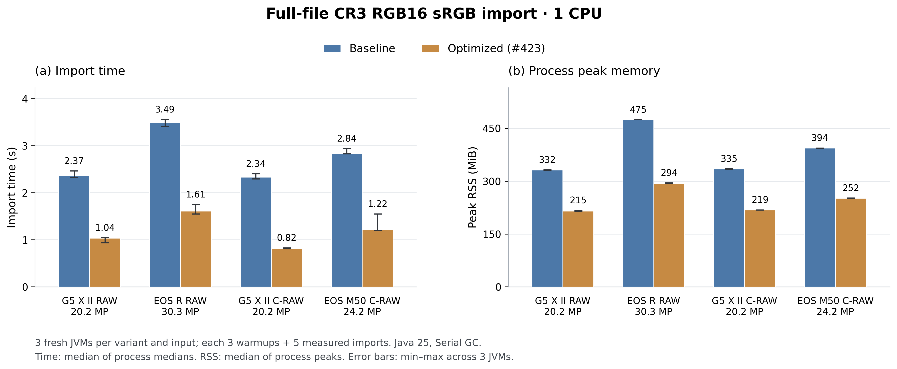

# CR3 QA and complete-import performance, 19 November 2026

**The RGB16 sRGB import now takes 48.5–64.8% less time and uses 33.6–38.2% less peak process memory in this four-file panel.**
The measured speedup is 1.94–2.84×, with 39.3–39.9% less measured Java allocation.
These gains belong to [runtime PR #423](https://github.com/carstenartur/Photographer/pull/423).
Ordinary RGB8 and native sensor controls do not establish a comparable general speedup.

The QA also corrected [stack preview fallback and advertised ImageIO destinations (#422)](https://github.com/carstenartur/Photographer/pull/422)
and found [an inclusive active-area endpoint defect (#424)](https://github.com/carstenartur/Photographer/pull/424).
The latter intentionally restores a row and column and changes some edge samples.
**All performance pairs and exact baseline/optimized hashes below use the frozen pre-crop-correction geometry of #423.**
They do not claim that #424 preserves the old cropped hashes.
The work targets 0.1.8-SNAPSHOT; no release is announced.

## RGB16 sRGB: full fresh-file imports

Java 25.0.5.1+2, Serial GC, 24–768 MiB heap, fixed CPU affinity and matching
available-processor budgets. Each cell is the median of three process medians;
each fresh process decodes three warmups and five measured images. Every import
opens and decodes a fresh file into owned output. The filesystem cache is warm;
there is no decoded-image cache. Time includes open, parse, decode, development
and cleanup. GC, plugin startup, statistics, checksums and serialization are outside it.
RSS is the median of three process-lifetime high-water marks, including warmups and VM overhead.

| Input | CPUs | Before ms | Optimized ms | Less time | Before RSS MiB | Optimized RSS MiB |
| --- | --- | --- | --- | --- | --- | --- |
| G5 X II RAW | 1 | 2371.25 | 1039.74 | 56.2% | 332.08 | 215.14 |
| G5 X II RAW | 4 | 928.15 | 454.57 | 51.0% | 329.59 | 217.37 |
| EOS R RAW | 1 | 3491.74 | 1614.82 | 53.8% | 475.21 | 293.74 |
| EOS R RAW | 4 | 1456.20 | 737.25 | 49.4% | 470.55 | 295.00 |
| G5 X II C-RAW | 1 | 2336.12 | 822.05 | 64.8% | 334.89 | 218.75 |
| G5 X II C-RAW | 4 | 942.00 | 413.92 | 56.1% | 338.75 | 224.84 |
| EOS M50 C-RAW | 1 | 2839.53 | 1222.80 | 56.9% | 394.46 | 252.28 |
| EOS M50 C-RAW | 4 | 1177.61 | 606.32 | 48.5% | 390.67 | 255.68 |

The figure's ranges show the three process medians or process peaks, not confidence intervals.
The [SVG](cr3-rgb16-performance.svg), [complete raw records](java25/results.json.gz),
[960 individual observations](java25/observations.csv) and [group summaries](java25/summary.json)
retain the full comparison, including less favorable runs.

### What changed

- The sRGB quantizer estimates a code with a small curve table and checks exact rounding boundaries. Inputs close to a boundary use the original power expression. It preserves the existing output codes, including special values and clipping.
- RGB16 development uses unsigned-short Bayer storage instead of an int array.
- Whole local mosaics with orientation 1 reuse exclusively owned Bayer storage as the green output bank. Worker-boundary rows are snapshotted before writes; borrowed arrays and other layouts keep separate storage.

For an equal-size W×H mosaic/output with P workers, sample and row-buffer payload
changes from `10WH + 24P(W+2)` bytes to `6WH + 24P(W+2) + 16(P−1)(W+2)`.
Metadata, codec state, VM and object overhead are additional. The lazy sRGB
tables retain about 640 KiB once initialized and contain no images.
Array payload, allocation counters, heap snapshots and RSS are different measures.

The fixed-heap Java 21 tests are also useful operational evidence: with a 160 MiB
heap cap for the G5 file and 224 MiB for EOS R, the baseline failed in both RGB16
transfers, while the measured optimized artifact completed with matching full
checksums. These are successful caps, not minimum-memory or total-RSS guarantees.
See [the eight outcomes](low-heap-results.json).

## Controls: native, default RGB8 and linear RGB16

Milliseconds, baseline → optimized. `default` calls actual `ImageIO.read(File)`.

| Input | CPUs | Native sensor | Default RGB8 | RGB16 linear |
| --- | --- | --- | --- | --- |
| G5 X II RAW | 1 | 303.86 → 343.22 | 619.75 → 565.35 | 967.09 → 996.18 |
| G5 X II RAW | 4 | 133.65 → 139.15 | 303.44 → 293.61 | 441.87 → 417.07 |
| EOS R RAW | 1 | 487.68 → 472.62 | 961.19 → 892.68 | 1556.20 → 1493.69 |
| EOS R RAW | 4 | 203.83 → 192.62 | 450.58 → 495.86 | 721.32 → 621.99 |
| G5 X II C-RAW | 1 | 216.28 → 214.88 | 456.35 → 469.96 | 947.69 → 806.26 |
| G5 X II C-RAW | 4 | 104.01 → 102.00 | 282.95 → 262.14 | 424.09 → 379.92 |
| EOS M50 C-RAW | 1 | 363.23 → 358.02 | 726.40 → 678.68 | 1285.02 → 1101.31 |
| EOS M50 C-RAW | 4 | 170.36 → 182.83 | 363.47 → 351.10 | 575.47 → 524.93 |

The large transfer-curve gain applies to sRGB RGB16. Linear RGB16 receives the
storage improvement but has smaller and less consistent time changes. RGB8 and
native sensor results vary in both directions; their production computation was
not the target of #423. For example, EOS R RGB8 with four CPUs has a slow third
fork in both variants; the raw fork values should accompany its median.

A separate RGB8 matrix/gamma-fusion candidate was **rejected** after 48 complete
processes: one-CPU C-RAW imports regressed by about 8–12%, while four-CPU gains
were small. Its [decision](rgb8-decision.md), [data](rgb8-experiment/summary.json)
and [isolated patch](rgb8-rejected.patch) remain available; that code was not merged.

## Comparison with LibRaw 0.21.4

This is a black-box public-API comparison with the pinned thread-safe binary,
not a dependency added to Photographer. Native outputs have equal full-sensor
dimensions and every sample agrees among Photographer, LibRaw and DNGLab.
The native C timer includes a consumer-owned copy before closing its decoder.

| Input | CPUs | Photographer ms | LibRaw ms | P RSS MiB | L RSS MiB |
| --- | --- | --- | --- | --- | --- |
| G5 X II RAW | 1 | 343.22 | 248.94 | 98.79 | 83.98 |
| G5 X II RAW | 4 | 139.15 | 117.34 | 100.09 | 83.91 |
| EOS R RAW | 1 | 472.62 | 371.53 | 118.91 | 123.81 |
| EOS R RAW | 4 | 192.62 | 176.42 | 119.58 | 123.80 |
| G5 X II C-RAW | 1 | 214.88 | 190.61 | 105.21 | 83.51 |
| G5 X II C-RAW | 4 | 102.00 | 100.62 | 108.25 | 83.79 |
| EOS M50 C-RAW | 1 | 358.02 | 331.51 | 114.33 | 101.15 |
| EOS M50 C-RAW | 4 | 182.83 | 152.47 | 113.88 | 101.44 |

The separate engine groups ran on the same host and CPU settings in different
windows. Their three-fork observations support this measured panel, not a
universal engine ranking. Native LibRaw remains a useful lower-overhead reference;
the optimized Java RGB16 stage is a different workload.

### Developed output geometry

| Input | Photographer #423 | LibRaw visible area |
| --- | --- | --- |
| G5 X II RAW | 5495 × 3667 | 5536 × 3692 |
| EOS R RAW | 6743 × 4499 | 6742 × 4498 |
| G5 X II C-RAW | 5495 × 3667 | 5536 × 3692 |
| EOS M50 C-RAW | 6023 × 4019 | 6024 × 4020 |

Both profiles use bilinear demosaicing, camera WB, sRGB primaries and an explicitly
chosen linear or sRGB transfer. LibRaw disables auto brightness and adaptive
maximum adjustment. Crop, black estimation, WB normalization, matrices and
numerical conventions still differ. **The following are complete rendering
workloads, not proofs of equivalent RGB pixels or equal image quality.**
P means Photographer #423; L means LibRaw. The [exact options and ownership](comparison-setup.md)
and [all stage times/RSS](libraw-color/summary.json) are retained.

### 1 CPU: developed color, milliseconds

| Input | P RGB8 | L RGB8 | P RGB16 linear | L RGB16 linear | P RGB16 sRGB | L RGB16 sRGB |
| --- | --- | --- | --- | --- | --- | --- |
| G5 X II RAW | 565.35 | 889.47 | 996.18 | 964.26 | 1039.74 | 904.34 |
| EOS R RAW | 892.68 | 1367.13 | 1493.69 | 1448.07 | 1614.82 | 1400.47 |
| G5 X II C-RAW | 469.96 | 856.94 | 806.26 | 902.14 | 822.05 | 890.82 |
| EOS M50 C-RAW | 678.68 | 1131.21 | 1101.31 | 1183.83 | 1222.80 | 1175.61 |

### 4 CPU: developed color, milliseconds

| Input | P RGB8 | L RGB8 | P RGB16 linear | L RGB16 linear | P RGB16 sRGB | L RGB16 sRGB |
| --- | --- | --- | --- | --- | --- | --- |
| G5 X II RAW | 293.61 | 688.00 | 417.07 | 706.74 | 454.57 | 707.67 |
| EOS R RAW | 495.86 | 1098.95 | 621.99 | 1090.96 | 737.25 | 1139.28 |
| G5 X II C-RAW | 262.14 | 687.07 | 379.92 | 674.48 | 413.92 | 667.97 |
| EOS M50 C-RAW | 351.10 | 833.99 | 524.93 | 837.89 | 606.32 | 859.77 |

### Developed color: peak RSS with four CPUs, MiB

| Input | P RGB8 | L RGB8 | P RGB16 linear | L RGB16 linear | P RGB16 sRGB | L RGB16 sRGB |
| --- | --- | --- | --- | --- | --- | --- |
| G5 X II RAW | 154.07 | 258.63 | 217.55 | 317.11 | 217.37 | 317.21 |
| EOS R RAW | 183.50 | 382.28 | 297.09 | 468.98 | 295.00 | 468.96 |
| G5 X II C-RAW | 159.02 | 258.48 | 223.34 | 317.01 | 224.84 | 316.99 |
| EOS M50 C-RAW | 170.29 | 306.85 | 250.15 | 376.13 | 255.68 | 376.29 |

These peaks include each engine's intermediate buffers and allocator/VM state,
with the different output dimensions above. Photographer's packed RGB8 output
uses four bytes per pixel while the C output uses three; both final RGB16
triplets use six. One-CPU values and every individual peak remain in the raw data.

## DNGLab 0.8.0: native CLI, including startup and PGM serialization

Each process performs a complete native import and writes PGM to `/dev/null`.
The Java and C clients do the same serialization; DNGLab uses `analyze --raw-pixel`.
These wall times include startup, buffering, writes and shutdown, and Java/C
sampled diagnostics. They are **not** the warmed API times above. `/dev/null`
removes persistent output I/O, not serialization work. Three fresh processes
per engine/input/CPU, rotating engine order; RSS is the median child peak.

| Input | CPUs | P wall ms | L wall ms | D wall ms | P RSS MiB | L RSS MiB | D RSS MiB |
| --- | --- | --- | --- | --- | --- | --- | --- |
| G5 X II RAW | 1 | 1022.90 | 278.77 | 932.36 | 98.76 | 83.44 | 171.05 |
| G5 X II RAW | 4 | 762.68 | 151.88 | 455.12 | 99.95 | 83.78 | 171.02 |
| EOS R RAW | 1 | 1252.10 | 395.81 | 1183.00 | 119.41 | 123.19 | 247.04 |
| EOS R RAW | 4 | 876.83 | 216.27 | 586.29 | 120.58 | 123.38 | 247.11 |
| G5 X II C-RAW | 1 | 1549.84 | 261.82 | 526.88 | 105.37 | 83.44 | 159.83 |
| G5 X II C-RAW | 4 | 942.95 | 118.61 | 372.81 | 104.44 | 83.70 | 153.04 |
| EOS M50 C-RAW | 1 | 1955.69 | 350.74 | 799.74 | 116.11 | 101.11 | 189.66 |
| EOS M50 C-RAW | 4 | 1011.67 | 174.91 | 493.35 | 113.63 | 101.33 | 181.41 |

The [72 process records](cli-native/records.json) preserve exact commands and
per-child wall/CPU/RSS. [Nonempty stderr](cli-native/nonempty-stderr.json)
retains reference-tool diagnostics. DNGLab's CLI exposes different rendering
options, so no settings-matched RGB16 API result is invented for it.

## Runtime and startup sensitivity

### Java 21.0.13 with G1, four CPUs

This smaller panel repeats the same three-fork/three-warmup/five-import protocol
on the G5 and EOS R files. It separates a relevant Java 21/G1 configuration from
the main Java 25/Serial measurements; it is not a full four-file JVM/GC factorial study.

| Input | Transfer | Before ms | Optimized ms | Before RSS MiB | Optimized RSS MiB |
| --- | --- | --- | --- | --- | --- |
| G5 X II RAW | linear | 468.78 | 409.73 | 256.45 | 180.65 |
| G5 X II RAW | sRGB | 972.47 | 472.55 | 257.04 | 182.66 |
| EOS R RAW | linear | 693.23 | 649.67 | 357.05 | 240.21 |
| EOS R RAW | sRGB | 1444.71 | 723.86 | 360.97 | 245.27 |

See [all 24 processes](java21-g1/results.json.gz) and [their observations](java21-g1/observations.csv).
This group uses the same frozen helper source compiled with `--release 21`,
shared by both variants. The main Java 25 group used a Java 25 helper build;
[both bindings](java21-helper-binding.json) are explicit. Initial Java 21
setup launches failed before decoding because of the helper's class-file
version, and contribute no timing observations. The production JARs were unchanged.

### First RGB16 sRGB import in a fresh JVM

No warmup and no explicit GC; Java 25/Serial, one import per process, three fresh
processes per variant/condition. The first API timer excludes plugin scanning;
the complete probe process includes JVM/plugin startup, statistics, sampled hash
and JSON output. Both use already-warm input files. The two boundaries must not
be presented as a measurement of cold disk speed.

| Input | CPUs | First API ms, before → optimized | Whole probe ms, before → optimized |
| --- | --- | --- | --- |
| G5 X II RAW | 1 | 2834.12 → 1560.55 | 3152.88 → 1788.73 |
| G5 X II RAW | 4 | 1442.57 → 924.57 | 1608.25 → 1098.51 |
| EOS R RAW | 1 | 4172.07 → 2144.10 | 4390.48 → 2374.99 |
| EOS R RAW | 4 | 2125.03 → 1196.19 | 2387.96 → 1339.55 |

The [24 raw startup records](first-import/records.json) also retain peak RSS.

## Correctness, review and remaining limits

The [QA summary](qa-summary.md) records reproduced defects, test scopes, hosted
CI, Java 21/Fiji coverage and the investigated CI performance incident. The
pixel-preserving optimization matches **56 full outputs from 14 inputs over
3,178,855,094 numeric samples**, across native, RGB8, RGB16 linear and RGB16 sRGB.
Complete canonical SHA-256 and full FNV, dimensions, channels and storage agree.
The independent native panel matches **98,606,416 photosites per engine** across
four files, including C-RAW, between Photographer, LibRaw and DNGLab.
Sampled timing hashes are not this correctness evidence.

The separate #424 crop correction was reproduced by 14 failing tests and
verified by 35 focused tests, then a successful 700-test module gate (one
optional skip). Its real-image histogram expectation was independently counted
from the unchanged registered TIFF reference, reproducing the old expectation
first. [Counts](crop-module-counts.json) · [Reference calculation](crop-reference-histogram.json).

ImageIO progress/cancellation remains an open, source-reviewed P2 finding; no
responsive mid-decode cancellation fix is claimed. Local full-product Docker
integration was unavailable, so hosted CI supplied that gate. Physical camera,
USB and user-machine UI workflows were not exercised by this automated QA.

## Reproduce and inspect

Use [the exact source/build recipe](comparison-setup.md) for the baseline and
#423 runtime, [public probe instructions](../../../scripts/benchmarks/README.md)
for new experiments, and [archived driver instructions](measurement-sources/README.md)
for the complete multi-fork matrices. Frozen helpers, input identities, commands,
tool versions and original artifact hashes are retained. The reusable public
tools have additional provider/output/argument guards added after the main
measurements; they are distinguished from the frozen measured sources.

This host was Linux 6.18.57 x86_64, glibc 2.41, Xeon Platinum 8573C with nine
visible CPUs. Runs used affinity 0 or 0–3, matching Java/OpenMP/Rayon budgets,
and no simultaneous local build, test, profiling or decoder workload. The
[environment snapshot](environment.json) and per-run manifests record details.
Three forks and four inputs do not establish universal bounds, and runtime,
collector, camera, dimensions and CPU budget can change the outcome.

Raw JSON is compressed losslessly where large; CSV retains every measured
observation. [The evidence manifest](evidence-manifest.json) hashes the complete
publication. No raw images, decoder binaries or third-party implementation
source are included in this evidence directory.

AI assistance: ChatGPT assisted investigation, profiling, implementation,
verification, independent agent review and preparation of this evidence.
