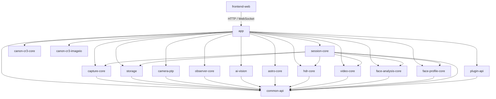
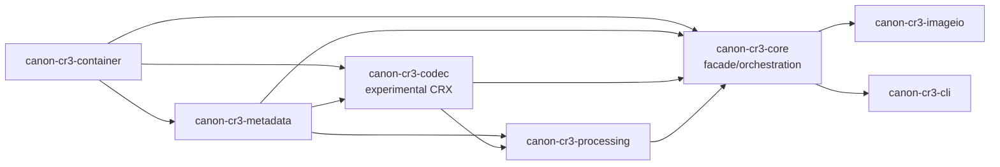

# Architecture

This chapter describes the current architecture of Photographer. It is derived from the root and module POMs, production contracts and executable tests on `main`; planning documents and historical inventories are supporting context only.

## Architectural style

Photographer is a **modular monolith**:

- one Spring Boot application in `app` is the deployable backend;
- the React/Vite application in `frontend-web` is copied into the Spring Boot artifact for production;
- reusable workflow, camera, storage, imaging and AI contracts live in Maven library modules;
- PostgreSQL is the production database, while H2 is the default local in-memory database;
- Canon camera access is provided through CCAPI over HTTP/WLAN and through a clean-room PTP/USB stack;
- the CR3 stack is a separate group of public runtime libraries plus internal test and research modules.

The broad dependency direction is:

The diagram is intentionally conceptual. Exact dependencies are defined by the current module POMs; [`modules.md`](modules.md) classifies every reactor module.

## Application composition

`app` is the only broad Spring composition module. It owns:

- Spring Boot startup and configuration binding;
- REST controllers, OpenAPI exposure and WebSocket progress reporting;
- Spring Security and administrator-password validation;
- JPA entities/repositories and Hibernate Search integration that have not yet been extracted from the application module;
- camera profile resolution, CCAPI HTTP transport, Digest authentication and backend lifecycle;
- orchestration adapters that connect domain modules to persistence and camera transports;
- production plugin discovery and provider registries;
- packaging of the compiled frontend.

Library modules should not acquire Spring dependencies merely to make composition easier. Spring-specific wiring belongs in `app`; transport-independent algorithms and contracts belong in the smallest suitable library module.

## Camera architecture

Photographer currently has two camera contract levels.

### Legacy operational contract

`common-api` defines `CameraBackend`, the compact contract used by existing controllers, workflow services and external `CameraBackendPlugin` implementations. Production CCAPI backends and the PTP backend implement or adapt to this surface.

This contract remains supported. It is not scheduled for immediate removal because it is the established plugin and workflow boundary.

### Generic transport-independent contract

`common-api` also defines `GenericCameraBackend` and related packages for device information, capabilities, media, policy, events and connection-scoped operations. The intent is to let upper layers express camera workflows without CCAPI endpoint keys or PTP opcodes.

The implementation is **incremental rather than complete**:

- `CcapiCameraBackend` adapts the legacy backend and currently exposes device information, capability mapping, live view, capture and battery/storage status;
- CCAPI media listing, transfer and deletion remain explicitly unimplemented in that adapter;
- `UsbCameraBackend` is a capability-safe skeleton and currently advertises only device information;
- the mature PTP implementation remains in `camera-ptp`, while the generic USB adapter still needs a production bridge to it.

Upper layers must therefore consult the reported capability set and must not infer support from transport type alone. A stubbed method is not a supported feature.

### CCAPI production boundary

Canon CCAPI production code is contained in the camera backend and transport packages inside `app`. Important boundaries are documented separately:

- [transport ownership](../ccapi-transport-boundary.md);
- [session ownership, shutdown cleanup and leases](../ccapi-session-ownership.md);
- [live-view modes and lifecycle](../ccapi-live-view.md);
- [Digest authentication and credential handling](../ccapi-authentication.md).

The camera-advertised endpoint catalogue is authoritative for endpoint path, API version and HTTP-method availability. Code must not construct an endpoint merely because another camera model exposes it. Canon specifies that supported paths and methods vary by model and firmware, so the production catalogue preserves exact advertised metadata. The private Canon reference manuals are not redistributed in the repository.

Only one logical workflow may own a physical CCAPI camera at a time. Session leases are independent from HTTP connection reuse, Digest state and backend caching.

## Workflow and domain modules

`capture-core` provides small capture abstractions and depends only on `common-api` plus logging.

`session-core` composes longer workflows, including HDR timelapse and face-orbit sessions. It depends on capture, storage and the specialized image/video/face contracts it orchestrates. It does not own Spring scheduling or HTTP concerns.

`common-api` owns the provider-neutral `VisionProvider`, context/result/capability records and shared `BoundingBox` compatibility type. `plugin-api` exposes external provider SPIs, `observer-core` owns observer-domain ports and event semantics, and `ai-vision` contains concrete Gemini/mock provider implementations. All three depend downward on the neutral contracts rather than on each other.

`astro-core`, `hdr-core`, `video-core`, `face-analysis-core` and `face-profile-core` contain focused, framework-light algorithms or ports. Mock implementations are intentional test/development seams and are not evidence of production integration with every external processor.

## Persistence

There are two persistence layers with different scopes:

- `storage` defines session/file-storage abstractions and a file-based implementation;
- `app` currently owns relational entities, Spring Data repositories and Hibernate Search/Lucene composition.

PostgreSQL is used by the Docker profile. H2 local-heap persistence and search are available in the default profile for development and tests. Testcontainers provides PostgreSQL for integration tests.

A future extraction of relational entities and repositories from `app` may improve module boundaries, but it is not current architecture and must not be documented as completed work.

## CR3 architecture

The CR3/CRX code is split into public runtime artifacts under `io.github.carstenartur`:

The responsibilities are:

- `canon-cr3-container`: ISO BMFF / Canon CR3 parsing and embedded JPEG access;
- `canon-cr3-metadata`: EXIF, MakerNote, CTMD and sensor/active-area metadata;
- `canon-cr3-codec`: experimental clean-room CRX RAW decoding and linear Bayer model;
- `canon-cr3-processing`: pedestal, crop, demosaic, white-balance and color processing;
- `canon-cr3-core`: compatibility facade and decode orchestration;
- `canon-cr3-imageio`: Java ImageIO SPI and reader;
- `canon-cr3-cli`: command-line inspection and experimental decode tooling.

The following modules are not normal supported runtime dependencies:

- `canon-cr3-reference-testkit` — shared reference loading, metrics and deterministic evidence output;
- `canon-cr3-research` — research-only experiments and report generators;
- `canon-cr3-maven-smoke` — isolated consumer validation;
- benchmark modules — JMH measurement infrastructure.

Stable container, metadata and ImageIO behavior must not be weakened by the experimental status of CRX RAW reconstruction. Conversely, a usable embedded preview must not be presented as proof that sensor RAW decoding is correct.

## Frontend

`frontend-web` is a React/Vite single-page application. During local frontend development it runs through Vite; production packaging copies `frontend-web/dist` into the Spring Boot static-resource directory.

The frontend may use public REST/capability data, but must not branch on private CCAPI path keys, PTP opcodes or camera-model guesses. Controls should be based on server-reported support and availability.

## Plugins

`plugin-api` exposes ServiceLoader extension points for analysis, camera backends and AI vision providers. Plugin JARs are discovered from the configured plugins directory.

The plugin SPI is framework-independent and depends only on neutral contracts in `common-api`. External vision-provider plugins continue to implement the stable `com.photographer.focusstack.ai.VisionProvider` FQN, while concrete built-in provider implementations remain outside the SPI in `ai-vision`.

## Concurrency, ownership and shutdown

Long-running workflows use bounded executors and explicit ownership. Camera session leases prevent two workflows from changing the same physical CCAPI camera concurrently. Application shutdown stops admission, cancels or drains owned work within configured bounds, releases leases and then closes backend/transport resources.

A daemon thread or process exit is not an acceptable lifecycle strategy for production components. New executors, sockets and stream readers need an owner, a bounded cancellation path and an executable shutdown test.

## Evidence boundaries

Architecture claims follow these rules:

- POMs define module membership and dependency direction;
- production code and tests define implemented behavior;
- capability snapshots define what a specific camera/firmware advertised;
- real-camera claims require model, firmware and connection-mode evidence;
- generated research reports are evidence snapshots, not timeless architecture;
- issues and TODO comments describe unfinished work, not current capability.

See [Modules](modules.md), [Testing](testing.md) and the [documentation map](documentation-map.md) for the corresponding ownership and verification rules.
