# Repository Inventory & Architecture Baseline

_Generated in-repo inventory run on 2026-06-17 18:05 UTC._

## Scope and method

- This document inventories the current repository state only.
- Sources are repository files and command output only; missing data is marked explicitly.
- No redesign proposal, module move, or architecture recommendation is included.

## Section 1: Maven Modules

- Root `pom.xml` default reactor modules: **18**
- Additional modules in profile `benchmarks`: **2**
- Total Maven modules declared in repository: **20**

| Module | artifactId | packaging | Direct internal dependencies | Public purpose (declared text) | Current maturity (repository evidence) |
|---|---|---|---|---|---|
| `ai-vision` | `ai-vision` | `jar` | `common-api`, `observer-core` | AI vision abstraction layer: VisionProvider interface with Gemini and mock implementations. Pure Java library with no Spring dependency. | Default reactor module; prod classes=14, unit tests=7, ITs=0, README=true, ARCH=true |
| `app` | `app` | `jar` | `ai-vision`, `astro-core`, `camera-ptp`, `canon-cr3-core`, `canon-cr3-imageio`, `capture-core`, `common-api`, `face-analysis-core`, `face-profile-core`, `hdr-core`, `observer-core`, `plugin-api`, `session-core`, `storage`, `video-core` | Unified Spring Boot application combining camera and analysis services | Default reactor module; prod classes=91, unit tests=29, ITs=27, README=true, ARCH=true |
| `astro-core` | `astro-core` | `jar` | `common-api` | Star detection, frame registration, and stacking for astrophotography | Default reactor module; prod classes=8, unit tests=6, ITs=0, README=true, ARCH=true |
| `astro-core-benchmark` | `astro-core-benchmark` | `jar` | `astro-core`, `canon-cr3-core` | JMH benchmarks for astro and pixel-processing hot paths. | benchmarks profile module; prod classes=3, unit tests=0, ITs=0, README=false, ARCH=false |
| `camera-ptp` | `camera-ptp` | `jar` | `common-api` | Clean-room PTP (ISO 15740) implementation with Canon vendor extensions.
        Standalone module — usable independently of the Focus Stack app. | Default reactor module; prod classes=33, unit tests=11, ITs=3, README=true, ARCH=true |
| `canon-cr3-benchmark` | `canon-cr3-benchmark` | `jar` | `canon-cr3-core` | JMH benchmarks for the Canon CR3 parser, metadata reader, preview extractor, and CRX RAW decoder.
        Mirrors the carstenartur/sandbox/sandbox-benchmarks pattern: shaded uber-jar with org.openjdk.jmh.Main as
        Main-Class, results consumed by benchmark-action/github-action-benchmark in the benchmark.yml workflow. | benchmarks profile module; prod classes=7, unit tests=0, ITs=0, README=true, ARCH=false |
| `canon-cr3-cli` | `canon-cr3-cli` | `jar` | `canon-cr3-core` | Command-line debug tool for Canon CR3 files | Default reactor module; prod classes=1, unit tests=3, ITs=0, README=true, ARCH=true |
| `canon-cr3-core` | `canon-cr3-core` | `jar` | — | Canon CR3 file parser, metadata extraction, preview extraction, and RAW decoding | Default reactor module; prod classes=52, unit tests=38, ITs=0, README=true, ARCH=true |
| `canon-cr3-imageio` | `canon-cr3-imageio` | `jar` | `canon-cr3-core` | javax.imageio adapter for Canon CR3 files (ImageReaderSpi + ImageReader) | Default reactor module; prod classes=4, unit tests=8, ITs=52, README=true, ARCH=true |
| `capture-core` | `capture-core` | `jar` | `common-api` | Core capture abstractions for bracket and sequence capture | Default reactor module; prod classes=2, unit tests=2, ITs=0, README=true, ARCH=true |
| `common-api` | `common-api` | `jar` | — | Shared interfaces and models for Focus Stack | Default reactor module; prod classes=66, unit tests=7, ITs=0, README=true, ARCH=true |
| `face-analysis-core` | `face-analysis-core` | `jar` | `common-api` | Face analysis engine interface with mock adapter | Default reactor module; prod classes=2, unit tests=1, ITs=0, README=true, ARCH=true |
| `face-profile-core` | `face-profile-core` | `jar` | `common-api`, `face-analysis-core` | 3D face profile generation interface with mock adapter | Default reactor module; prod classes=2, unit tests=1, ITs=0, README=true, ARCH=true |
| `frontend-web` | `frontend-web` | `pom` | — | React frontend built with Vite and packaged via frontend-maven-plugin | Default reactor module; prod classes=0, unit tests=0, ITs=0, README=true, ARCH=true |
| `hdr-core` | `hdr-core` | `jar` | `common-api` | HDR processing and tonemapping interfaces with mock adapter | Default reactor module; prod classes=4, unit tests=2, ITs=0, README=true, ARCH=true |
| `observer-core` | `observer-core` | `jar` | `common-api` | Wildlife Observer core logic: event model, state machine, rules engine, scene monitor, capture orchestrator, and pipeline. Pure Java library with no Spring dependency. | Default reactor module; prod classes=30, unit tests=16, ITs=0, README=true, ARCH=true |
| `plugin-api` | `plugin-api` | `jar` | `ai-vision`, `common-api` | Stable plugin SPI for Focus Stack — no Spring dependencies | Default reactor module; prod classes=7, unit tests=1, ITs=0, README=true, ARCH=true |
| `session-core` | `session-core` | `jar` | `capture-core`, `common-api`, `face-analysis-core`, `face-profile-core`, `hdr-core`, `storage`, `video-core` | Session orchestration for HDR Timelapse and Face Orbit | Default reactor module; prod classes=5, unit tests=2, ITs=0, README=true, ARCH=true |
| `storage` | `storage` | `jar` | `common-api` | Session storage abstraction and file-based implementation | Default reactor module; prod classes=6, unit tests=3, ITs=0, README=true, ARCH=true |
| `video-core` | `video-core` | `jar` | `common-api` | Video encoding interface with mock adapter | Default reactor module; prod classes=2, unit tests=1, ITs=0, README=true, ARCH=true |

## Section 2: Packages

Top-level package roots were counted from `src/main` and `src/test` Java package declarations.

| Top-level package | Purpose evidence | Production or research | Approximate size (classes) | Should remain or be split |
|---|---|---|---|---|
| `com.photographer.focusstack` | Package name and module path only (no separate package-level spec file found) | production package (with tests where present) | main=1, test=0, total=1 | No explicit split marker found in repository documentation; current state is one package root entry |
| `com.photographer.focusstack.ai` | Package name and module path only (no separate package-level spec file found) | production package (with tests where present) | main=15, test=8, total=23 | No explicit split marker found in repository documentation; current state is one package root entry |
| `com.photographer.focusstack.analysis` | Package name and module path only (no separate package-level spec file found) | production package (with tests where present) | main=19, test=12, total=31 | No explicit split marker found in repository documentation; current state is one package root entry |
| `com.photographer.focusstack.app` | Package name and module path only (no separate package-level spec file found) | production package (with tests where present) | main=19, test=4, total=23 | No explicit split marker found in repository documentation; current state is one package root entry |
| `com.photographer.focusstack.astro` | Package name and module path only (no separate package-level spec file found) | production package (with tests where present) | main=13, test=8, total=21 | No explicit split marker found in repository documentation; current state is one package root entry |
| `com.photographer.focusstack.benchmark` | Package name and module path only (no separate package-level spec file found) | research/benchmark (JMH profile modules) | main=3, test=0, total=3 | No explicit split marker found in repository documentation; current state is one package root entry |
| `com.photographer.focusstack.camera` | Package name and module path only (no separate package-level spec file found) | production package (with tests where present) | main=29, test=34, total=63 | No explicit split marker found in repository documentation; current state is one package root entry |
| `com.photographer.focusstack.capture` | Package name and module path only (no separate package-level spec file found) | production package (with tests where present) | main=2, test=2, total=4 | No explicit split marker found in repository documentation; current state is one package root entry |
| `com.photographer.focusstack.common` | Package name and module path only (no separate package-level spec file found) | production package (with tests where present) | main=66, test=7, total=73 | No explicit split marker found in repository documentation; current state is one package root entry |
| `com.photographer.focusstack.cr3` | Package name and module path only (no separate package-level spec file found) | production + research (research tests under `canon-cr3-imageio/src/test/java/.../research`) | main=64, test=108, total=172 | No explicit split marker found in repository documentation; current state is one package root entry |
| `com.photographer.focusstack.face` | Package name and module path only (no separate package-level spec file found) | production package (with tests where present) | main=4, test=2, total=6 | No explicit split marker found in repository documentation; current state is one package root entry |
| `com.photographer.focusstack.generic` | Package name and module path only (no separate package-level spec file found) | production package (with tests where present) | main=5, test=1, total=6 | No explicit split marker found in repository documentation; current state is one package root entry |
| `com.photographer.focusstack.hdr` | Package name and module path only (no separate package-level spec file found) | production package (with tests where present) | main=4, test=2, total=6 | No explicit split marker found in repository documentation; current state is one package root entry |
| `com.photographer.focusstack.observer` | Package name and module path only (no separate package-level spec file found) | production package (with tests where present) | main=42, test=20, total=62 | No explicit split marker found in repository documentation; current state is one package root entry |
| `com.photographer.focusstack.plugin` | Package name and module path only (no separate package-level spec file found) | production package (with tests where present) | main=7, test=1, total=8 | No explicit split marker found in repository documentation; current state is one package root entry |
| `com.photographer.focusstack.session` | Package name and module path only (no separate package-level spec file found) | production package (with tests where present) | main=5, test=2, total=7 | No explicit split marker found in repository documentation; current state is one package root entry |
| `com.photographer.focusstack.storage` | Package name and module path only (no separate package-level spec file found) | production package (with tests where present) | main=6, test=3, total=9 | No explicit split marker found in repository documentation; current state is one package root entry |
| `com.photographer.focusstack.video` | Package name and module path only (no separate package-level spec file found) | production package (with tests where present) | main=2, test=1, total=3 | No explicit split marker found in repository documentation; current state is one package root entry |
| `com.photographer.ptp.backend` | Package name and module path only (no separate package-level spec file found) | production package (with tests where present) | main=2, test=0, total=2 | No explicit split marker found in repository documentation; current state is one package root entry |
| `com.photographer.ptp.canon` | Package name and module path only (no separate package-level spec file found) | production package (with tests where present) | main=6, test=6, total=12 | No explicit split marker found in repository documentation; current state is one package root entry |
| `com.photographer.ptp.core` | Package name and module path only (no separate package-level spec file found) | production package (with tests where present) | main=11, test=3, total=14 | No explicit split marker found in repository documentation; current state is one package root entry |
| `com.photographer.ptp.integration` | Package name and module path only (no separate package-level spec file found) | test/integration support package | main=0, test=3, total=3 | No explicit split marker found in repository documentation; current state is one package root entry |
| `com.photographer.ptp.mock` | Package name and module path only (no separate package-level spec file found) | test/integration support package | main=0, test=2, total=2 | No explicit split marker found in repository documentation; current state is one package root entry |
| `com.photographer.ptp.session` | Package name and module path only (no separate package-level spec file found) | production package (with tests where present) | main=7, test=1, total=8 | No explicit split marker found in repository documentation; current state is one package root entry |
| `com.photographer.ptp.usb` | Package name and module path only (no separate package-level spec file found) | production package (with tests where present) | main=4, test=0, total=4 | No explicit split marker found in repository documentation; current state is one package root entry |
| `com.photographer.ptp.wpd` | Package name and module path only (no separate package-level spec file found) | production package (with tests where present) | main=3, test=0, total=3 | No explicit split marker found in repository documentation; current state is one package root entry |

## Section 3: Public APIs

| API surface | Module | Artifact | Intended consumer | Stability evidence | Current documentation |
|---|---|---|---|---|---|
| ImageIO SPI | `canon-cr3-imageio` | `CanonCr3ImageReaderSpi` | Java ImageIO runtime via SPI lookup | Documented in module README key types and usage | `canon-cr3-imageio/README.md, canon-cr3-imageio/src/main/java/com/photographer/focusstack/cr3/imageio/CanonCr3ImageReaderSpi.java` |
| ImageIO Reader | `canon-cr3-imageio` | `CanonCr3ImageReader` | Java callers using ImageReader | Documented in module README key types and usage | `canon-cr3-imageio/README.md, canon-cr3-imageio/src/main/java/com/photographer/focusstack/cr3/imageio/CanonCr3ImageReader.java` |
| ImageIO Read Param | `canon-cr3-imageio` | `CanonCr3ImageReadParam` | Java callers configuring decode options | Documented in module README usage section | `canon-cr3-imageio/README.md, canon-cr3-imageio/src/main/java/com/photographer/focusstack/cr3/imageio/CanonCr3ImageReadParam.java` |
| ImageIO Metadata | `canon-cr3-imageio` | `Cr3ImageMetadata` | Java callers reading IIOMetadata output | Class exists; not listed in README key-type table | `canon-cr3-imageio/src/main/java/com/photographer/focusstack/cr3/imageio/Cr3ImageMetadata.java` |
| CLI entrypoint | `canon-cr3-cli` | `Cr3CliApp` | Terminal users | Documented in module README command table | `canon-cr3-cli/README.md, canon-cr3-cli/src/main/java/com/photographer/focusstack/cr3/cli/Cr3CliApp.java` |
| Metadata model | `canon-cr3-core` | `Cr3Metadata` | Decoder and CLI metadata consumers | Documented in core README metadata section | `canon-cr3-core/README.md, canon-cr3-core/src/main/java/com/photographer/focusstack/cr3/metadata/Cr3Metadata.java` |
| Metadata reader | `canon-cr3-core` | `Cr3MetadataReader` | Internal/parser consumers and CLI metadata dump | Class exists and is referenced by CLI README command table | `canon-cr3-core/src/main/java/com/photographer/focusstack/cr3/metadata/Cr3MetadataReader.java, canon-cr3-cli/README.md` |
| Decoder API | `canon-cr3-core` | `Cr3Decoder / Cr3DecodeOptions` | Java decoding callers and CLI decode commands | Documented in core README decoder section | `canon-cr3-core/README.md, canon-cr3-core/src/main/java/com/photographer/focusstack/cr3/decode/Cr3Decoder.java` |
| Plugin SPI | `plugin-api` | `AnalysisPlugin` | External plugin implementers | Documented in root README plugin section | `plugin-api/src/main/java/com/photographer/focusstack/plugin/AnalysisPlugin.java, README.md` |
| Plugin SPI | `plugin-api` | `CameraBackendPlugin` | External plugin implementers | Documented in root README plugin section | `plugin-api/src/main/java/com/photographer/focusstack/plugin/CameraBackendPlugin.java, README.md` |
| Plugin SPI | `plugin-api` | `VisionProviderPlugin` | External plugin implementers | Documented in root README plugin section | `plugin-api/src/main/java/com/photographer/focusstack/plugin/VisionProviderPlugin.java, README.md` |
| REST API | `app` | `12 @RestController classes under /api/*` | HTTP clients | Documented in docs/api.md and OpenAPI tags in controller classes | `docs/api.md, app/src/main/java/com/photographer/focusstack/**/controller/*.java` |
| Document API | `repository-wide` | `No Java class/interface with name containing "Document" in src/main/java` | n/a | No dedicated Document API artifact found by code search | `rg pattern "Document" on **/src/main/java/**/*.java` |

### CLI command inventory (from `Cr3CliApp` command switch)

| Command | Purpose source | Stable | Research |
|---|---|---|---|
| `boxes` | `canon-cr3-cli/README.md` + `Cr3CliApp` switch-case | yes (listed in `canon-cr3-cli/README.md` command table) | no |
| `decode` | `canon-cr3-cli/README.md` + `Cr3CliApp` switch-case | yes (listed in `canon-cr3-cli/README.md` command table) | no |
| `decode-compare` | `canon-cr3-cli/README.md` + `Cr3CliApp` switch-case | yes (listed in `canon-cr3-cli/README.md` command table) | yes |
| `dump-box-tree` | `canon-cr3-cli/README.md` + `Cr3CliApp` switch-case | yes (listed in `canon-cr3-cli/README.md` command table) | no |
| `dump-crop` | `canon-cr3-cli/README.md` + `Cr3CliApp` switch-case | yes (listed in `canon-cr3-cli/README.md` command table) | no |
| `dump-metadata` | `canon-cr3-cli/README.md` + `Cr3CliApp` switch-case | yes (listed in `canon-cr3-cli/README.md` command table) | no |
| `dump-raw-layout` | `canon-cr3-cli/README.md` + `Cr3CliApp` switch-case | yes (listed in `canon-cr3-cli/README.md` command table) | no |
| `dump-subband` | `canon-cr3-cli/README.md` + `Cr3CliApp` switch-case | yes (listed in `canon-cr3-cli/README.md` command table) | yes |
| `info` | `canon-cr3-cli/README.md` + `Cr3CliApp` switch-case | yes (listed in `canon-cr3-cli/README.md` command table) | no |
| `list-subbands` | `canon-cr3-cli/README.md` + `Cr3CliApp` switch-case | yes (listed in `canon-cr3-cli/README.md` command table) | yes |
| `pedestal-report` | `canon-cr3-cli/README.md` + `Cr3CliApp` switch-case | yes (listed in `canon-cr3-cli/README.md` command table) | yes |
| `preview` | `canon-cr3-cli/README.md` + `Cr3CliApp` switch-case | yes (listed in `canon-cr3-cli/README.md` command table) | no |
| `subband-stats` | `canon-cr3-cli/README.md` + `Cr3CliApp` switch-case | yes (listed in `canon-cr3-cli/README.md` command table) | yes |
| `thumb` | `canon-cr3-cli/README.md` + `Cr3CliApp` switch-case | yes (listed in `canon-cr3-cli/README.md` command table) | no |

## Section 4: Research

- Classes in `.../research/...`: **60** (main=3, test=57)
- Complete list is in **Appendix D**.

| Research | Class | Report | Current Status |
|---|---|---|---|
| CR3 research component | `SubbandBatchStatistics` | `-` | main component; source: `canon-cr3-core/src/main/java/com/photographer/focusstack/cr3/research/SubbandBatchStatistics.java` |
| CR3 research component | `SubbandHypothesisHarness` | `-` | main component; source: `canon-cr3-core/src/main/java/com/photographer/focusstack/cr3/research/SubbandHypothesisHarness.java` |
| CR3 research component | `SubbandStatistics` | `-` | main component; source: `canon-cr3-core/src/main/java/com/photographer/focusstack/cr3/research/SubbandStatistics.java` |
| CR3 research component | `SubbandHypothesisHarnessTest` | `-` | test component; source: `canon-cr3-core/src/test/java/com/photographer/focusstack/cr3/research/SubbandHypothesisHarnessTest.java` |
| CR3 research component | `SubbandStatisticsTest` | `-` | test component; source: `canon-cr3-core/src/test/java/com/photographer/focusstack/cr3/research/SubbandStatisticsTest.java` |
| CR3 research component | `BitstreamAlignmentDeepAuditIT` | `-` | test component; source: `canon-cr3-imageio/src/test/java/com/photographer/focusstack/cr3/research/BitstreamAlignmentDeepAuditIT.java` |
| CR3 research component | `BitstreamPlaneAlignmentIT` | `-` | test component; source: `canon-cr3-imageio/src/test/java/com/photographer/focusstack/cr3/research/BitstreamPlaneAlignmentIT.java` |
| CR3 research component | `BurstFrameStabilityIT` | `-` | test component; source: `canon-cr3-imageio/src/test/java/com/photographer/focusstack/cr3/research/BurstFrameStabilityIT.java` |
| CR3 research component | `CleanroomFixtureSubbandStatisticsIT` | `-` | test component; source: `canon-cr3-imageio/src/test/java/com/photographer/focusstack/cr3/research/CleanroomFixtureSubbandStatisticsIT.java` |
| CR3 research component | `Cr3ReferenceComparisonIT` | `-` | test component; source: `canon-cr3-imageio/src/test/java/com/photographer/focusstack/cr3/research/Cr3ReferenceComparisonIT.java` |
| CR3 research component | `CrawLossyBringUpIT` | `-` | test component; source: `canon-cr3-imageio/src/test/java/com/photographer/focusstack/cr3/research/CrawLossyBringUpIT.java` |
| CR3 research component | `CrossFileStabilityIT` | `-` | test component; source: `canon-cr3-imageio/src/test/java/com/photographer/focusstack/cr3/research/CrossFileStabilityIT.java` |
| CR3 research component | `CrxBitsPerPixelIT` | `-` | test component; source: `canon-cr3-imageio/src/test/java/com/photographer/focusstack/cr3/research/CrxBitsPerPixelIT.java` |
| CR3 research component | `CrxCandidateDecoders` | `-` | test component; source: `canon-cr3-imageio/src/test/java/com/photographer/focusstack/cr3/research/CrxCandidateDecoders.java` |
| CR3 research component | `CrxHypothesisSweepIT` | `-` | test component; source: `canon-cr3-imageio/src/test/java/com/photographer/focusstack/cr3/research/CrxHypothesisSweepIT.java` |
| CR3 research component | `CrxKUpdateRuleBakeoffIT` | `-` | test component; source: `canon-cr3-imageio/src/test/java/com/photographer/focusstack/cr3/research/CrxKUpdateRuleBakeoffIT.java` |
| CR3 research component | `CrxNormativeLosslessCandidate` | `-` | test component; source: `canon-cr3-imageio/src/test/java/com/photographer/focusstack/cr3/research/CrxNormativeLosslessCandidate.java` |
| CR3 research component | `CrxNormativeLosslessCandidateIT` | `target/** report/TSV artifacts (runtime artifact)` | test component; source: `canon-cr3-imageio/src/test/java/com/photographer/focusstack/cr3/research/CrxNormativeLosslessCandidateIT.java` |
| CR3 research component | `CrxPatentIdwtValidationIT` | `-` | test component; source: `canon-cr3-imageio/src/test/java/com/photographer/focusstack/cr3/research/CrxPatentIdwtValidationIT.java` |
| CR3 research component | `CrxPlaneFollowupExtendedIT` | `-` | test component; source: `canon-cr3-imageio/src/test/java/com/photographer/focusstack/cr3/research/CrxPlaneFollowupExtendedIT.java` |
| … | … | … | Full inventory continues in Appendix D |

## Section 5: Reports

| Filename | Purpose evidence | Generated manually or automatically | Superseded? | Still relevant? |
|---|---|---|---|---|
| `canon-cr3-imageio/src/test/resources/samples/reference-manifest.json` | filename/path and content title | automatic/test-generated target or docs artifact | not marked as superseded in filename | present in repository HEAD |
| `canon-cr3-imageio/src/test/resources/samples/research/manifest.tsv` | filename/path and content title | automatic/test-generated target or docs artifact | not marked as superseded in filename | present in repository HEAD |
| `docs/cr3-fixture-audit.md` | filename/path and content title | manual document (no generator declared in file path) | not marked as superseded in filename | present in repository HEAD |
| `docs/cr3-reference-inventory.md` | filename/path and content title | manual document (no generator declared in file path) | not marked as superseded in filename | present in repository HEAD |
| `docs/cr3-reference-manifest.md` | filename/path and content title | automatic/test-generated target or docs artifact | not marked as superseded in filename | present in repository HEAD |
| `docs/cr3-results-index.md` | filename/path and content title | manual document (no generator declared in file path) | no explicit superseded marker | present in repository HEAD |
| `docs/cr3-results/2026-06-14-B1-predictor-state-isolation.md` | filename/path and content title | manual document (no generator declared in file path) | not marked as superseded in filename | present in repository HEAD |
| `docs/cr3-results/2026-06-14-predictor-evidence-matrix.md` | filename/path and content title | manual document (no generator declared in file path) | not marked as superseded in filename | present in repository HEAD |
| `docs/cr3-results/2026-06-16-pedestal-hypothesis-validation.md` | filename/path and content title | automatic origin in IT (`PedestalHypothesisValidationIT`) with committed dated filename | not marked as superseded in filename | present in repository HEAD |
| `docs/cr3-results/reference-comparison.md` | filename/path and content title | automatic (written by `Cr3ReferenceComparisonIT`) | not marked as superseded in filename | present in repository HEAD |

## Section 6: Documentation

- Markdown files (`*.md`/`*.markdown`) found: **67**
- Complete markdown inventory table is provided in **Appendix A**.

## Section 7: Samples

- No repository-root directory `/samples` exists in this clone.
- Sample fixtures are committed under `canon-cr3-imageio/src/test/resources/samples` and `.../samples/research`.

| Category | Evidence | Count |
|---|---|---|
| committed fixtures (`*.cr3`) | `canon-cr3-imageio/src/test/resources/samples/**/*.cr3` | 13 |
| reference TIFFs (`*.reference.tiff` + `sample.tiff`) | same directory tree | 12 |
| previews/references (`*.reference.png`) | same directory tree | 11 |
| embedded JPEG previews/thumbnails (`*.jpg`) | same directory tree | 2 |
| manifest files (`reference-manifest.json`, `manifest.tsv`) | same directory tree | 2 |
| generated files policy | `samples/research/README.md` describes capture workflow and appended manifest behavior | n/a |

## Section 8: CLI

| Command | Purpose | Stable | Research |
|---|---|---|---|
| `boxes` | Defined in `Cr3CliApp` switch and documented in `canon-cr3-cli/README.md` | yes (command exists in main branch) | no |
| `decode` | Defined in `Cr3CliApp` switch and documented in `canon-cr3-cli/README.md` | yes (command exists in main branch) | no |
| `decode-compare` | Defined in `Cr3CliApp` switch and documented in `canon-cr3-cli/README.md` | yes (command exists in main branch) | yes |
| `dump-box-tree` | Defined in `Cr3CliApp` switch and documented in `canon-cr3-cli/README.md` | yes (command exists in main branch) | no |
| `dump-crop` | Defined in `Cr3CliApp` switch and documented in `canon-cr3-cli/README.md` | yes (command exists in main branch) | no |
| `dump-metadata` | Defined in `Cr3CliApp` switch and documented in `canon-cr3-cli/README.md` | yes (command exists in main branch) | no |
| `dump-raw-layout` | Defined in `Cr3CliApp` switch and documented in `canon-cr3-cli/README.md` | yes (command exists in main branch) | no |
| `dump-subband` | Defined in `Cr3CliApp` switch and documented in `canon-cr3-cli/README.md` | yes (command exists in main branch) | yes |
| `info` | Defined in `Cr3CliApp` switch and documented in `canon-cr3-cli/README.md` | yes (command exists in main branch) | no |
| `list-subbands` | Defined in `Cr3CliApp` switch and documented in `canon-cr3-cli/README.md` | yes (command exists in main branch) | yes |
| `pedestal-report` | Defined in `Cr3CliApp` switch and documented in `canon-cr3-cli/README.md` | yes (command exists in main branch) | yes |
| `preview` | Defined in `Cr3CliApp` switch and documented in `canon-cr3-cli/README.md` | yes (command exists in main branch) | no |
| `subband-stats` | Defined in `Cr3CliApp` switch and documented in `canon-cr3-cli/README.md` | yes (command exists in main branch) | yes |
| `thumb` | Defined in `Cr3CliApp` switch and documented in `canon-cr3-cli/README.md` | yes (command exists in main branch) | no |

## Section 9: Tests

- Java test files total: **230**
- Unit tests (`*Test.java`): **138**
- Integration tests (`*IT.java`): **82**
- Research-path tests (`/research/`): **57**
- Non-research tests (production behaviour verification): **173**
- Tests writing files/reports/images: **33**

| Category | Inventory evidence |
|---|---|
| Unit tests | `find **/src/test/**/*.java` filtered by `*Test.java` |
| Integration tests | `find **/src/test/**/*.java` filtered by `*IT.java` |
| Research tests that produce knowledge artifacts | `/research/` tests and tests with `Files.writeString/newBufferedWriter/ImageIO.write` |
| Tests verifying production behaviour | all non-`/research/` tests (controllers, services, repositories, integration flows) |

## Section 10: GitHub

| Area | Inventory |
|---|---|
| Workflows | `.github/workflows/benchmark.yml`, `.github/workflows/ci.yml`, `.github/workflows/deploy-release.yml`, `.github/workflows/docker.yml` |
| Issue templates | none found under `.github/ISSUE_TEMPLATE` |
| Copilot instructions | `.github/copilot-instructions.md` |
| GitHub Actions used in workflows | `actions/cache@v5` (1x), `actions/checkout@v6` (8x), `actions/download-artifact@v8` (1x), `actions/setup-java@v5` (4x), `actions/setup-node@v6` (1x), `actions/upload-artifact@v7` (2x), `benchmark-action/github-action-benchmark@v1` (1x), `docker/build-push-action@v7` (3x), `docker/login-action@v4` (2x), `docker/metadata-action@v6` (2x), `docker/setup-buildx-action@v4` (1x), `dorny/test-reporter@v3` (1x), `peaceiris/actions-gh-pages@v4` (2x) |

## Section 11: Dependency Graph

```mermaid
graph TD
    ai_vision["ai-vision"] --> common_api["common-api"]
    ai_vision["ai-vision"] --> observer_core["observer-core"]
    app["app"] --> ai_vision["ai-vision"]
    app["app"] --> astro_core["astro-core"]
    app["app"] --> camera_ptp["camera-ptp"]
    app["app"] --> canon_cr3_core["canon-cr3-core"]
    app["app"] --> canon_cr3_imageio["canon-cr3-imageio"]
    app["app"] --> capture_core["capture-core"]
    app["app"] --> common_api["common-api"]
    app["app"] --> face_analysis_core["face-analysis-core"]
    app["app"] --> face_profile_core["face-profile-core"]
    app["app"] --> hdr_core["hdr-core"]
    app["app"] --> observer_core["observer-core"]
    app["app"] --> plugin_api["plugin-api"]
    app["app"] --> session_core["session-core"]
    app["app"] --> storage["storage"]
    app["app"] --> video_core["video-core"]
    astro_core["astro-core"] --> common_api["common-api"]
    astro_core_benchmark["astro-core-benchmark"] --> astro_core["astro-core"]
    astro_core_benchmark["astro-core-benchmark"] --> canon_cr3_core["canon-cr3-core"]
    camera_ptp["camera-ptp"] --> common_api["common-api"]
    canon_cr3_benchmark["canon-cr3-benchmark"] --> canon_cr3_core["canon-cr3-core"]
    canon_cr3_cli["canon-cr3-cli"] --> canon_cr3_core["canon-cr3-core"]
    canon_cr3_core["canon-cr3-core"]
    canon_cr3_imageio["canon-cr3-imageio"] --> canon_cr3_core["canon-cr3-core"]
    capture_core["capture-core"] --> common_api["common-api"]
    common_api["common-api"]
    face_analysis_core["face-analysis-core"] --> common_api["common-api"]
    face_profile_core["face-profile-core"] --> common_api["common-api"]
    face_profile_core["face-profile-core"] --> face_analysis_core["face-analysis-core"]
    frontend_web["frontend-web"]
    hdr_core["hdr-core"] --> common_api["common-api"]
    observer_core["observer-core"] --> common_api["common-api"]
    plugin_api["plugin-api"] --> ai_vision["ai-vision"]
    plugin_api["plugin-api"] --> common_api["common-api"]
    session_core["session-core"] --> capture_core["capture-core"]
    session_core["session-core"] --> common_api["common-api"]
    session_core["session-core"] --> face_analysis_core["face-analysis-core"]
    session_core["session-core"] --> face_profile_core["face-profile-core"]
    session_core["session-core"] --> hdr_core["hdr-core"]
    session_core["session-core"] --> storage["storage"]
    session_core["session-core"] --> video_core["video-core"]
    storage["storage"] --> common_api["common-api"]
    video_core["video-core"] --> common_api["common-api"]
```

- Cycles found by DFS over internal module graph: **0**
- `research/benchmark -> production` edges found: `canon-cr3-benchmark -> canon-cr3-core`, `astro-core-benchmark -> astro-core`, `astro-core-benchmark -> canon-cr3-core`
- `production -> research` module edges found: **0** (no production module depends on benchmark-profile modules)

## Section 12: Documentation Graph

README outbound markdown links:

- `README.md` → `ai-vision/README.md`
- `README.md` → `docs/api.md`
- `README.md` → `docs/architecture.md`
- `README.md` → `docs/camera-setup.md`
- `README.md` → `docs/development.md`
- `README.md` → `docs/quickstart.md`
- `README.md` → `docs/test-strategy.md`

Second-level markdown links from README-linked docs:

- `docs/development.md` → `docs/architecture.md`
- `docs/development.md` → `docs/test-strategy.md`
- `docs/quickstart.md` → `docs/camera-setup.md`
- `docs/test-strategy.md` → `docs/camera-setup.md`

- Markdown files reachable from `README.md`: **8**
- Orphaned markdown files (not reachable from `README.md` markdown links): **59**
- Duplicate basename groups: `README.md` (22 files), `ARCHITECTURE.md` (18 files)

## Section 13: Architecture Smells (factual observations only)

1. **Large orphan set in markdown graph**: 59 of 67 markdown files are not reachable from `README.md` via markdown-to-markdown links.
2. **Multiple CR3 state documents in parallel**: `docs/cr3-current-state.md`, `docs/cr3-open-hypotheses.md`, `docs/cr3-results-index.md`, and dated files under `docs/cr3-results/`.
3. **Research code in main source tree**: package `com.photographer.focusstack.cr3.research` exists in `canon-cr3-core/src/main/java` (3 classes).
4. **Research-heavy integration test surface**: `canon-cr3-imageio` contains 52 `*IT.java`, mostly under `/research/`.
5. **Document API artifact missing**: search on `**/src/main/java/**/*.java` for type names containing `Document` returned no matches.

## Section 14: Metrics

| Metric | Count | Source |
|---|---:|---|
| Maven modules (default reactor) | 18 | root `pom.xml` `<modules>` |
| Maven modules (including benchmark profile) | 20 | root `pom.xml` + `benchmarks` profile |
| Markdown files | 67 | `git ls-files` filtered by `*.md`/`*.markdown` |
| Report/inventory/manifest files (Section 5 list) | 10 | Section 5 inventory |
| CLI commands (`cr3-cli`) | 14 | `Cr3CliApp` switch-case |
| Research classes (`.../research/...`) | 60 | `find **/research/*.java` |
| Public API entries inventoried in Section 3 | 13 | Section 3 table |

---

## Appendix A: Complete Markdown Inventory

| File | Audience | Current Purpose | Duplicate? |
|---|---|---|---|
| `.github/copilot-instructions.md` | Contributors and Copilot agents | Copilot Instructions for Photographer (Focus Stack) | no |
| `BACKUP.md` | Developers and maintainers | BACKUP.md — what to back up & what is recoverable from git | no |
| `README.md` | All repository users | Focus Stack (Photographer) | yes |
| `TODO.md` | Developers and maintainers | TODO | no |
| `ai-vision/ARCHITECTURE.md` | Module maintainers | ai-vision Architecture | yes |
| `ai-vision/README.md` | Module users/developers | ai-vision | yes |
| `app/ARCHITECTURE.md` | Module maintainers | app Architecture | yes |
| `app/README.md` | Module users/developers | app | yes |
| `astro-core/ARCHITECTURE.md` | Module maintainers | astro-core Architecture | yes |
| `astro-core/README.md` | Module users/developers | astro-core | yes |
| `camera-ptp/ARCHITECTURE.md` | Module maintainers | camera-ptp Architecture | yes |
| `camera-ptp/README.md` | Module users/developers | camera-ptp | yes |
| `canon-cr3-benchmark/README.md` | Module users/developers | canon-cr3-benchmark | yes |
| `canon-cr3-cli/ARCHITECTURE.md` | Module maintainers | canon-cr3-cli Architecture | yes |
| `canon-cr3-cli/README.md` | Module users/developers | canon-cr3-cli | yes |
| `canon-cr3-core/ARCHITECTURE.md` | Module maintainers | canon-cr3-core Architecture | yes |
| `canon-cr3-core/README.md` | Module users/developers | canon-cr3-core | yes |
| `canon-cr3-core/SubbandFixtures.md` | Developers and maintainers | CRX Subband Research Log | no |
| `canon-cr3-imageio/ARCHITECTURE.md` | Module maintainers | canon-cr3-imageio Architecture | yes |
| `canon-cr3-imageio/CR3_FORMAT.md` | Developers and maintainers | CR3_FORMAT.md — Canon CR3 / CRX bitstream format reference card | no |
| `canon-cr3-imageio/README.md` | Module users/developers | canon-cr3-imageio | yes |
| `canon-cr3-imageio/src/test/resources/samples/research/README.md` | Developers in local fixture/module context | Cleanroom CR3 Decoder Research Fixtures | yes |
| `capture-core/ARCHITECTURE.md` | Module maintainers | capture-core Architecture | yes |
| `capture-core/README.md` | Module users/developers | capture-core | yes |
| `common-api/ARCHITECTURE.md` | Module maintainers | common-api Architecture | yes |
| `common-api/README.md` | Module users/developers | common-api | yes |
| `docs/api.md` | Developers and maintainers | REST API Reference | no |
| `docs/architecture.md` | Developers and maintainers | Architecture | no |
| `docs/camera-setup.md` | Developers and maintainers | Camera Setup | no |
| `docs/cleanroom-fixture-plan.md` | Developers and maintainers | Cleanroom Fixture Plan — CR3 / C-RAW Phase A continuation | no |
| `docs/cr3-agent-playbook.md` | Developers and maintainers | CR3 Research Playbook | no |
| `docs/cr3-current-state.md` | Developers and maintainers | CR3 Current State | no |
| `docs/cr3-fixture-audit.md` | Developers and maintainers | CR3 Fixture Audit | no |
| `docs/cr3-open-hypotheses.md` | Developers and maintainers | CR3 Open Hypotheses | no |
| `docs/cr3-reference-inventory.md` | Developers and maintainers | CR3 Reference Inventory | no |
| `docs/cr3-reference-manifest.md` | Developers and maintainers | CR3 Reference Manifest | no |
| `docs/cr3-results-index.md` | Developers and maintainers | CR3 Results Index | no |
| `docs/cr3-results/2026-06-14-B1-predictor-state-isolation.md` | Developers and maintainers | CR3 Phase-B Predictor State Isolation — Results | no |
| `docs/cr3-results/2026-06-14-predictor-evidence-matrix.md` | Developers and maintainers | CR3 Phase-C Predictor Evidence Matrix — Results | no |
| `docs/cr3-results/2026-06-16-pedestal-hypothesis-validation.md` | Developers and maintainers | Pedestal Hypothesis Validation | no |
| `docs/cr3-results/reference-comparison.md` | Developers and maintainers | CR3 Reference Comparison | no |
| `docs/crx-cleanroom-spec.md` | Developers and maintainers | CRX Lossless — internal clean-room decoder specification | no |
| `docs/development.md` | Developers and maintainers | Development Guide | no |
| `docs/generic-camera-architecture.md` | Developers and maintainers | Generic Camera Architecture | no |
| `docs/patent-us20160323602a1-analysis.md` | Developers and maintainers | Clean-room evaluation of patent US 2016/0323602 A1 ("Image processing apparatus, image processing method, and storage medium") | no |
| `docs/quickstart.md` | Developers and maintainers | Quick Start | no |
| `docs/reference-pipeline.md` | Developers and maintainers | Reference Export Pipeline | no |
| `docs/test-strategy.md` | Developers and maintainers | Test Strategy | no |
| `face-analysis-core/ARCHITECTURE.md` | Module maintainers | face-analysis-core Architecture | yes |
| `face-analysis-core/README.md` | Module users/developers | face-analysis-core | yes |
| `face-profile-core/ARCHITECTURE.md` | Module maintainers | face-profile-core Architecture | yes |
| `face-profile-core/README.md` | Module users/developers | face-profile-core | yes |
| `frontend-web/ARCHITECTURE.md` | Module maintainers | frontend-web Architecture | yes |
| `frontend-web/README.md` | Module users/developers | frontend-web | yes |
| `hdr-core/ARCHITECTURE.md` | Module maintainers | hdr-core Architecture | yes |
| `hdr-core/README.md` | Module users/developers | hdr-core | yes |
| `observer-core/ARCHITECTURE.md` | Module maintainers | observer-core Architecture | yes |
| `observer-core/README.md` | Module users/developers | observer-core | yes |
| `plugin-api/ARCHITECTURE.md` | Module maintainers | plugin-api Architecture | yes |
| `plugin-api/README.md` | Module users/developers | plugin-api | yes |
| `sample-data/astro/README.md` | Developers in local fixture/module context | Astro Sample Data | yes |
| `session-core/ARCHITECTURE.md` | Module maintainers | session-core Architecture | yes |
| `session-core/README.md` | Module users/developers | session-core | yes |
| `storage/ARCHITECTURE.md` | Module maintainers | storage Architecture | yes |
| `storage/README.md` | Module users/developers | storage | yes |
| `video-core/ARCHITECTURE.md` | Module maintainers | video-core Architecture | yes |
| `video-core/README.md` | Module users/developers | video-core | yes |

## Appendix B: Complete Module Inventory

| Module directory | artifactId | packaging | Direct dependencies (count) | Internal module deps | Production classes | Unit tests | Integration tests |
|---|---|---|---:|---|---:|---:|---:|
| `ai-vision` | `ai-vision` | `jar` | 6 | `common-api`, `observer-core` | 14 | 7 | 0 |
| `app` | `app` | `jar` | 37 | `ai-vision`, `astro-core`, `camera-ptp`, `canon-cr3-core`, `canon-cr3-imageio`, `capture-core`, `common-api`, `face-analysis-core`, `face-profile-core`, `hdr-core`, `observer-core`, `plugin-api`, `session-core`, `storage`, `video-core` | 91 | 29 | 27 |
| `astro-core` | `astro-core` | `jar` | 3 | `common-api` | 8 | 6 | 0 |
| `astro-core-benchmark` | `astro-core-benchmark` | `jar` | 4 | `astro-core`, `canon-cr3-core` | 3 | 0 | 0 |
| `camera-ptp` | `camera-ptp` | `jar` | 5 | `common-api` | 33 | 11 | 3 |
| `canon-cr3-benchmark` | `canon-cr3-benchmark` | `jar` | 3 | `canon-cr3-core` | 7 | 0 | 0 |
| `canon-cr3-cli` | `canon-cr3-cli` | `jar` | 6 | `canon-cr3-core` | 1 | 3 | 0 |
| `canon-cr3-core` | `canon-cr3-core` | `jar` | 4 | — | 52 | 38 | 0 |
| `canon-cr3-imageio` | `canon-cr3-imageio` | `jar` | 6 | `canon-cr3-core` | 4 | 8 | 52 |
| `capture-core` | `capture-core` | `jar` | 4 | `common-api` | 2 | 2 | 0 |
| `common-api` | `common-api` | `jar` | 3 | — | 66 | 7 | 0 |
| `face-analysis-core` | `face-analysis-core` | `jar` | 3 | `common-api` | 2 | 1 | 0 |
| `face-profile-core` | `face-profile-core` | `jar` | 4 | `common-api`, `face-analysis-core` | 2 | 1 | 0 |
| `frontend-web` | `frontend-web` | `pom` | 0 | — | 0 | 0 | 0 |
| `hdr-core` | `hdr-core` | `jar` | 3 | `common-api` | 4 | 2 | 0 |
| `observer-core` | `observer-core` | `jar` | 3 | `common-api` | 30 | 16 | 0 |
| `plugin-api` | `plugin-api` | `jar` | 4 | `ai-vision`, `common-api` | 7 | 1 | 0 |
| `session-core` | `session-core` | `jar` | 10 | `capture-core`, `common-api`, `face-analysis-core`, `face-profile-core`, `hdr-core`, `storage`, `video-core` | 5 | 2 | 0 |
| `storage` | `storage` | `jar` | 3 | `common-api` | 6 | 3 | 0 |
| `video-core` | `video-core` | `jar` | 3 | `common-api` | 2 | 1 | 0 |

## Appendix C: Complete Public API Inventory

| API surface | Module | Artifact | Intended consumer | Stability evidence | Documentation / source reference |
|---|---|---|---|---|---|
| ImageIO SPI | `canon-cr3-imageio` | `CanonCr3ImageReaderSpi` | Java ImageIO runtime via SPI lookup | Documented in module README key types and usage | `canon-cr3-imageio/README.md, canon-cr3-imageio/src/main/java/com/photographer/focusstack/cr3/imageio/CanonCr3ImageReaderSpi.java` |
| ImageIO Reader | `canon-cr3-imageio` | `CanonCr3ImageReader` | Java callers using ImageReader | Documented in module README key types and usage | `canon-cr3-imageio/README.md, canon-cr3-imageio/src/main/java/com/photographer/focusstack/cr3/imageio/CanonCr3ImageReader.java` |
| ImageIO Read Param | `canon-cr3-imageio` | `CanonCr3ImageReadParam` | Java callers configuring decode options | Documented in module README usage section | `canon-cr3-imageio/README.md, canon-cr3-imageio/src/main/java/com/photographer/focusstack/cr3/imageio/CanonCr3ImageReadParam.java` |
| ImageIO Metadata | `canon-cr3-imageio` | `Cr3ImageMetadata` | Java callers reading IIOMetadata output | Class exists; not listed in README key-type table | `canon-cr3-imageio/src/main/java/com/photographer/focusstack/cr3/imageio/Cr3ImageMetadata.java` |
| CLI entrypoint | `canon-cr3-cli` | `Cr3CliApp` | Terminal users | Documented in module README command table | `canon-cr3-cli/README.md, canon-cr3-cli/src/main/java/com/photographer/focusstack/cr3/cli/Cr3CliApp.java` |
| Metadata model | `canon-cr3-core` | `Cr3Metadata` | Decoder and CLI metadata consumers | Documented in core README metadata section | `canon-cr3-core/README.md, canon-cr3-core/src/main/java/com/photographer/focusstack/cr3/metadata/Cr3Metadata.java` |
| Metadata reader | `canon-cr3-core` | `Cr3MetadataReader` | Internal/parser consumers and CLI metadata dump | Class exists and is referenced by CLI README command table | `canon-cr3-core/src/main/java/com/photographer/focusstack/cr3/metadata/Cr3MetadataReader.java, canon-cr3-cli/README.md` |
| Decoder API | `canon-cr3-core` | `Cr3Decoder / Cr3DecodeOptions` | Java decoding callers and CLI decode commands | Documented in core README decoder section | `canon-cr3-core/README.md, canon-cr3-core/src/main/java/com/photographer/focusstack/cr3/decode/Cr3Decoder.java` |
| Plugin SPI | `plugin-api` | `AnalysisPlugin` | External plugin implementers | Documented in root README plugin section | `plugin-api/src/main/java/com/photographer/focusstack/plugin/AnalysisPlugin.java, README.md` |
| Plugin SPI | `plugin-api` | `CameraBackendPlugin` | External plugin implementers | Documented in root README plugin section | `plugin-api/src/main/java/com/photographer/focusstack/plugin/CameraBackendPlugin.java, README.md` |
| Plugin SPI | `plugin-api` | `VisionProviderPlugin` | External plugin implementers | Documented in root README plugin section | `plugin-api/src/main/java/com/photographer/focusstack/plugin/VisionProviderPlugin.java, README.md` |
| REST API | `app` | `12 @RestController classes under /api/*` | HTTP clients | Documented in docs/api.md and OpenAPI tags in controller classes | `docs/api.md, app/src/main/java/com/photographer/focusstack/**/controller/*.java` |
| Document API | `repository-wide` | `No Java class/interface with name containing "Document" in src/main/java` | n/a | No dedicated Document API artifact found by code search | `rg pattern "Document" on **/src/main/java/**/*.java` |

CLI command list (complete):

- `boxes`
- `decode`
- `decode-compare`
- `dump-box-tree`
- `dump-crop`
- `dump-metadata`
- `dump-raw-layout`
- `dump-subband`
- `info`
- `list-subbands`
- `pedestal-report`
- `preview`
- `subband-stats`
- `thumb`

## Appendix D: Complete Research Inventory

| Research | Class | Report | Current Status |
|---|---|---|---|
| CR3 research | `SubbandBatchStatistics` | `-` | main component; `canon-cr3-core/src/main/java/com/photographer/focusstack/cr3/research/SubbandBatchStatistics.java` |
| CR3 research | `SubbandHypothesisHarness` | `-` | main component; `canon-cr3-core/src/main/java/com/photographer/focusstack/cr3/research/SubbandHypothesisHarness.java` |
| CR3 research | `SubbandStatistics` | `-` | main component; `canon-cr3-core/src/main/java/com/photographer/focusstack/cr3/research/SubbandStatistics.java` |
| CR3 research | `SubbandHypothesisHarnessTest` | `-` | test component; `canon-cr3-core/src/test/java/com/photographer/focusstack/cr3/research/SubbandHypothesisHarnessTest.java` |
| CR3 research | `SubbandStatisticsTest` | `-` | test component; `canon-cr3-core/src/test/java/com/photographer/focusstack/cr3/research/SubbandStatisticsTest.java` |
| CR3 research | `BitstreamAlignmentDeepAuditIT` | `-` | test component; `canon-cr3-imageio/src/test/java/com/photographer/focusstack/cr3/research/BitstreamAlignmentDeepAuditIT.java` |
| CR3 research | `BitstreamPlaneAlignmentIT` | `-` | test component; `canon-cr3-imageio/src/test/java/com/photographer/focusstack/cr3/research/BitstreamPlaneAlignmentIT.java` |
| CR3 research | `BurstFrameStabilityIT` | `-` | test component; `canon-cr3-imageio/src/test/java/com/photographer/focusstack/cr3/research/BurstFrameStabilityIT.java` |
| CR3 research | `CleanroomFixtureSubbandStatisticsIT` | `-` | test component; `canon-cr3-imageio/src/test/java/com/photographer/focusstack/cr3/research/CleanroomFixtureSubbandStatisticsIT.java` |
| CR3 research | `Cr3ReferenceComparisonIT` | `-` | test component; `canon-cr3-imageio/src/test/java/com/photographer/focusstack/cr3/research/Cr3ReferenceComparisonIT.java` |
| CR3 research | `CrawLossyBringUpIT` | `-` | test component; `canon-cr3-imageio/src/test/java/com/photographer/focusstack/cr3/research/CrawLossyBringUpIT.java` |
| CR3 research | `CrossFileStabilityIT` | `-` | test component; `canon-cr3-imageio/src/test/java/com/photographer/focusstack/cr3/research/CrossFileStabilityIT.java` |
| CR3 research | `CrxBitsPerPixelIT` | `-` | test component; `canon-cr3-imageio/src/test/java/com/photographer/focusstack/cr3/research/CrxBitsPerPixelIT.java` |
| CR3 research | `CrxCandidateDecoders` | `-` | test component; `canon-cr3-imageio/src/test/java/com/photographer/focusstack/cr3/research/CrxCandidateDecoders.java` |
| CR3 research | `CrxHypothesisSweepIT` | `-` | test component; `canon-cr3-imageio/src/test/java/com/photographer/focusstack/cr3/research/CrxHypothesisSweepIT.java` |
| CR3 research | `CrxKUpdateRuleBakeoffIT` | `-` | test component; `canon-cr3-imageio/src/test/java/com/photographer/focusstack/cr3/research/CrxKUpdateRuleBakeoffIT.java` |
| CR3 research | `CrxNormativeLosslessCandidate` | `-` | test component; `canon-cr3-imageio/src/test/java/com/photographer/focusstack/cr3/research/CrxNormativeLosslessCandidate.java` |
| CR3 research | `CrxNormativeLosslessCandidateIT` | `target/** report/TSV artifacts (runtime artifact)` | test component; `canon-cr3-imageio/src/test/java/com/photographer/focusstack/cr3/research/CrxNormativeLosslessCandidateIT.java` |
| CR3 research | `CrxPatentIdwtValidationIT` | `-` | test component; `canon-cr3-imageio/src/test/java/com/photographer/focusstack/cr3/research/CrxPatentIdwtValidationIT.java` |
| CR3 research | `CrxPlaneFollowupExtendedIT` | `-` | test component; `canon-cr3-imageio/src/test/java/com/photographer/focusstack/cr3/research/CrxPlaneFollowupExtendedIT.java` |
| CR3 research | `CrxPlaneFollowupIT` | `-` | test component; `canon-cr3-imageio/src/test/java/com/photographer/focusstack/cr3/research/CrxPlaneFollowupIT.java` |
| CR3 research | `CrxPlaneFollowupRound10IT` | `-` | test component; `canon-cr3-imageio/src/test/java/com/photographer/focusstack/cr3/research/CrxPlaneFollowupRound10IT.java` |
| CR3 research | `CrxPlaneFollowupRound11IT` | `-` | test component; `canon-cr3-imageio/src/test/java/com/photographer/focusstack/cr3/research/CrxPlaneFollowupRound11IT.java` |
| CR3 research | `CrxPlaneFollowupRound12IT` | `-` | test component; `canon-cr3-imageio/src/test/java/com/photographer/focusstack/cr3/research/CrxPlaneFollowupRound12IT.java` |
| CR3 research | `CrxPlaneFollowupRound13IT` | `-` | test component; `canon-cr3-imageio/src/test/java/com/photographer/focusstack/cr3/research/CrxPlaneFollowupRound13IT.java` |
| CR3 research | `CrxPlaneFollowupRound14IT` | `-` | test component; `canon-cr3-imageio/src/test/java/com/photographer/focusstack/cr3/research/CrxPlaneFollowupRound14IT.java` |
| CR3 research | `CrxPlaneFollowupRound3IT` | `-` | test component; `canon-cr3-imageio/src/test/java/com/photographer/focusstack/cr3/research/CrxPlaneFollowupRound3IT.java` |
| CR3 research | `CrxPlaneFollowupRound4IT` | `-` | test component; `canon-cr3-imageio/src/test/java/com/photographer/focusstack/cr3/research/CrxPlaneFollowupRound4IT.java` |
| CR3 research | `CrxPlaneFollowupRound5IT` | `-` | test component; `canon-cr3-imageio/src/test/java/com/photographer/focusstack/cr3/research/CrxPlaneFollowupRound5IT.java` |
| CR3 research | `CrxPlaneFollowupRound6IT` | `-` | test component; `canon-cr3-imageio/src/test/java/com/photographer/focusstack/cr3/research/CrxPlaneFollowupRound6IT.java` |
| CR3 research | `CrxPlaneFollowupRound7IT` | `-` | test component; `canon-cr3-imageio/src/test/java/com/photographer/focusstack/cr3/research/CrxPlaneFollowupRound7IT.java` |
| CR3 research | `CrxPlaneFollowupRound8IT` | `-` | test component; `canon-cr3-imageio/src/test/java/com/photographer/focusstack/cr3/research/CrxPlaneFollowupRound8IT.java` |
| CR3 research | `CrxPlaneFollowupRound9IT` | `-` | test component; `canon-cr3-imageio/src/test/java/com/photographer/focusstack/cr3/research/CrxPlaneFollowupRound9IT.java` |
| CR3 research | `CrxPlaneOffsetDiagnosticIT` | `target/** report/TSV artifacts (runtime artifact)` | test component; `canon-cr3-imageio/src/test/java/com/photographer/focusstack/cr3/research/CrxPlaneOffsetDiagnosticIT.java` |
| CR3 research | `CrxPlaneOffsetSweepRound16IT` | `target/** report/TSV artifacts (runtime artifact)` | test component; `canon-cr3-imageio/src/test/java/com/photographer/focusstack/cr3/research/CrxPlaneOffsetSweepRound16IT.java` |
| CR3 research | `CrxPlaneSemanticsIT` | `-` | test component; `canon-cr3-imageio/src/test/java/com/photographer/focusstack/cr3/research/CrxPlaneSemanticsIT.java` |
| CR3 research | `CrxReferenceCeilingIT` | `target/** report/TSV artifacts (runtime artifact)` | test component; `canon-cr3-imageio/src/test/java/com/photographer/focusstack/cr3/research/CrxReferenceCeilingIT.java` |
| CR3 research | `CrxSmallVsPrvwGeometryIT` | `-` | test component; `canon-cr3-imageio/src/test/java/com/photographer/focusstack/cr3/research/CrxSmallVsPrvwGeometryIT.java` |
| CR3 research | `DarkFixtureLosslessDecoderIT` | `-` | test component; `canon-cr3-imageio/src/test/java/com/photographer/focusstack/cr3/research/DarkFixtureLosslessDecoderIT.java` |
| CR3 research | `DarkFrameDecoderLockOracleIT` | `-` | test component; `canon-cr3-imageio/src/test/java/com/photographer/focusstack/cr3/research/DarkFrameDecoderLockOracleIT.java` |
| CR3 research | `DcComponentIsolationIT` | `target/**/report.md (runtime artifact)` | test component; `canon-cr3-imageio/src/test/java/com/photographer/focusstack/cr3/research/DcComponentIsolationIT.java` |
| CR3 research | `DecoderHypothesisD1D2IT` | `target/**/report.md (runtime artifact)` | test component; `canon-cr3-imageio/src/test/java/com/photographer/focusstack/cr3/research/DecoderHypothesisD1D2IT.java` |
| CR3 research | `DecoderStageIsolationIT` | `target/** report/TSV artifacts (runtime artifact)` | test component; `canon-cr3-imageio/src/test/java/com/photographer/focusstack/cr3/research/DecoderStageIsolationIT.java` |
| CR3 research | `FixtureIntelligenceReportIT` | `-` | test component; `canon-cr3-imageio/src/test/java/com/photographer/focusstack/cr3/research/FixtureIntelligenceReportIT.java` |
| CR3 research | `FlatFieldDiagnosticIT` | `-` | test component; `canon-cr3-imageio/src/test/java/com/photographer/focusstack/cr3/research/FlatFieldDiagnosticIT.java` |
| CR3 research | `FlatFixtureLosslessDecoderIT` | `-` | test component; `canon-cr3-imageio/src/test/java/com/photographer/focusstack/cr3/research/FlatFixtureLosslessDecoderIT.java` |
| CR3 research | `Iad1OpticalBlackDeepDiagnosticIT` | `-` | test component; `canon-cr3-imageio/src/test/java/com/photographer/focusstack/cr3/research/Iad1OpticalBlackDeepDiagnosticIT.java` |
| CR3 research | `Iad1OpticalBlackProfileIT` | `-` | test component; `canon-cr3-imageio/src/test/java/com/photographer/focusstack/cr3/research/Iad1OpticalBlackProfileIT.java` |
| CR3 research | `KnownCameraTilingFixtureCrossCheckIT` | `target/** report/TSV artifacts (runtime artifact)` | test component; `canon-cr3-imageio/src/test/java/com/photographer/focusstack/cr3/research/KnownCameraTilingFixtureCrossCheckIT.java` |
| CR3 research | `KnownCameraTilingHypothesis` | `target/** report/TSV artifacts (runtime artifact)` | test component; `canon-cr3-imageio/src/test/java/com/photographer/focusstack/cr3/research/KnownCameraTilingHypothesis.java` |
| CR3 research | `KnownCameraTilingHypothesisIT` | `-` | test component; `canon-cr3-imageio/src/test/java/com/photographer/focusstack/cr3/research/KnownCameraTilingHypothesisIT.java` |
| CR3 research | `NullFixtureDiagnosticIT` | `-` | test component; `canon-cr3-imageio/src/test/java/com/photographer/focusstack/cr3/research/NullFixtureDiagnosticIT.java` |
| CR3 research | `PedestalHypothesisValidationIT` | `docs/cr3-results/2026-06-16-pedestal-hypothesis-validation.md (committed filename)` | test component; `canon-cr3-imageio/src/test/java/com/photographer/focusstack/cr3/research/PedestalHypothesisValidationIT.java` |
| CR3 research | `PredictorEvidenceMatrixIT` | `target/predictor-evidence/results.md (runtime artifact)` | test component; `canon-cr3-imageio/src/test/java/com/photographer/focusstack/cr3/research/PredictorEvidenceMatrixIT.java` |
| CR3 research | `PredictorStateIsolationIT` | `target/predictor-state-isolation/results.md (runtime artifact)` | test component; `canon-cr3-imageio/src/test/java/com/photographer/focusstack/cr3/research/PredictorStateIsolationIT.java` |
| CR3 research | `PreviewReferenceExtractor` | `-` | test component; `canon-cr3-imageio/src/test/java/com/photographer/focusstack/cr3/research/PreviewReferenceExtractor.java` |
| CR3 research | `ReferenceManifestValidationIT` | `-` | test component; `canon-cr3-imageio/src/test/java/com/photographer/focusstack/cr3/research/ReferenceManifestValidationIT.java` |
| CR3 research | `ReferenceRebuildValidationIT` | `-` | test component; `canon-cr3-imageio/src/test/java/com/photographer/focusstack/cr3/research/ReferenceRebuildValidationIT.java` |
| CR3 research | `SubbandResearchHarnessIT` | `-` | test component; `canon-cr3-imageio/src/test/java/com/photographer/focusstack/cr3/research/SubbandResearchHarnessIT.java` |
| CR3 research | `TileCroppedPreviewExtractor` | `-` | test component; `canon-cr3-imageio/src/test/java/com/photographer/focusstack/cr3/research/TileCroppedPreviewExtractor.java` |
