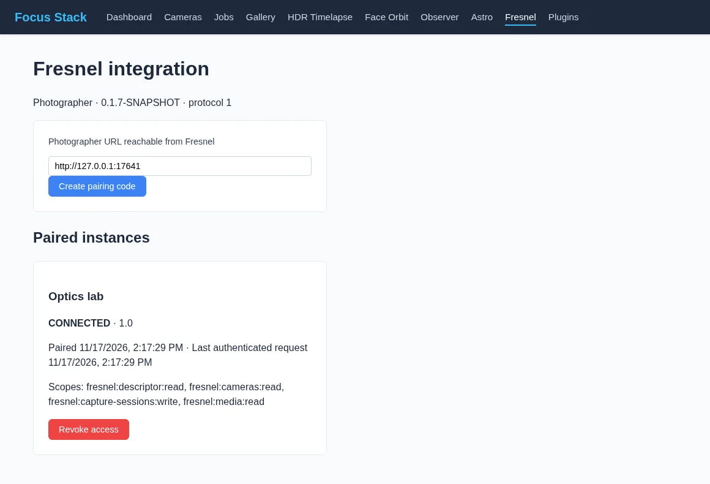

# Pair Photographer with Fresnel for mock still capture

Photographer can run a sequence of externally triggered PNG exposures for a Fresnel measurement. A paired client selects a mock camera, submits a plan, and triggers each step when the physical condition or display pattern is ready. Photographer holds the camera lease across the sequence and publishes the original PNG and its SHA-256. The current adapter supports background-oriented schlieren (BOS) and display photometric stereo plans using mock profiles.

## Enable and pair

1. Set `FOCUSSTACK_FRESNEL_ENABLED=true` in the environment of the Photographer process and restart it. For Compose, set it in `.env` and recreate the `focusstack` service. The integration defaults to disabled.
2. In Photographer, select **Add Camera**, choose **Mock** for the backend type, and create the profile. Use a persistent profile database for deployments that must retain the same selectable camera after restart. [Quickstart](quickstart.md)
3. As a Photographer administrator, select **Fresnel** in the navigation bar at `/integrations/fresnel`. Enter the Photographer base URL reachable **from the Fresnel server** and select **Create pairing code**. The single-use code expires in five minutes.
4. In Fresnel, set `FRESNEL_CAPTURE_PHOTOGRAPHER_ENABLED=true` and `FRESNEL_CAPTURE_PHOTOGRAPHER_ORIGIN` to that same base URL, then restart Fresnel. Under **Camera service → Manage Photographer pairing**, enter the one-time code with your Fresnel administrator credentials. The [Fresnel deployment guide](https://github.com/carstenartur/Fresnel/blob/main/docs/security/deployment.md#pairing-a-photographer-capture-service) describes private HTTP and persistent credential storage. Its adapter exchanges the code at `POST /api/v1/integrations/fresnel/pair` and stores the resulting scoped bearer credential server-side. The Photographer admin page shows the client identity, granted scopes, active sessions and last authenticated request. A successful authenticated request establishes the connected state. Use **Abort capture** to stop an active sequence or **Revoke access** to stop outstanding captures and invalidate that client's credential.



## Choose a reachable address

| Deployment | Photographer base URL for Fresnel | Photographer setting |
| --- | --- | --- |
| Both services on the same host, outside containers | `http://127.0.0.1:8080` | Loopback HTTP works by default. |
| Both services on a private Compose network | `http://focusstack:8080` using the Photographer service name in this repository | Attach both services to the same network and explicitly enable `focusstack.fresnel.trust-private-network=true` on its private ingress, or use HTTPS. |
| Fresnel on the host, Photographer in Docker | The published Photographer origin, for example `https://photographer.example.org` | Use HTTPS, or enable trusted private ingress for a local bridge whose requests arrive from a non-loopback address. |
| Fresnel in Docker, Photographer on the host | The reachable HTTPS host or `http://host.docker.internal:8080` | On Linux, configure a `host-gateway` mapping if needed. Use HTTPS or explicitly trust the private network. |

For a private-network deployment, restrict Photographer's listening interface or published port to that network. The trusted-network setting accepts HTTP from peers that can reach this ingress. Separate Compose projects need a common network and a resolvable service alias. The Photographer integration starts no outbound connections to Fresnel.

For separate hosts, configure an administrator-confirmed HTTPS origin reachable from the Fresnel server. Camera discovery and camera-to-Photographer connectivity are independent of this address.

## Capture, restart and storage

Each plan takes one exclusive lease for the selected profile. An incompatible lock or output format is rejected before camera use. A new client persists its request bytes and idempotency key before submitting a plan or a trigger. On a lost response it can repeat that request byte for byte. A pending trigger returns 202. A completed trigger returns the original result and asset ID. The client can poll session status and event IDs, then retrieve the metadata and resume the source download using the strong ETag. Verify the complete byte length and SHA-256 before importing an asset.

Plans are limited to 32 steps, 30 seconds of settling per step, ten minutes per session and 60 seconds waiting for an external trigger. A wait timeout pauses the sequence and releases its lease. Each PNG is limited to 8 MiB. One Photographer process accepts up to 16 active leases and retains up to 512 session records. The advertised idempotency guarantee extends at least 24 hours beyond a terminal state.

The default `focusstack.fresnel.directory` is the `fresnel` subdirectory of `focusstack.storage.images-dir`. Persist both locations together when overriding either one. Pairing-token hashes, the instance identity, session plans, request hashes, queued and dispatched steps, and events are stored on disk. The existing Photographer frame store holds the originals. Use one Photographer process per journal and a filesystem supporting locks and atomic replacement. The Docker profile stores the default journal and assets on the `image-storage` volume.

Completed and cancelled sessions are retained by default. To reclaim space automatically, configure `focusstack.fresnel.retention` to an ISO 8601 duration of at least one day, for example `P7D`. The hourly cleanup removes eligible terminal sessions and their associated media. Cancel a paused or recovery-fenced session explicitly after checking its state. After a restart, Photographer verifies committed files and fences unfinished sessions with `RECOVERY_REQUIRED`. A verified completion remains available for replay. A reserved step without a verified result requires reconciliation and cannot fire again.

## Contract and tests

The Photographer build pins the three upstream contract files from Fresnel commit `e7ff869254276fdf044e2e62a8802470596e5643`. The draft defines the protocol and fixtures for pairing, scoped discovery, bounded still capture, polling, restart fencing and conditional media transfer. The mock adapter advertises its PNG and polling capabilities in the descriptor. Physical cameras, online resume, SSE and RAW previews require further integration work. [Protocol notes](integrations/fresnel-v1/photographer-capture-v1.md) · [OpenAPI](integrations/fresnel-v1/photographer-capture-v1.openapi.yaml) · [Contract fixtures](integrations/fresnel-v1/photographer-capture-v1.fixtures.json) · [Protocol follow-up](../TODO.md#capture-integrations) · [Hardware acceptance](manual-todo.md#fresnel-hardware-acceptance)

From the repository root, run the contract tests and the loopback HTTP session. The latter pairs through the actual admin API, discovers a camera, captures both BOS steps and checks range downloads and revocation.

```sh
mvn -B -pl app -am -Dtest=FresnelCaptureContractTest,FresnelPairingHttpTest,FresnelPairingsTest -Dsurefire.failIfNoSpecifiedTests=false test
```

On a host with Docker, the normal Maven verification also runs `FresnelPairingPostgresIT` against PostgreSQL 16. For a two-product run, follow the [Fresnel provider acceptance instructions](https://github.com/carstenartur/Fresnel/blob/main/docs/integrations/photographer-provider.md). They cover both measurement plan types and include checkpoints for a real Photographer restart and token revocation.
