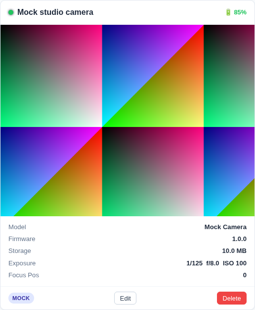
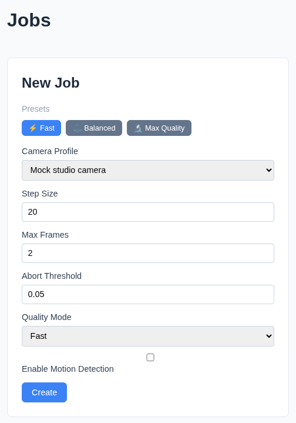
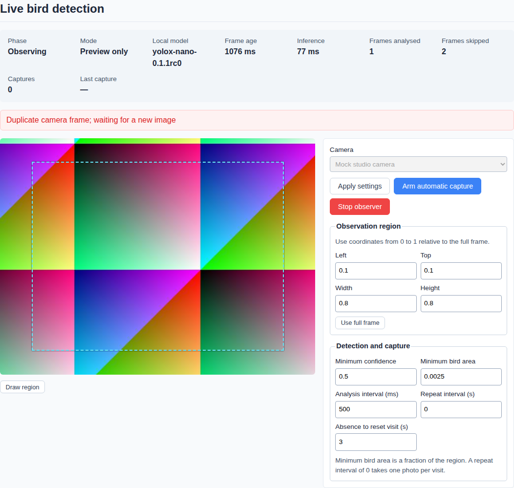
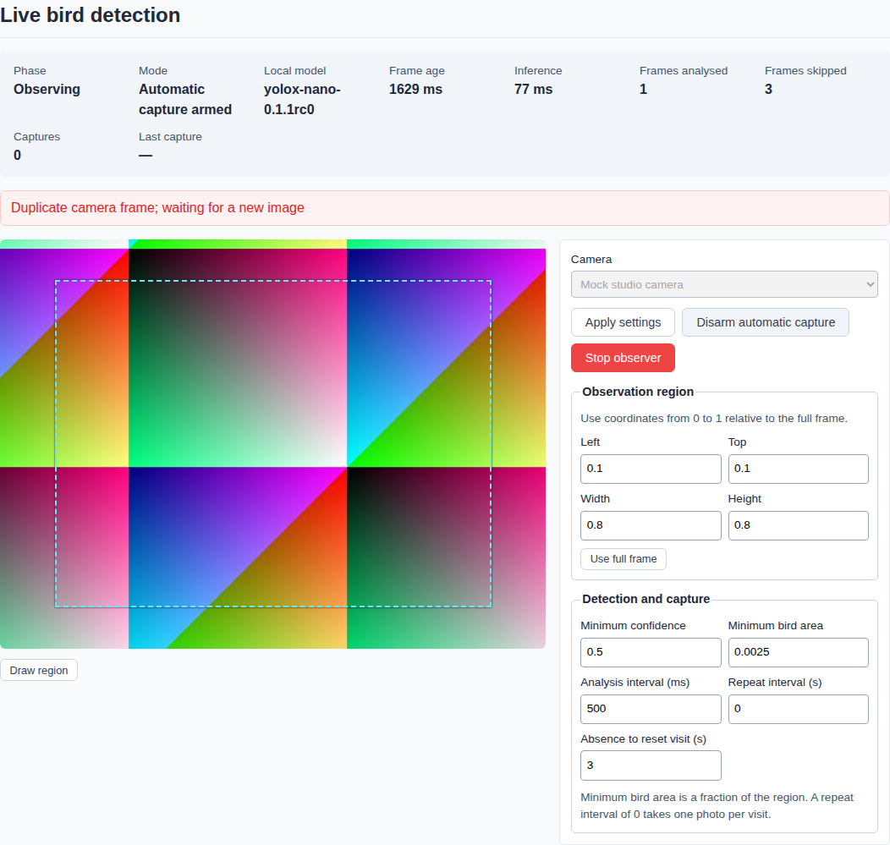
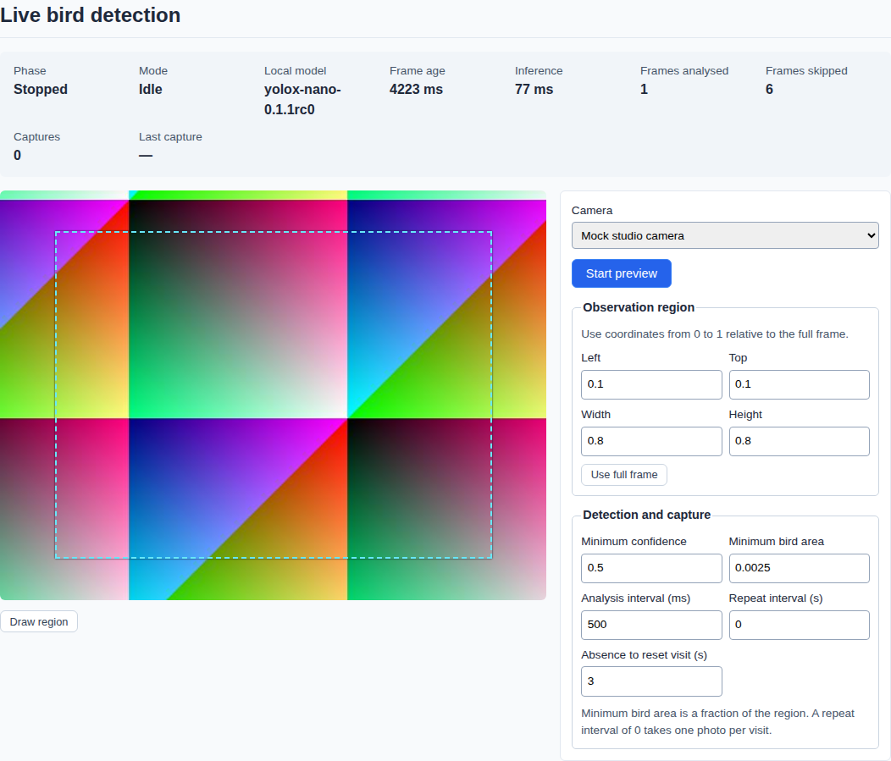

# Your first capture in Focus Stack

Start the application with the [quick start](quickstart.md). Open its web address and sign in as `admin` using the password configured for that deployment. The **Dashboard** shows configured camera profiles and recent jobs. You can try the capture workflow with the built-in **Mock** backend before connecting a camera.

## Create a camera profile

1. Choose **Add Camera** on the dashboard.
2. Enter a name such as **Mock studio camera**. Select **Mock** under **Backend Type** and choose **Create**.
3. Open **Cameras**. Look for your profile name and its live view. The mock camera generates a colour pattern and reports simulated battery and exposure values. For a physical camera, follow the [camera setup guide](camera-setup.md) and choose the matching backend.

## Capture two frames

1. Open **Jobs**, choose **Create Job**, then select your **Camera Profile**.
2. Select the **Fast** preset, change **Max Frames** to **2** and clear **Enable Motion Detection** for this short mock run. The preset also fills in **Step Size**, **Abort Threshold** and **Quality Mode**. Choose the preset before adjusting individual values.
3. Choose **Create**. Open the job by selecting its ID. The job is initially **CREATED**. Choose **Start** in the detail view.
4. Follow the frame count under **Progress**. Use **Refresh** to request the current state. When the job is **COMPLETED**, choose **Export Frames (ZIP)** to download its individual captures. The **Gallery** also lists completed jobs and offers **Download ZIP** and **Merge Stack**.

## Photograph birds at a fixed location

The local bird observer analyses the live view on the application host. When explicitly armed, it requests a full photograph after detecting a qualifying bird. It needs no cloud API key. Use a configured Canon CCAPI or USB profile whose camera supports both live view and capture. A fixed feeder, nest entrance or perch is a useful first setup: choose exposure and focus for that location before starting.

The screenshots below use the built-in **Mock** camera, which generates a static colour pattern without birds. **Duplicate camera frame; waiting for a new image** is expected after the first analysis of this unchanged image. The mock camera demonstrates the controls without producing automatic bird-triggered photographs.

### Preview and select the observation region

1. Open **Observer** and find **Live bird detection**. Select the **Camera**, then choose **Start preview**.
2. Check **Phase: Observing**, **Mode: Preview only** and a decoded camera image. Preview mode analyses frames without taking photographs. A missing model or camera error appears above the controls.
3. Choose **Draw region** and drag over the feeder or perch. Mouse and touch are supported. Alternatively, enter **Left**, **Top**, **Width** and **Height** as fractions of the full frame, from 0 to 1. Choose **Apply settings** to use the edited region.

The detector receives the selected region's actual pixels. The camera still takes a full photograph with its current framing; the region does not crop the saved original. Keep the likely landing position inside the region and leave enough space for the bird to move.

*Preview only. The cyan dashed rectangle marks the selected observation region, covering the central 80% of the image's width and height in this example. The initial region is the full frame.*

### Enable automatic capture

Choose **Arm automatic capture** after checking the preview. **Mode: Automatic capture armed** confirms that a qualifying bird can trigger the camera. The model currently identifies generic birds; it does not distinguish a kingfisher from a blackbird or fill the species ranking.

The initial settings analyse approximately every 500 ms, require a confidence score of 0.5 and a bird area of 0.0025 of the selected region, repeat photographs every five seconds, and reset a visit after three seconds of valid observations without a bird. **Repeat interval (s) = 0** takes one photograph per visit. These are adjustable starting values; the confidence is a model score and the analysis interval is not a measured shutter delay. See [all settings and frame-handling rules](developer/operations.md#local-bird-observer).

*Automatic capture armed. This example sets **Repeat interval (s)** to **0** for one photograph per visit; the initial value is five seconds.*

### Open a photograph and stop observation

After a capture, choose **View observation** beside **Last capture**, or open an event under **Recent Observations**. The detail page shows the preview and **Download original** retrieves the unchanged JPEG or RAW returned by the camera. A preview labelled **Live-view image at trigger** is the frame used for detection; it is distinct from the captured original.

Choose **Disarm automatic capture** to continue watching without photographs. Choose **Stop observer** to finish and release the camera. A photo already triggered may finish saving while the phase reads **Stopping**. Wait for **Stopped** before starting another camera workflow. Closing the browser leaves an armed observer running; an application restart starts it stopped and unarmed, and the current settings are not yet stored as a reusable location profile.

*Stopped and idle: **Start preview** is available again. The last analysed frame, observation region and counters remain visible; no further frames are processed.*

Field accuracy, autofocus and timing need a [test with the actual camera](manual-todo.md#local-bird-observer-on-hardware).

## Try an experimental timed capture

Open **HDR Timelapse**, choose **New Session** and select a **Camera Profile**. **Bracket Count** is the number of shots per interval. **EV Step** sets the intended exposure offsets recorded in the shot metadata. The prototype leaves the camera exposure settings as selected on the camera. **Interval (seconds)** and **Total Intervals** control the timing and number of capture intervals. Automatic exposure adjustment, HDR merging and video export are under development.

Choose **Create Session** to review the session and its status. Choose **Start** in the session panel when you are ready to capture. Configuring a session and starting its capture are separate actions. See the [REST API guide](api.md) for programmatic access.

The screenshots were captured in Chromium from the packaged application, using an in-memory database and the project's Java mock camera.

The bird-observer screenshots come from the [successful packaged browser test on `24a6dc3`](https://github.com/carstenartur/Photographer/actions/runs/44620623339). See the [browser test instructions](../frontend-web/e2e/README.md) to reproduce them.
